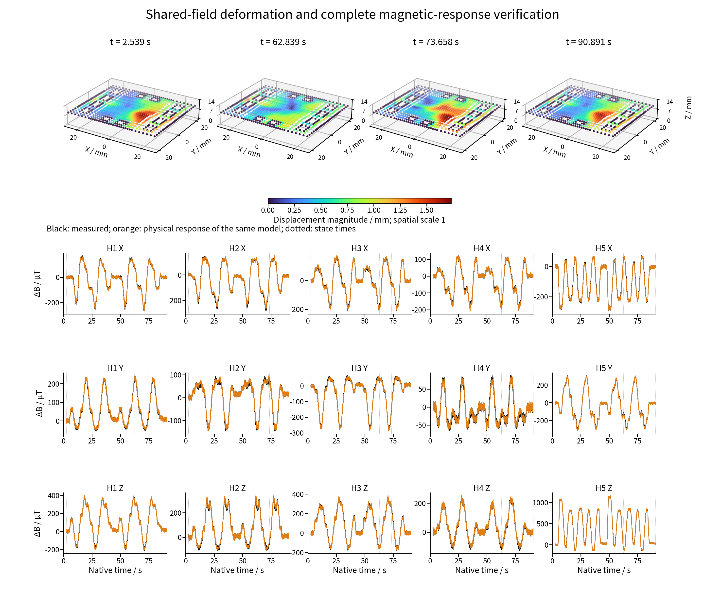

# MagTouch Magnetic Supervision for Soft State Reconstruction

**English** | [中文](README.zh.md)

One magnetic-supervision framework supports two separately attributable routes: **physics structures the state-to-observation relation, measured fields identify an unknown state relation, and the physical response generated by that state tests its explanation.** The routes are complementary while preserving independent model, data, experiment and version identities.

| Route | Frozen model | Research question | Entry and citation |
| --- | ---: | --- | --- |
| Explicit node/magnet states | Epoch 138 | How measured adaptation improves generated relations under fixed physics and weak geometry | [Route](methods/explicit_state/README.en.md) · [Citation](methods/explicit_state/CITATION.md) |
| Shared continuous field | Epoch 529 | Whether one displacement function coupling material and magnet motion supports learning without the weak displacement teacher examined | [Route](methods/shared_field/README.en.md) · [Citation](methods/shared_field/CITATION.md) |

Explicit magnetic loss directly supervises magnet states; ordinary nodes retain weak geometry and shared encoding. Shared learning couples physical probes and displayed material queries through one function. Teacher-free shared-field evidence does not negate explicit measured adaptation. Neither route has independent dense displacement ground truth.

## Joint papers and framework

- [English joint paper](papers/joint/Magnetic_Supervision_main_en.pdf) · [Chinese joint paper](papers/joint/Magnetic_Supervision_main_zh.pdf)
- [English supplement](papers/joint/Magnetic_Supervision_supplement_en.pdf) · [Chinese supplement](papers/joint/Magnetic_Supervision_supplement_zh.pdf)
- [Editable English](papers/joint/manuscript_en.md) · [Editable Chinese](papers/joint/manuscript_zh.md)
- [Framework and protocols](framework/README.md) · [Citation scopes](CITATION.md) · [Paper/resource mapping](docs/PAPER_AND_CITATION_MAP.md)

## Independent route papers

- Explicit states: [English paper](methods/explicit_state/companion/paper/soft_magnetic_tactile_core_en.pdf) · [Chinese paper](methods/explicit_state/companion/paper/soft_magnetic_tactile_core_zh.pdf)
- Shared field: [English paper](methods/shared_field/paper/Shared_Field_main_en.pdf) · [Chinese paper](methods/shared_field/paper/Shared_Field_main_zh.pdf)
- Shared supplements: [English](methods/shared_field/paper/Shared_Field_supplement_en.pdf) · [Chinese](methods/shared_field/paper/Shared_Field_supplement_zh.pdf)
- [Editable shared English](methods/shared_field/paper/manuscript_en.md) · [Editable Chinese](methods/shared_field/paper/manuscript_zh.md)

The independent shared paper develops representation coupling, magnetic gradients, fixed supports, valid magnet orientations, teacher comparisons and complete 101-sequence results. The joint paper organizes complementary evidence for the common method; each scientific scope can be cited separately.

## Frozen results in their original protocols

| Route | DEV sequences | Pooled field RMSE | MAE | Selection aggregation |
| --- | ---: | ---: | ---: | --- |
| Explicit states |97|4.139 µT|2.440 µT|Scored scalar pooling|
| Shared field |101|4.034 µT|1.811 µT|Equal-domain equal-sequence RMSE 2.822 µT|

Sets, masks, aggregation and capacity differ. This is not a controlled structural leaderboard. Source adaptation and matched-budget component comparisons address the distinct route questions.

## Reproduction and attribution

Each route has its own source, results and paper entry. The original 79-file [explicit companion](methods/explicit_state/companion) remains byte-exact. Physical demonstration belongs to the experimenter-confirmed explicit epoch 138 route. Shared apparatus provenance does not merge branch-specific geometry, field mappings, weights or scoring protocols.

Run `python -B tools/recompute_results.py` for public scalar recomputation and `python -B tools/verify_release.py` for identities and links. Raw scientific arrays, registered geometry and checkpoints are not bundled; [reproduction limits](docs/REPRODUCTION.md) apply.

[Apparatus evidence](https://github.com/googo2025/MagTouch-RA-3d-trajectory-recon) and the [existing unified public repository](https://github.com/googo2025/magtouch-temporal-state-reconstruction) provide source entries. Cite the relevant route directory together with an actual frozen published commit/version, and cite the relevant scientific paper separately.

The repository organizes the common framework, explicit epoch138 and shared epoch529 papers, sources, results and citations separately. Existing explicit public material and the measured GIF are retained. See [upload/version notes](docs/UPLOAD.md) and [rights](LICENSE.md).
