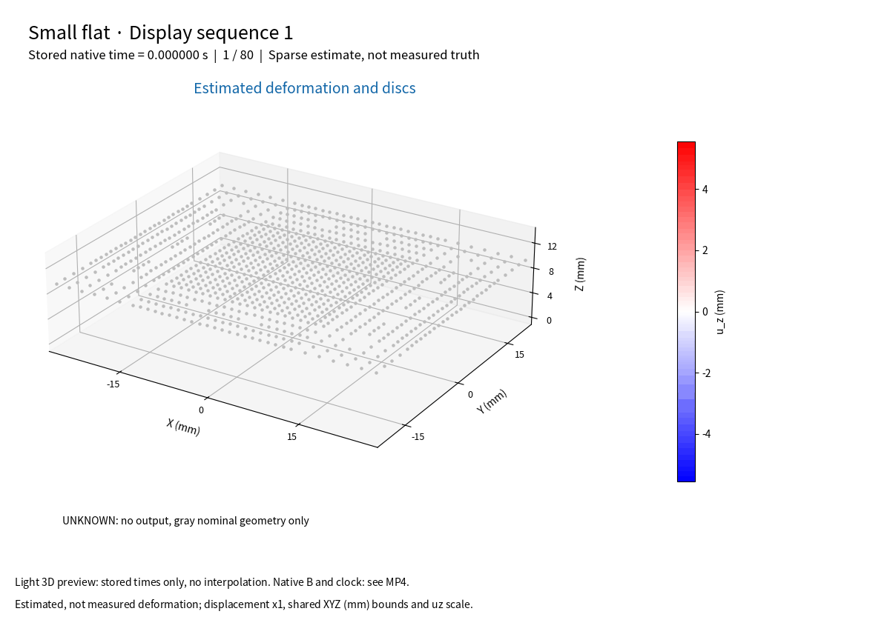
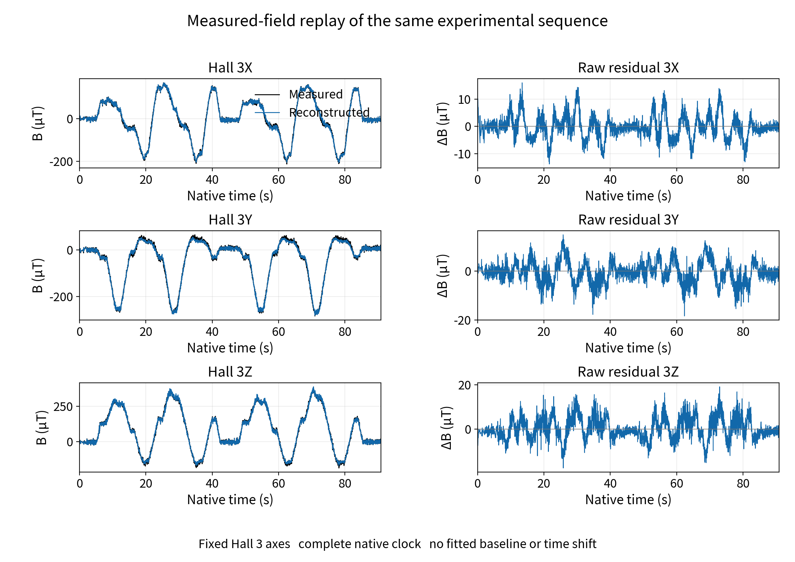
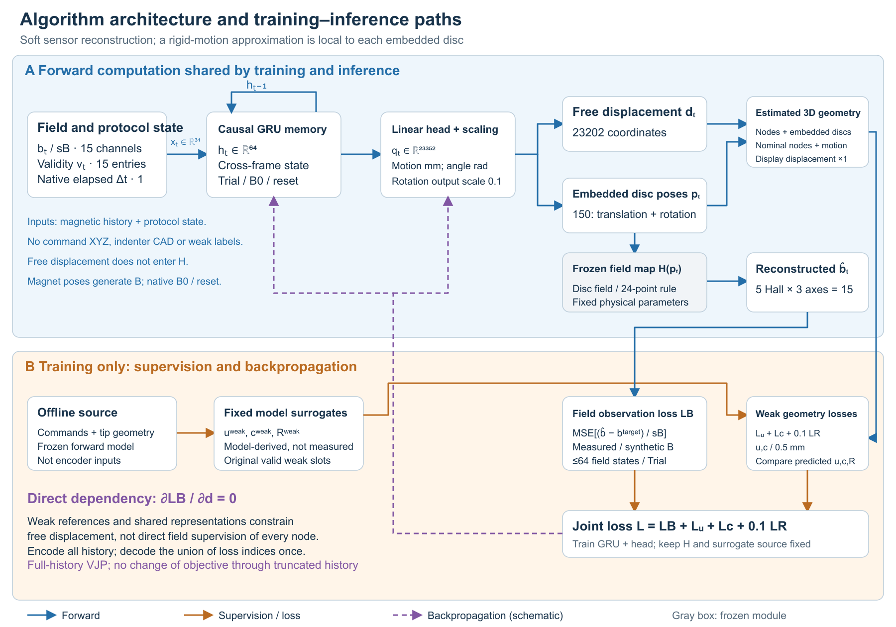

Display sample 1 from the selected epoch-138 model. Geometry and magnet poses are estimates, not measured deformation ground truth; displacement scale is 1. This GIF rounds timing to centiseconds and does not synthesize intermediate deformation. See the [native-clock video](media/native/sequence_01_en.mp4) and [all native videos](docs/MEDIA.md).

# Temporal State Reconstruction and Observation Consistency of Flexible Magnetic Tactile Sensing under Physical Constraints

[中文](README.md)

The method learns temporal deformation states from magnetic histories, maps them to estimated compliant geometry and body-carried magnet poses, and checks consistency with measured fields through a fixed field mapping. It does not require an exact inverse solution of a high-fidelity material and contact model. Reasonable device geometry, magnet layout and field priors remain necessary.

Deformation estimates and measured-field replay of real experimental sequences are the central results. Training diagnostics and dense channel examples are supplemental evidence. Magnetic reconstruction errors are not millimetre deformation accuracy, and neither dense measured deformation ground truth nor physics-parameter perturbation robustness is established.

## Paper and core results

[Chinese main paper](paper/soft_magnetic_tactile_core_zh.pdf) · [English main paper](paper/soft_magnetic_tactile_core_en.pdf) · [Chinese supplement](paper/soft_magnetic_tactile_supplement_zh.pdf) · [English supplement](paper/soft_magnetic_tactile_supplement_en.pdf)

The main papers contain 8 Chinese and 9 English pages; each supplement contains 14 pages. All 45 PDF pages have completed page-level visual review. This does not establish Word visual acceptance. [Markdown sources](paper/source/manuscript_core_en.md) change only figure links to repository-relative paths.


The same real hemispherical sequence is shown at the first valid saved state, maximum estimated displacement, largest saved-state field residual and final saved state. Panels share XYZ millimetre scale, view, limits and colour scale, with displacement scale 1. This display selection is not ground truth or a substitute for aggregate evaluation.



## Aggregate evaluation

Selection uses pooled field RMSE on all 97 exposed development sequences, with evaluation ending at epoch 160. There are 234195 native rows and 233791 valid rows. A single inherited seed is used; this is not sealed blind testing or a multi-seed significance result.

| State | Field RMSE µT | MAE µT |
| --- | ---: | ---: |
| Selected epoch 138 | 4.139025764220211 | 2.4397324334174137 |
| Terminal epoch 160 | 4.795930922955195 | 2.726328449500218 |

See [aggregate statistics](data/results_summary.json), [main-paper tables](data/paper_tables_en.json) and [epoch 0 to 160 scalar curves](data/training_curve.json). The curve retains the early objective distinction, null epoch-0 TRAIN loss and absent measured-field DEV values at epochs 0 to 36. These are aggregate epoch metadata, not raw scientific arrays.

## Method and materials



Inverse inference uses magnetic history, native time and validity/reset state, not touch commands or CAD. Ordinary compliant displacements do not directly enter the field map; magnet poses do. Field consistency therefore cannot independently validate all compliant displacements.

The companion includes papers, figures, native videos, light previews, aggregate metadata, the inherited network and fixed decoder, shared loss/evaluation functions, display/clock helpers and portable configuration descriptions. [Model implementation](docs/MODEL_SOURCE.md) describes their provenance and required inputs. Raw TRAIN/DEV arrays, model states, optimizer/RNG, private geometry caches, fonts and third-party binaries are excluded.

## Verification and reproduction scope

Run at the repository root:

```text
python tools/verify_companion.py
```

This verifies asset bytes, links, tables and curve conventions without loading a model or executing physics. [Reproduction scope](docs/REPRODUCTION.md) separates saved-result inspection from fresh scientific reproduction. [Dependency context](docs/DEPENDENCIES.md) is not a locked original training environment.

## Rights scope

Exact original bytes of [rigid_mesh.py](source/physics/rigid_mesh.py) and [fast_magnetic.py](source/physics/fast_magnetic.py) are included with the project owner's MIT permission, limited to those two files. The bounded code review found no direct evidence of copying a public library, but does not prove legal authorship. The modules implement established kinematic and magnetostatic methods: see [source origin](docs/SOURCE_ORIGIN.md) and [source custody](source/physics_source_custody.json). Other code, papers, summaries and media do not inherit MIT: see [rights scope](LICENSE.md). Asset verification does not establish fresh scientific reproduction or email delivery.
