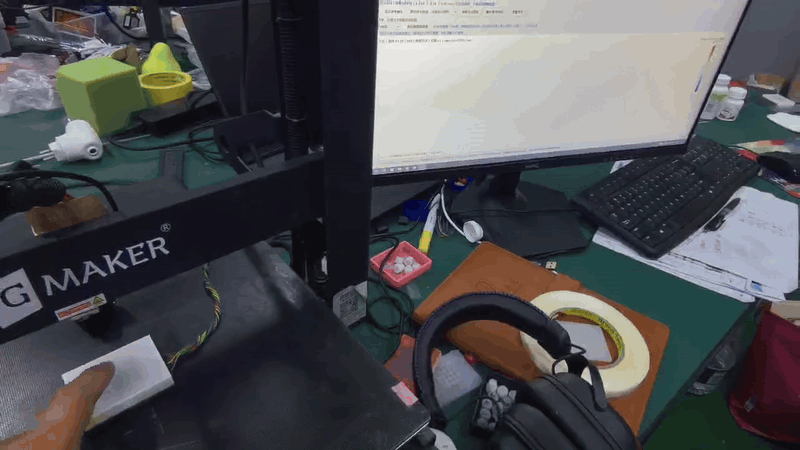

# MagTouch 磁场监督柔性状态重建

一个磁场监督框架，两条可以分别引用的实现路线。共同方法是：**物理模型提供状态到观测的结构，实测磁场辨识未知状态关系，预测状态产生的物理磁响应检验其解释。**两条路线在状态表示和监督路径上互补，各自保留模型、数据、实验与版本身份。

## 两条路线

| 路线 | 固定主模型 | 主要研究问题 | 独立入口 |
| --- | ---: | --- | --- |
| 显式节点／磁片状态 | 第138轮 | 固定物理结构与弱几何参考下，实测适应如何改善生成关系 | [路线资料](methods/explicit_state/README.md) · [引用说明](methods/explicit_state/CITATION.md) |
| 共享连续位移场 | 第529轮 | 同一位移函数生成材料与磁片运动，能否在不读取弱位移教师时学习解释磁响应的状态 | [路线资料](methods/shared_field/README.md) · [引用说明](methods/shared_field/CITATION.md) |

显式路线以磁场损失直接约束磁片状态，普通节点仍受弱几何参考与共享编码约束；共享路线通过同一位移场把磁片运动和材料查询连接到共同参数。共享场的纯磁场证据不否定显式路线的实测适应价值。两者均提供形变状态生成与物理磁响应核对，但当前没有独立稠密位移真值。

## 联合论文与共同框架

- [中文联合主文](papers/joint/Magnetic_Supervision_main_zh.pdf) · [English joint paper](papers/joint/Magnetic_Supervision_main_en.pdf)
- [中文补充](papers/joint/Magnetic_Supervision_supplement_zh.pdf) · [English supplement](papers/joint/Magnetic_Supervision_supplement_en.pdf)
- [中文可编辑全文](papers/joint/manuscript_zh.md) · [English editable manuscript](papers/joint/manuscript_en.md)
- [共同框架与协议](framework/README.md) · [三种引用范围](CITATION.md) · [拆分论文的资源映射](docs/PAPER_AND_CITATION_MAP.md)

## 两条路线的独立论文

- 显式状态：[中文独立稿](methods/explicit_state/companion/paper/soft_magnetic_tactile_core_zh.pdf) · [English paper](methods/explicit_state/companion/paper/soft_magnetic_tactile_core_en.pdf)
- 共享连续场：[中文独立稿](methods/shared_field/paper/Shared_Field_main_zh.pdf) · [English paper](methods/shared_field/paper/Shared_Field_main_en.pdf)
- 共享场补充：[中文](methods/shared_field/paper/Shared_Field_supplement_zh.pdf) · [English](methods/shared_field/paper/Shared_Field_supplement_en.pdf)
- [共享场可编辑中文全文](methods/shared_field/paper/manuscript_zh.md) · [Editable English](methods/shared_field/paper/manuscript_en.md)

共享独立稿围绕同一位移场的表示耦合、磁监督梯度、固定支撑与合法磁片方向、弱教师对照和完整101序列结果展开。联合稿组织两条实现对共同磁监督方法的互补验证；三种论文范围可以分别引用。

## 原协议下的冻结结果

| 路线 | 开发序列 | 池化磁场RMSE | MAE | 主要选模口径 |
| --- | ---: | ---: | ---: | --- |
| 显式节点／磁片状态 | 97 | 4.139 µT | 2.440 µT | 全评分标量池化 |
| 共享连续位移场 | 101 | 4.034 µT | 1.811 µT | 等域等序列RMSE 2.822 µT |

两者的序列范围、掩码、聚合权重和容量不同，不能由这张表直接判断结构优劣。来源对照与共同预算组件对照分别服务于两条路线的科学问题。

## 代码 数据与复算

两条路线分别保存自己的`source`、`results`和论文入口，实物媒体归属已直接确认的显式138路线。原79文件显式伴随资料完整保存在[显式路线伴随目录](methods/explicit_state/companion)，原文件字节保持一致。共同装置资料只记录来源，分支几何和物理映射保留原定义，不把它们混成一个权重、损失或评分协议。

运行 `python -B tools/recompute_results.py` 复算公开标量结果，运行 `python -B tools/verify_release.py` 核验文件清单和哈希。原始科学数组、注册几何与权重未随本包公开；可复现范围详见[说明](docs/REPRODUCTION.md)。

## 装置与引用

[实验装置与采集仓库](https://github.com/googo2025/MagTouch-RA-3d-trajectory-recon)提供硬件来源；[现有研究仓库](https://github.com/googo2025/magtouch-temporal-state-reconstruction)为统一公开入口。以后引用某条路线时，应同时指明其目录和实际发布的固定提交或版本；论文则引用对应科学论述。共同框架、显式路线、共享路线各自的引用说明已分开。

本仓库按共同框架、显式138路线与共享529路线分别组织论文、源码、结果和引用入口。原显式公开资料及实测GIF保留。[上传与版本说明](docs/UPLOAD.md) · [许可范围](LICENSE.md)。
