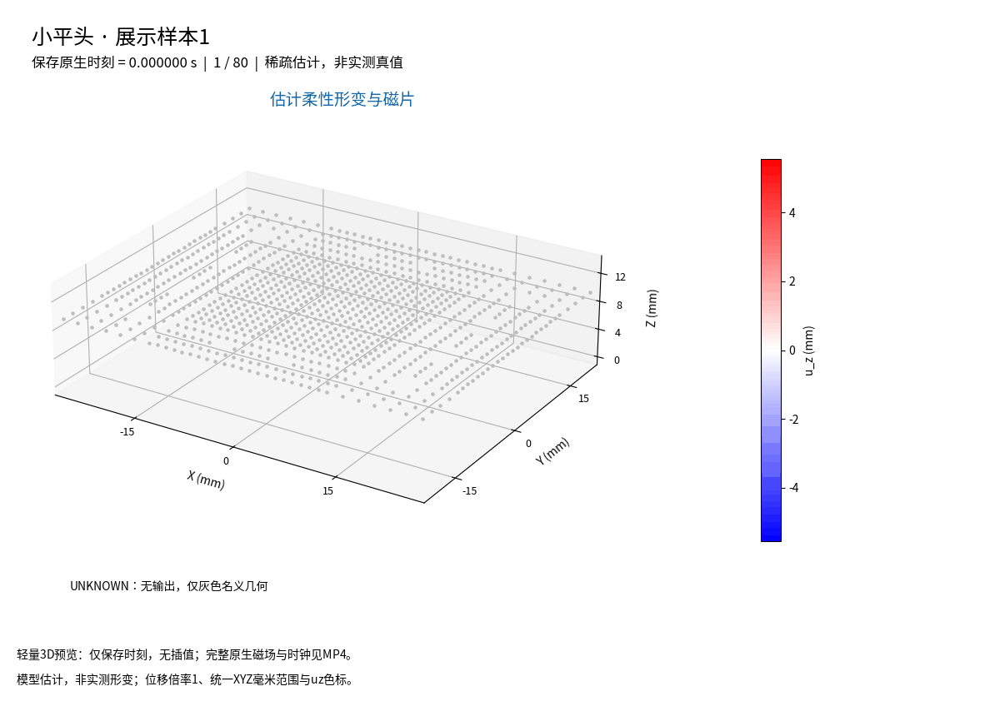
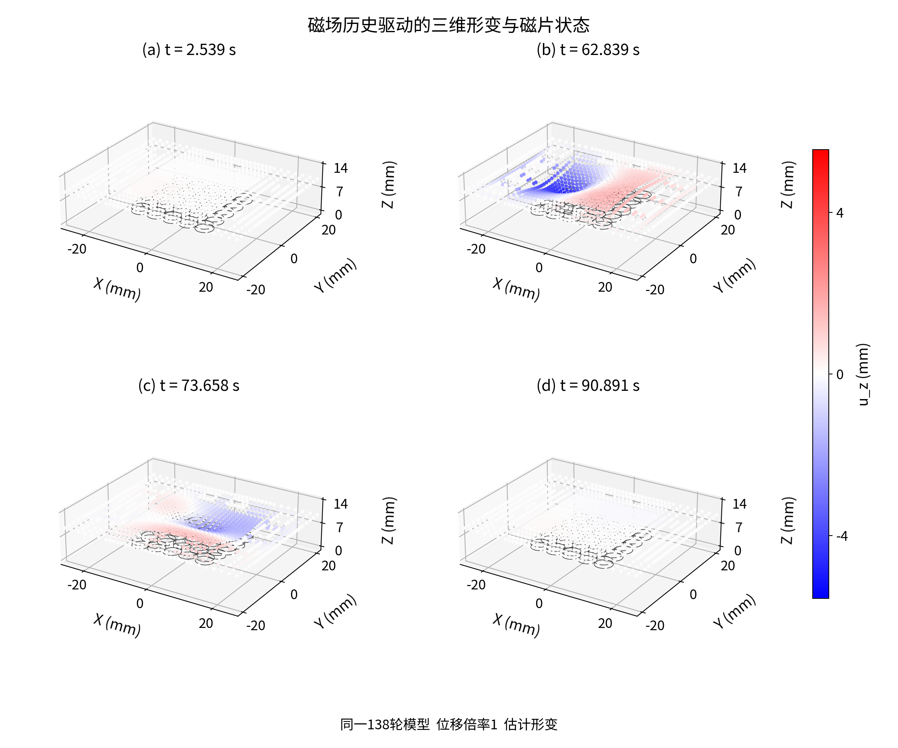
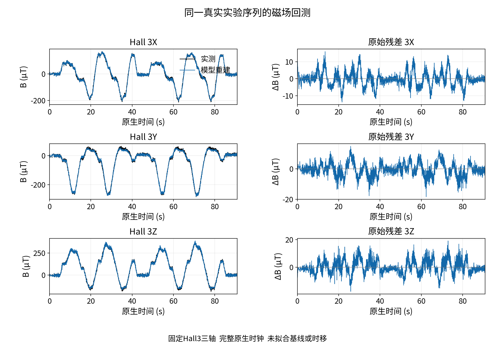
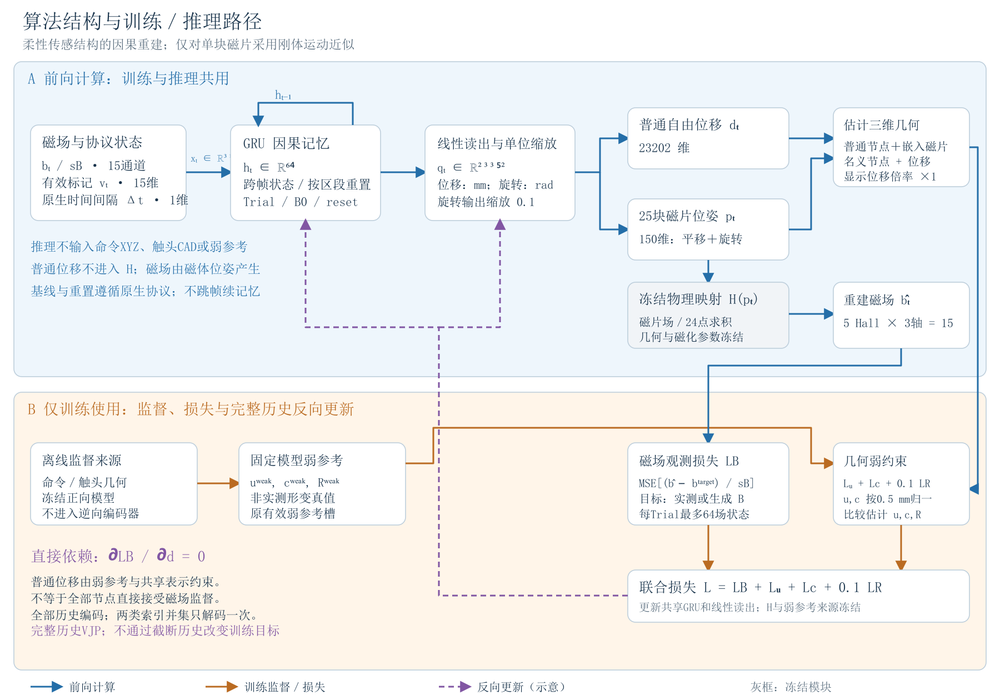

最终138轮模型的展示样本1。图中是估计柔性形变和磁片状态，不是实测形变真值；位移倍率为1。GIF仅为轻量预览，时间量化到百分之一秒，不补造中间形变。查看[原生时钟视频](media/native/sequence_01_zh.mp4)或[全部原生视频](docs/MEDIA.md)。

# 物理约束下柔性磁触觉的时序状态重建与观测一致性评价

[English](README.en.md)

本方法从磁场历史学习柔性器件的时序形变状态，将该状态转换为柔性体形变与随体磁片位姿，再通过固定磁场映射检查与实测观测的一致性。它不以高保真材料和接触模型的精确逆解为前提，但仍依赖合理的器件几何、磁片布局和场映射。

真实实验序列的形变展示与磁场回放是主要结果。训练细节和密集通道例程放在补充资料，不作为论文的主要贡献。磁场重建误差不能直接解释为毫米级形变精度；没有稠密实测形变真值，也没有物理参数扰动稳健性实验。

## 论文与核心效果

[中文主文](paper/soft_magnetic_tactile_core_zh.pdf) · [英文主文](paper/soft_magnetic_tactile_core_en.pdf) · [中文补充](paper/soft_magnetic_tactile_supplement_zh.pdf) · [英文补充](paper/soft_magnetic_tactile_supplement_en.pdf)

主文中文8页、英文9页，补充各14页。四份PDF已完成45页逐页视觉验收；Word视觉验收不包含在此结果中。[Markdown源稿](paper/source/manuscript_core_zh.md)仅将图片链接改为仓库相对路径，正文未另作修改。



同一真实半球实验序列，展示首次有效保存时刻、最大估计位移、最大保存时刻磁场残差及末保存时刻。所有面板共用XYZ毫米比例、视角、范围和色标，位移倍率为1。选择规则用于展示，不替代总体评价，也不将估计视作真值。



## 总体评价

模型按完整97条已暴露开发实验序列的磁场RMSE选取，评价截止160轮。共有234195个原生时刻，其中233791个有效时刻；使用单一继承种子，不是封存盲测试或多种子显著性结论。

| 状态 | 磁场RMSE µT | MAE µT |
| --- | ---: | ---: |
| 138轮验证最佳 | 4.139025764220211 | 2.4397324334174137 |
| 160轮末态 | 4.795930922955195 | 2.726328449500218 |

详细数值见[结果汇总](data/results_summary.json)和[正文表格](data/paper_tables_zh.json)。[0至160轮曲线数值](data/training_curve.json)保留早期目标差异、0轮TRAIN空值及0至36轮实测开发评价空值；这些是轮次标量，不是原始科学数组。

## 方法与资料



推理使用磁场历史及原生时间、有效和重置状态，不把触头命令或CAD作为逆向输入。普通柔性体位移不直接进入磁场映射；磁片位姿进入映射。因此观测一致性支持的是该映射下的状态解释，不能独立证明全部柔性体位移准确。

仓库包含论文、图、原生视频、轻量预览、汇总数值、显示与时钟辅助源码及便携配置说明。它不包含原始TRAIN或DEV数组、模型权重、优化器、RNG、私有几何缓存、字体或第三方二进制。

## 校验与复现范围

在仓库根目录运行：

```text
python tools/verify_companion.py
```

此入口校验资料字节、路径、表格与曲线口径，不加载模型或调用物理计算。[复现范围](docs/REPRODUCTION.md)区分已保存结果检查与新的科学复现；本包不声称完整fresh训练复现。[依赖说明](docs/DEPENDENCIES.md)记录观察到的环境上下文，不冒充原训练锁定环境。

## 公开准备状态与权利

这是尚未上传的准备版本。两份物理模块[rigid_mesh.py](source/physics/rigid_mesh.py)与[fast_magnetic.py](source/physics/fast_magnetic.py)已按精确原始字节纳入，并获项目所有者MIT公开许可；许可仅覆盖这两份文件。代码审查未发现直接复制公开库的证据，但不把有限检索当作法律原创性证明；两模块实现的是经典几何和磁场方法，见[来源说明](docs/SOURCE_ORIGIN.md)和[源码保管状态](source/physics_source_custody.json)。其余源码、论文、数据汇总和媒体不自动套用MIT，见[权利范围](LICENSE.md)。实际公开发布、完整科学复现与邮件交付不由本包的资料校验代替。
