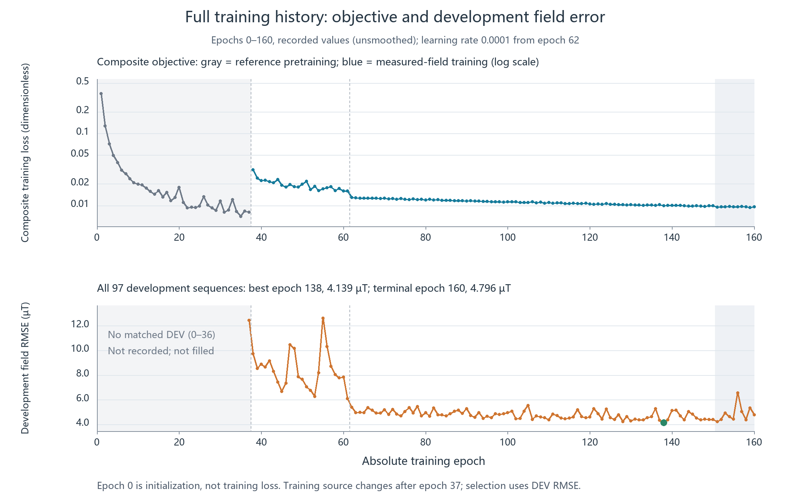
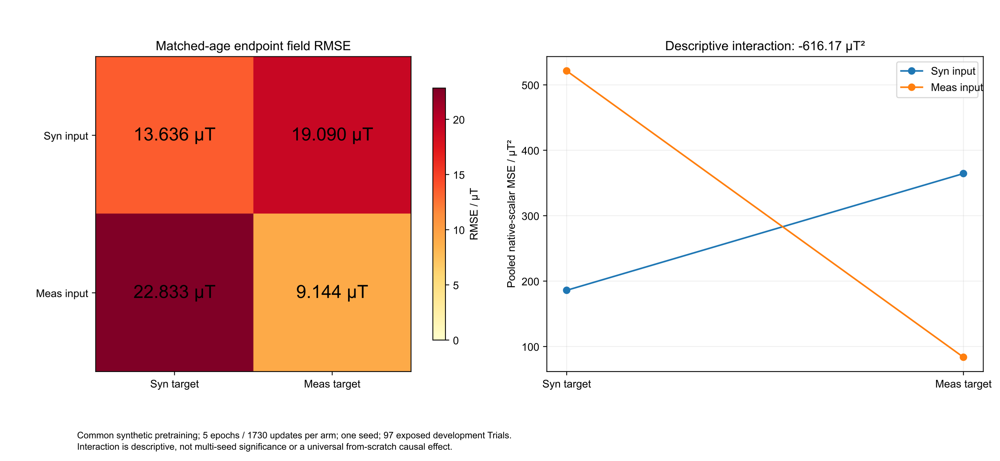
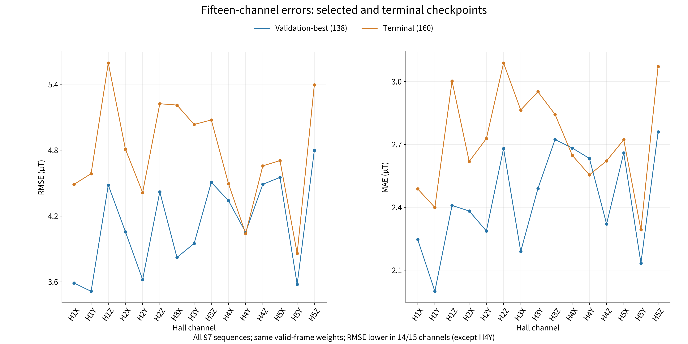
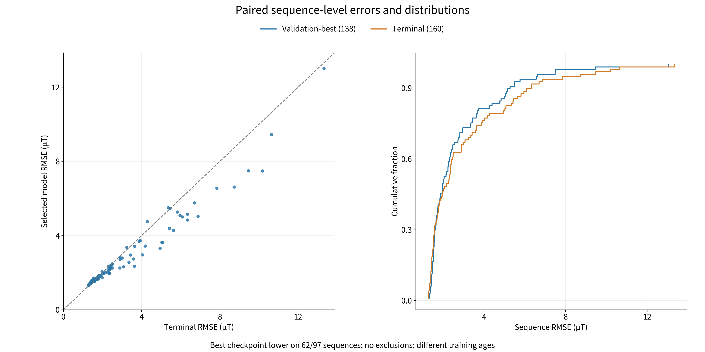
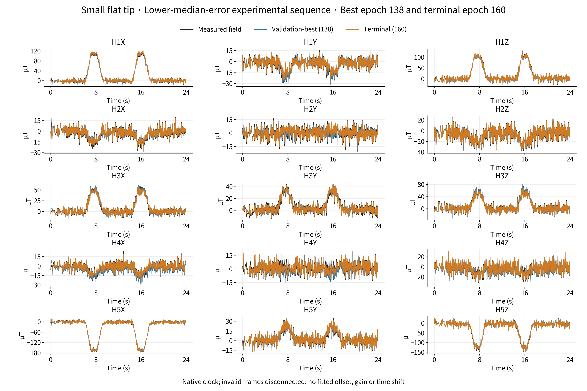
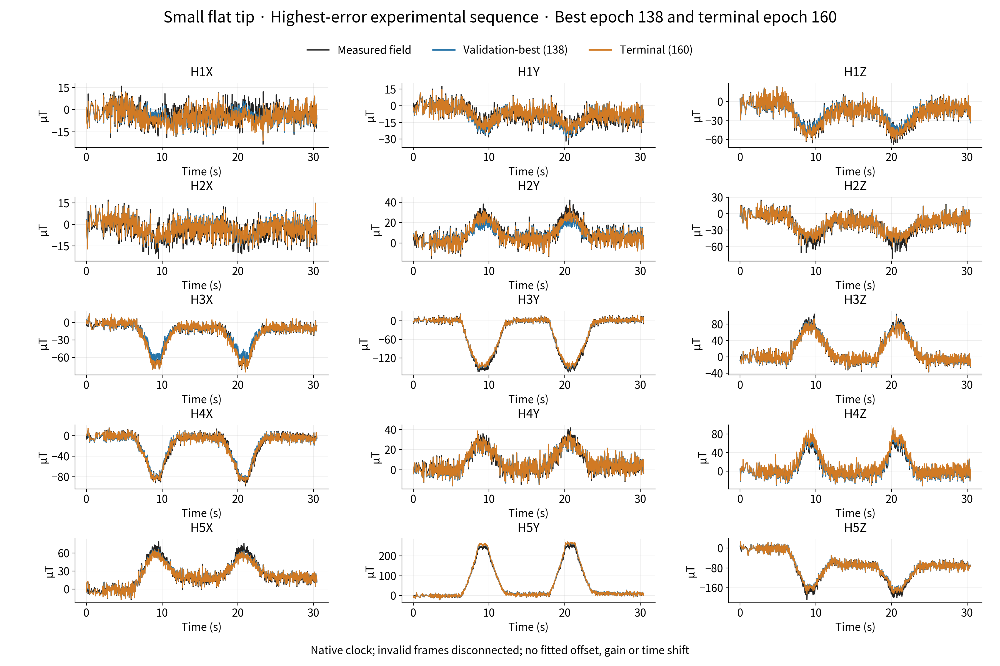
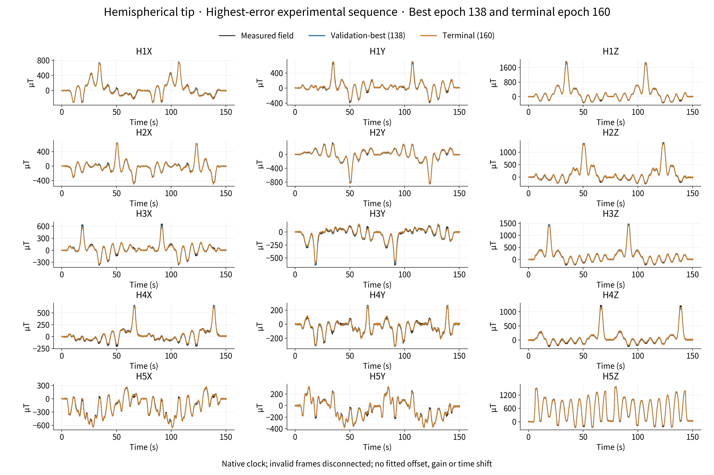
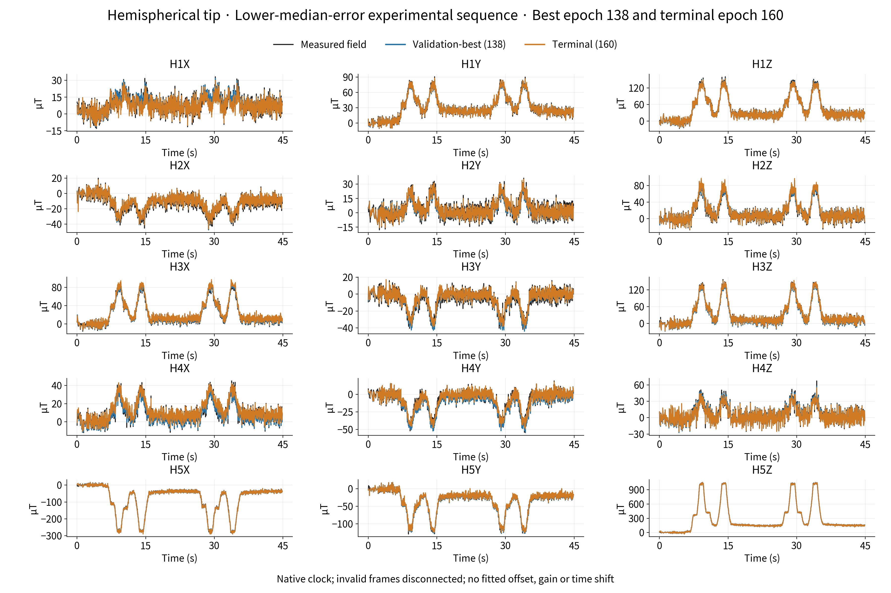
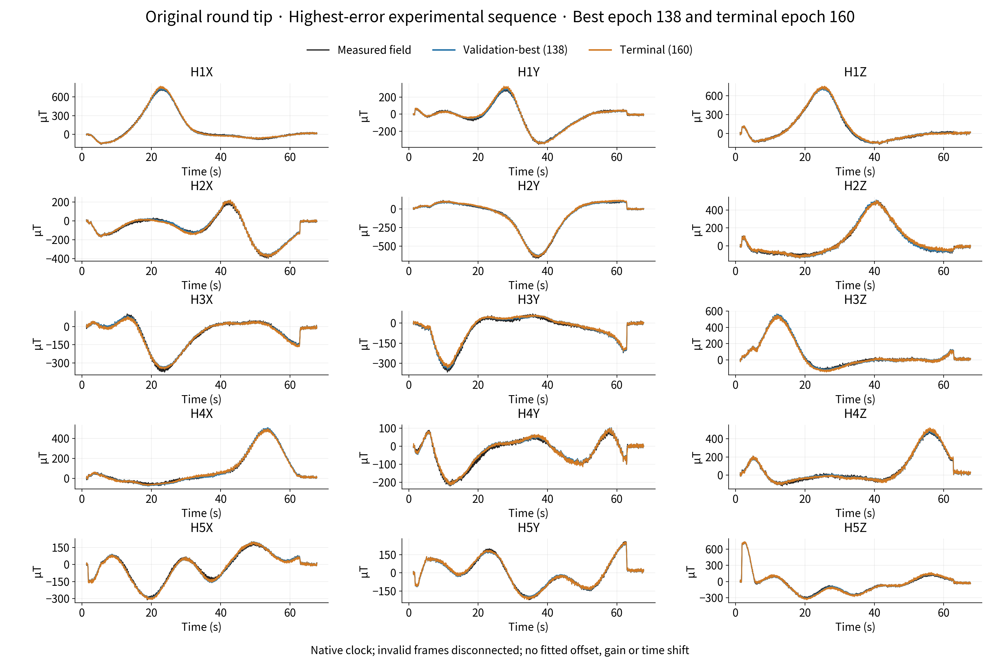
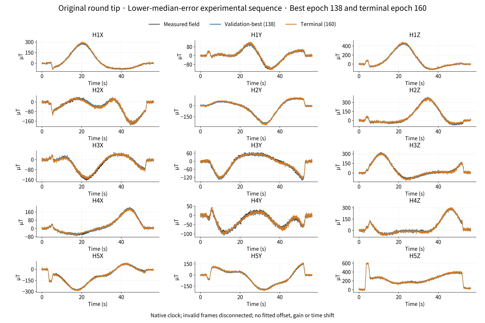

# Supplement: physics-prior-guided temporal deformation estimation for soft magnetic tactile sensing

## S1 Additional training and model-selection information

The main text summarizes training in one paragraph. This supplement retains the full learning curve without treating optimization history as the research outcome. Epochs 1–37 use model weak-reference pretraining; later epochs use measured adaptation and a different objective. TRAIN loss at epoch 0 is null, and complete measured-field DEV evaluation first closes at epoch 37, leaving epochs 0–36 blank. The curve does not splice in the matched-age original-learning-rate branch. Epoch 138 is selected by field RMSE over all 97 DEV sequences, with evaluation ending at epoch 160, not by display quality, TRAIN composite loss or the last epoch.

Figure S1. Full epoch 0–160 learning curve. Pretraining and measured adaptation are distinguished, missing values remain blank, TRAIN is auxiliary and DEV determines selection.

Table S1. Selected model, evaluation endpoint and matched-age learning-rate comparison

| Protocol | Epoch | RMSE µT | MAE µT |
| --- | ---: | ---: | ---: |
| Selected final model | 138 | 4.139 | 2.440 |
| Evaluation endpoint | 160 | 4.796 | 2.726 |
| Low learning rate, matched age | 94 | 4.496 | 2.644 |
| Original learning rate, matched age | 94 | 4.749 | 2.824 |

At epoch 94, the low-learning-rate comparison reduces RMSE by 5.32% and MAE by 6.39%; epochs 138 and 94 are not matched-age comparisons. No new development best occurs over epochs 139–160. Across equal-length windows 141–150 and 151–160, mean TRAIN loss decreases from 0.009899 to 0.009603 (2.99%), while mean DEV RMSE increases from 4.625 to 4.878 µT (5.48%). The divergence supports DEV-based selection, not a causal diagnosis of overfitting or proof of full convergence from fluctuations.

## S2 Matched-age comparison with fixed physics and weak-reference limits

Figure S2. Input and supervision source comparison after five epochs from the same pretrained state. Generated/measured factors correspond to main-text Table 3; differently aged final models are not ranked as matched-age methods.

Ordinary displacement does not directly enter the field mapping, so geometric weak-reference proximity and explanation of real fields must be distinguished. Geometric errors on 16 internal TRAIN-monitor sequences use only model-generated weak references. The unique constant-XYZ-translation diagnostic is defined over a complete sequence:

\[
\mathbf a_j=\frac1{N_j}\sum_{n=1}^{N_j}(\widehat{\mathbf y}_{jn}-\mathbf y_{jn}^{\rm weak}),\qquad
\mathbf e_{jn}^{\rm trans}=\widehat{\mathbf y}_{jn}-\mathbf y_{jn}^{\rm weak}-\mathbf a_j.
\]

Table S2. Vector errors relative to model weak references and unique constant-XYZ-translation diagnostic

| Input and target | Raw vector RMSE mm | After constant XYZ translation, mm |
| --- | ---: | ---: |
| Both generated | 0.108174 | 0.107071 |
| Both measured | 0.085419 | 0.084411 |

These are not measured deformation accuracies. Translation affects diagnostic errors only, not model outputs or displayed geometry. Magnetic fields have no corresponding XYZ-translation correction; main-text magnetic errors are raw replay values.

## S3 Errors across all channels and complete sequences

Figure S3. Magnetic errors over all 15 channels. The final model and epoch-160 endpoint share the native valid denominator; a display subset does not change evaluation scope.

Figure S4. Paired sequence RMSE and distributions over all 97 experimental sequences. Epoch 138 improves on epoch 160 in 62 sequences, whereas 35 do not improve; aggregate selection does not imply superiority in every sequence.

RMSE is lower than the epoch-160 endpoint in 14 of 15 channels; Hall4 Y does not improve. Final channel RMSE ranges from 3.515 to 4.798 µT, highest for Hall5 Z. Scalar and sequence P95 values are descriptive, not confidence intervals or deformation accuracy in millimeters.

## S4 Complete native 15-channel waveforms

The following six fixed display samples provide complete waveform checks outside the main text. Each seen shape domain retains a lower common-error median sequence and its highest-error sequence. Selection is post hoc for display, not model selection, and all 97 sequences remain in scoring. Native clocks, joint validity and raw waveforms are retained without fitted baseline, gain, time shift or registration. These six sequences follow different display rules from the preregistered main-text three-dimensional sequence and are not treated as the same experimental object.

Figure S5. Small-flat lower-error sequence: 919/920 jointly valid/native points; final RMSE 1.750 µT and MAE 1.288 µT. All 15-channel native waveforms; black measured, blue final model, orange epoch-160 endpoint.

Figure S6. Small-flat highest-error sequence: 1163/1164 jointly valid/native points; final RMSE 3.363 µT and MAE 2.139 µT. All 15-channel native waveforms; black measured, blue final model, orange epoch-160 endpoint.

Figure S7. Hemisphere highest-error sequence: 5029/5030 jointly valid/native points; final RMSE 13.027 µT and MAE 8.769 µT. All 15-channel native waveforms; black measured, blue final model, orange epoch-160 endpoint.

Figure S8. Hemisphere lower-error sequence: 1678/1679 jointly valid/native points; final RMSE 1.958 µT and MAE 1.421 µT. All 15-channel native waveforms; black measured, blue final model, orange epoch-160 endpoint.

Figure S9. Original-round highest-error sequence: 2761/2821 jointly valid/native points; final RMSE 7.496 µT and MAE 5.791 µT. All 15-channel native waveforms; black measured, blue final model, orange epoch-160 endpoint.

Figure S10. Original-round lower-error sequence: 2180/2181 jointly valid/native points; final RMSE 3.619 µT and MAE 2.797 µT. All 15-channel native waveforms; black measured, blue final model, orange epoch-160 endpoint.
