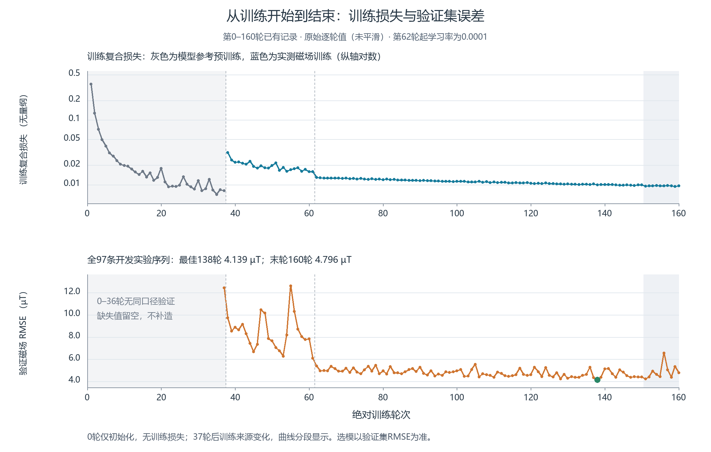
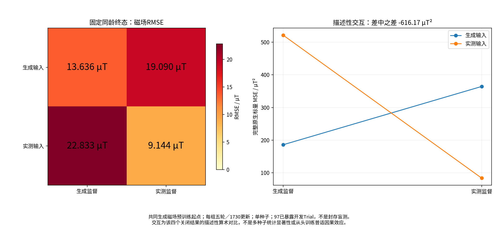
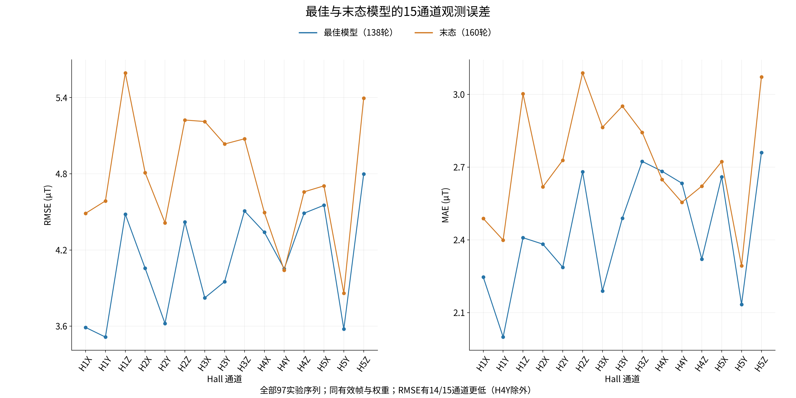
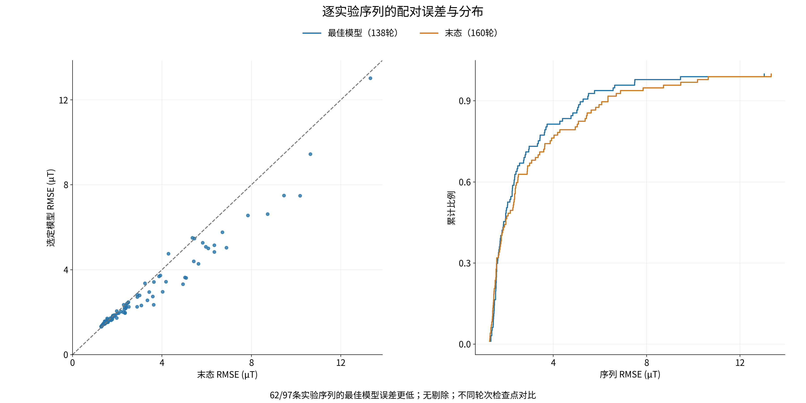
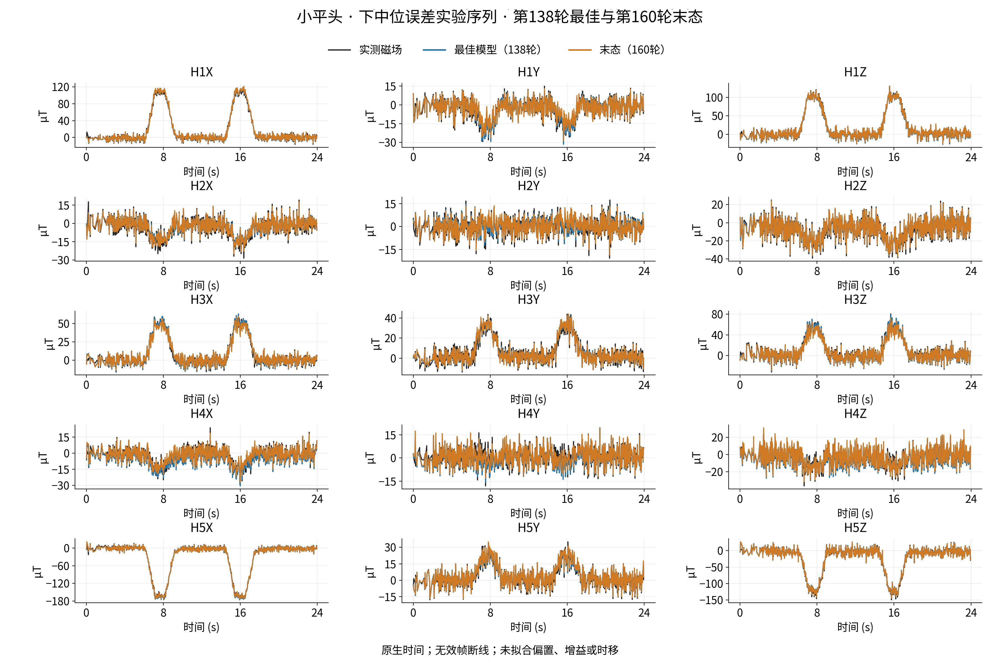
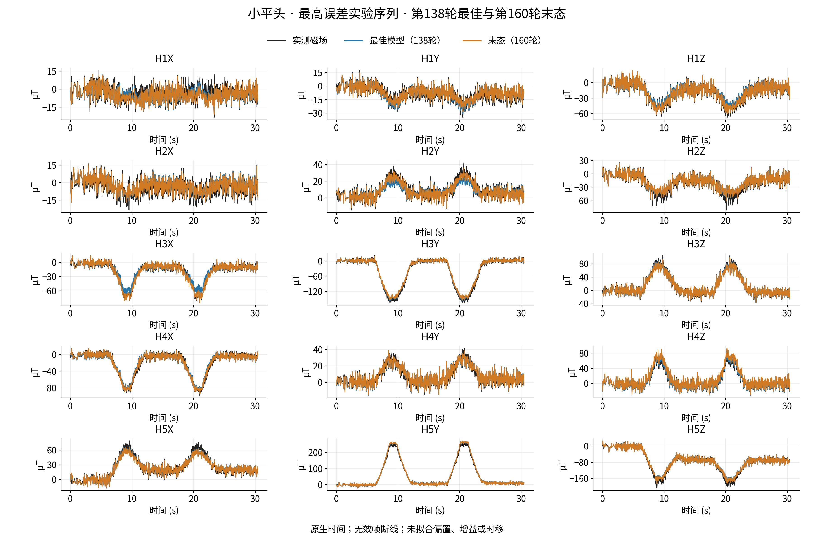
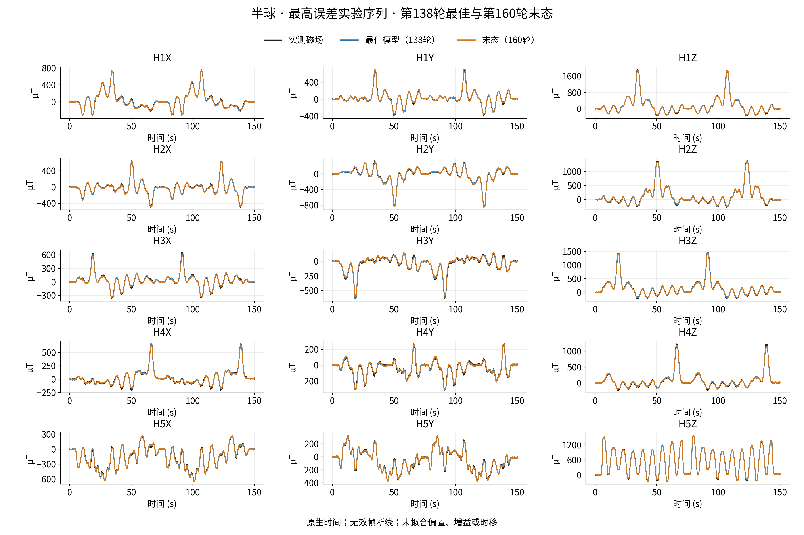
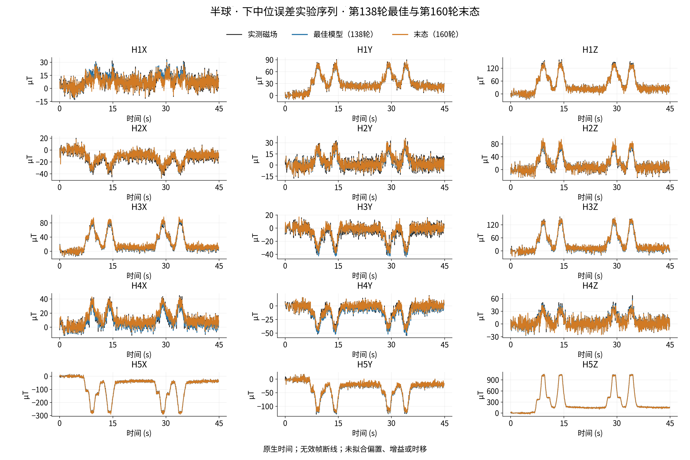
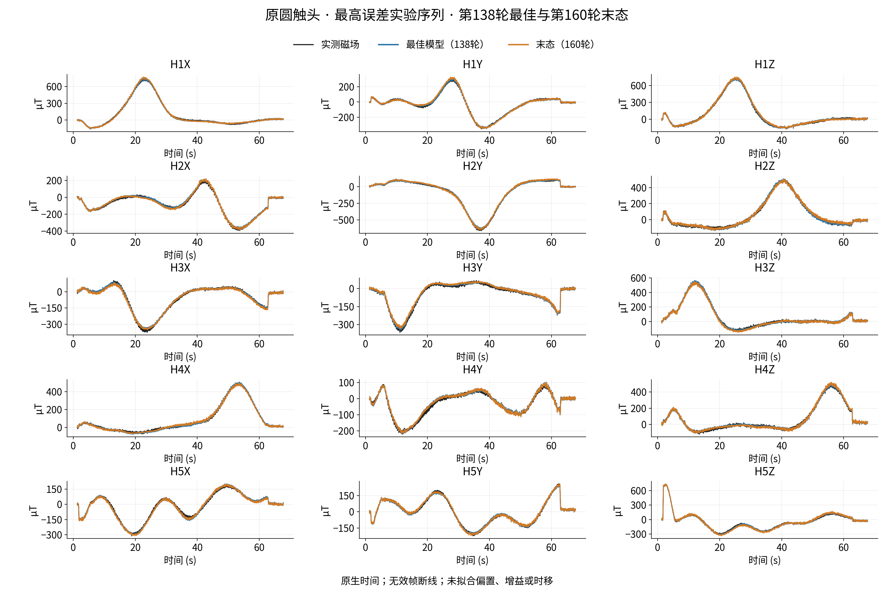
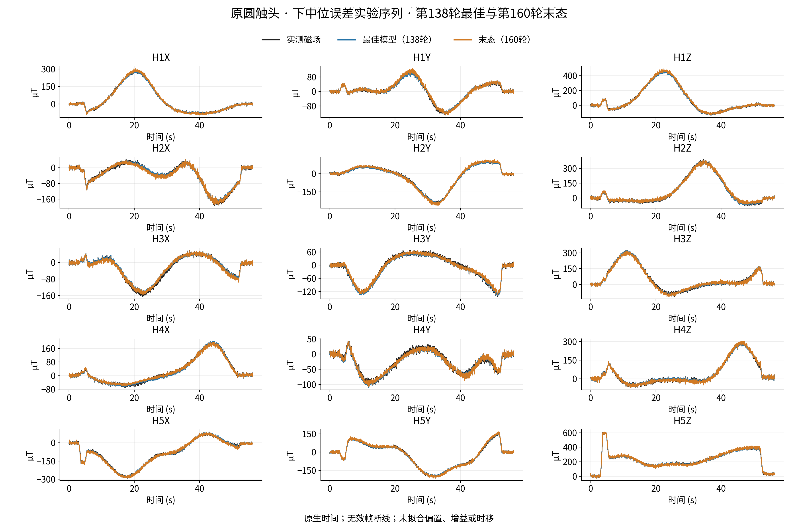

# 补充材料：物理先验引导的柔性磁触觉时序形变估计

## S1 训练与选模的补充信息

主文仅用一段说明训练协议。本材料保留完整学习曲线，不把逐轮优化经历作为研究成果。前1–37轮为模型弱参考预训练，后续为实测适应，二者目标不同；第0轮TRAIN损失为空，实测全97条DEV最早在37轮关闭，0–36的实测DEV留白。曲线没有拼接同龄原学习率支线。最终模型按全97条DEV磁场RMSE选择138轮，论文评价截止160轮，不按展示图、TRAIN复合损失或末轮选模。

图S1 完整0–160轮学习曲线。预训练与实测适应阶段分开标记，缺失值留白；TRAIN仅作辅助，DEV用于选模。

表S1 选定模型、评价末态与同龄学习率比较

| 协议 | 轮次 | RMSE µT | MAE µT |
| --- | ---: | ---: | ---: |
| 最终选定模型 | 138 | 4.139 | 2.440 |
| 评价末态 | 160 | 4.796 | 2.726 |
| 低学习率同龄对照 | 94 | 4.496 | 2.644 |
| 原学习率同龄对照 | 94 | 4.749 | 2.824 |

低学习率在固定94轮同龄对照中降低5.32%的RMSE和6.39%的MAE，不将138轮与94轮混为同龄。139–160轮未出现新的开发最佳。141–150与151–160两个等长窗口中，TRAIN均值从0.009899降至0.009603（下降2.99%），DEV RMSE均值从4.625升至4.878 µT（上升5.48%）；此分歧支持用DEV选模，不单凭波动断言过拟合成因或充分收敛。

## S2 固定物理模型的同龄对照与弱参考边界

图S2 同一预训练状态后五轮的输入与监督来源对照。生成/实测两因素对应主文表3；不同最终训练年龄不进入同龄方法排名。

普通位移不直接进入磁场映射，模型几何接近度与真实磁场解释能力必须区分。16条TRAIN内部监测序列的几何误差仅以模型弱参考为对象。唯一常量XYZ平移诊断按完整序列定义：

\[
\mathbf a_j=\frac1{N_j}\sum_{n=1}^{N_j}(\widehat{\mathbf y}_{jn}-\mathbf y_{jn}^{\rm weak}),\qquad
\mathbf e_{jn}^{\rm trans}=\widehat{\mathbf y}_{jn}-\mathbf y_{jn}^{\rm weak}-\mathbf a_j.
\]

表S2 与模型弱参考的向量误差及唯一常量XYZ平移诊断

| 输入与目标 | 原始向量RMSE mm | 常量XYZ平移后 mm |
| --- | ---: | ---: |
| 全生成 | 0.108174 | 0.107071 |
| 联合实测 | 0.085419 | 0.084411 |

这不是实测形变精度，平移仅作用于诊断误差，不改变模型输出或显示几何。磁场没有对应的XYZ平移消偏；主文磁场误差均为原始回测值。

## S3 全通道与完整序列的误差分布

图S3 全部15通道的磁场误差。最终模型与160轮末态共用原生有效分母，展示子集不改变评价范围。

图S4 全97条实验序列的配对RMSE与分布。138轮在62条序列上优于160轮，35条并未改善；总体最优不意味着每条序列更优。

全部15通道中14个通道的RMSE低于160轮末态，Hall4的Y通道未改善。最终各通道RMSE为3.515–4.798 µT，最高为Hall5的Z通道。标量和序列P95均为描述统计，不是置信区间或毫米形变精度。

## S4 完整原生15通道波形

以下六个既定展示样本只作为完整波形核查，移出主文以避免例程掩盖核心成果。每个已见形状域保留共同误差较低中位与最高误差序列，选例属于事后展示，不参与模型选择；总体评分保留全部97条序列。各图保留原生时钟、共同有效标记和原始波形，不拟合基线、增益、时移或配准。这里的六序列与主文预登记三维展示序列使用不同展示规则，不能混作同一实验对象。

图S5 小平头较低误差序列，919/920个共同有效/原生时点；最终RMSE 1.750 µT、MAE 1.288 µT。全部15通道原生波形；黑实测、蓝最终模型、橙160轮末态。

图S6 小平头最高误差序列，1163/1164个共同有效/原生时点；最终RMSE 3.363 µT、MAE 2.139 µT。全部15通道原生波形；黑实测、蓝最终模型、橙160轮末态。

图S7 半球最高误差序列，5029/5030个共同有效/原生时点；最终RMSE 13.027 µT、MAE 8.769 µT。全部15通道原生波形；黑实测、蓝最终模型、橙160轮末态。

图S8 半球较低误差序列，1678/1679个共同有效/原生时点；最终RMSE 1.958 µT、MAE 1.421 µT。全部15通道原生波形；黑实测、蓝最终模型、橙160轮末态。

图S9 原圆最高误差序列，2761/2821个共同有效/原生时点；最终RMSE 7.496 µT、MAE 5.791 µT。全部15通道原生波形；黑实测、蓝最终模型、橙160轮末态。

图S10 原圆较低误差序列，2180/2181个共同有效/原生时点；最终RMSE 3.619 µT、MAE 2.797 µT。全部15通道原生波形；黑实测、蓝最终模型、橙160轮末态。
