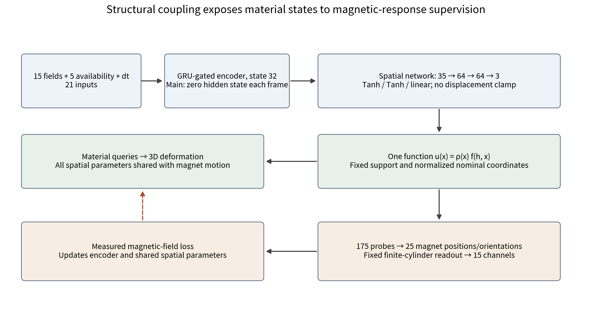
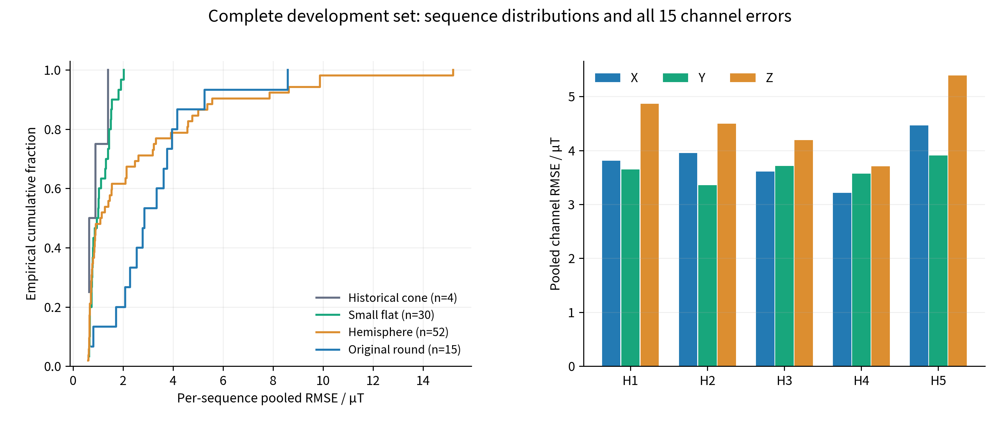
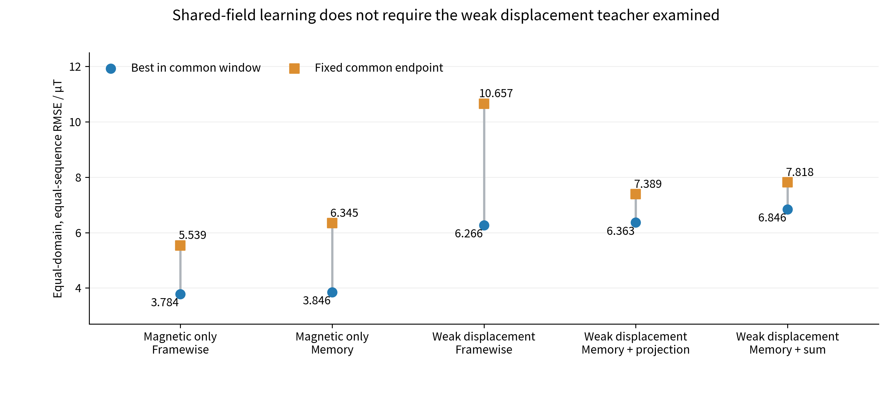

# Magnetic Supervision of Soft Deformation through a Shared Continuous Displacement Field

## Abstract

Soft magnetic tactile devices measure the response of moving embedded magnets, whereas contact occlusion and internal material motion make complete dynamic deformation labels difficult to obtain. We investigate whether measurable magnetic consequences can train a queryable three-dimensional soft state. A coordinate-conditioned network generates material displacement; queries of the same function around each magnet determine its position and orientation; a fixed finite-cylinder magnetic operator converts those motions into observations. Measured fields train the unknown state relation through this state-dependent path. Distance weighting enforces registered fixed supports, and local orthogonalization produces valid magnet orientations. There is no independent magnet-pose head or free magnetic-output head. Using 381 training and 101 development sequences, the final magnetic-only framewise model achieves equal-domain, equal-sequence RMSE of 2.822 µT, pooled RMSE of 4.034 µT and pooled MAE of 1.811 µT without reading a weak displacement teacher. Five configurations within a common training window show that magnetic-only supervision outperforms the weak displacement configurations examined. Three-dimensional deformation and all 15 magnetic channels from the same physical sequence demonstrate state generation and its observation explanation. The contribution is a shared parameter path coupling material representation to magnet motion, allowing difficult-to-measure states to receive supervision through measurable physical consequences. The evidence supports learning feasibility and effectiveness within the present structure; dense displacement accuracy requires independent spatial evaluation.

Keywords: magnetic supervision; soft magnetic tactile sensing; continuous displacement field; representation coupling; physical readout; deformation learning.

## 1 Introduction

Embedding magnetic elements in a soft material converts touch-induced internal motion into measurable fields [1]. A further challenge is to generate the changing state of the compliant body rather than only a contact point or indenter trajectory. One indenter coordinate cannot describe surrounding local deformation, and one magnet cannot describe the motion of an entire array and its silicone host. A spatial state representation connects material motion, magnetic response and visualization, providing a basis for interpretable tactile interaction.

Supervision differs from conventional deformation reconstruction. The indenter occludes the contact region, the Hall board and supports restrict rear observation, and surface images do not automatically establish internal material-point correspondence. GelSight measures contact geometry through a dedicated optical structure [2], while SuperMag obtains shape supervision using paired optical and magnetic modules [3]. These methods establish the value of spatial references, but complete dynamic node labels remain difficult to collect in the present assembled device. We examine another learning signal: deformation moves magnets, and magnet motion has measurable physical consequences that can supervise the unknown state relation.

Physics organizes the relation without having to prescribe every true displacement. Magnetic tactile material-point simulation connects mechanical and magnetic representations [4], but generated geometry can differ from actual material, assembly and contact response. We retain geometry, support and magnetic readout while learning the unknown observation-to-state mapping. The resulting design question is which state the field loss actually constrains. Separate material and magnet outputs can expose mainly the pose branch to magnetic supervision. When both derive from one displacement function, magnetic explanation and material representation share parameters.

We construct a continuous displacement field that can be queried at nominal material coordinates, using the same function to derive every magnet's local motion. Observation error cannot bypass the state through a free magnetic-output head. Coordinate-conditioned representations have established precedents [5]; our contribution is their specific coupling to magnet motion, registered supports and measured supervision, and an experimental test of learning without the weak displacement teacher examined.

Three linked questions organize the study: does parameter sharing establish a supervision path to material representation; can magnetic-only training learn states that explain physical response; and how do these states and residuals behave across complete sequences and indenter domains? We describe the actual architecture and provable construction properties, test teacher and temporal configurations within a common window, and show three-dimensional states alongside every magnetic channel from one physical record. Field error evaluates the method's effectiveness rather than serving as an architecture leaderboard.

## 2 Method and Theoretical Basis

### 2.1 From Magnetic Observations to States and Back to Response

Five triaxial Hall units provide 15 magnetic channels. Normalized field changes, five sensor-availability flags and the native time interval form the input; an encoder produces a 32-dimensional condition h. The network reads magnetic observations, validity and timing, without indenter identity, commanded position, depth or CAD. Nominal material coordinates are fixed spatial queries, not indenter inputs.

Equation 1. The 21-dimensional input and state-dependent magnetic-response path. v denotes five availability flags and sB the fixed normalization scale; Ψ converts shared displacement probes into magnet motion, and H is the fixed physical readout. The main encoder starts each frame from zero hidden state; the memory comparison recurs along the native sequence.

Measured ΔB uses the unloaded baseline of each record. Prediction subtracts the physical operator's nominal zero-displacement response. The frozen input and baseline contract relates these quantities; the physical reference is not a newly fitted measured baseline. Device coordinates, magnetization, sensor orientations and the mechanical-to-array datum retain their registered definitions. H has no measured-field-dependent free output parameters; its parameters remain fixed while derivatives with respect to state remain available.

### 2.2 One Function for Material and Magnet Motion

The spatial network concatenates h with normalized nominal coordinates and returns displacement. Distance d to the registered fixed-face set Γ determines a support weight:

Equation 2. Shared displacement and support weighting. xmid and xhalf are the center and half extents of the fixed nominal mesh bounding box, with componentwise normalization; support length ℓs is 1.25 mm.

For x on Γ, d=0 implies uθ(x)=0 for every θ. Fixed supports therefore follow from construction rather than requiring each boundary point as a new displacement label. Distance is evaluated against registered axis-aligned rectangular faces. Tanh hidden layers and continuous distance weighting produce a continuous function, but arbitrary-order smoothness is not claimed where the nearest face changes. The structure adds neither a constitutive law, volume preservation nor complete contact equilibrium.

Each magnet has one center and six axial neighbor probes, giving 175 queries for 25 magnets. Center displacement supplies translation; central differences supply local deformed axes:

Equation 3. Magnet centers and local deformation axes from the same displacement field. c0 is a nominal center, ek a coordinate unit vector and probe spacing ℓp is 1.25 mm.

Orthogonalizing the first two columns of F and taking their cross product gives orientation:

Equation 4. Local orientation construction. When detF>0 and the two axes used for orthogonalization are nondegenerate, RᵀR=I and detR=1.

Each magnet uses a shape-preserving finite-cylinder readout; the complete array and silicone can undergo distinct local motions. Inverted or degenerate local states are rejected rather than clipped into apparent validity. The original axis ordering is retained, so this is not the nearest rotation obtained by polar decomposition. Dense material queries and magnet probes share the function, but all query points inside a magnet are not additionally constrained to exact rigid motion. Shape preservation is a local readout approximation.

### 2.3 Fixed Physical Readout and Measured Supervision

Predicted centers and orientations define finite-cylinder responses that are transformed and superposed at Hall positions [7]. The implementation retains 24-point thickness quadrature and elliptic-integral evaluation; magnetic polarity and amplitude follow registered parameters.

Equation 5. State-generated physical response. si denotes Hall position and Jj registered signed magnetic polarization. Bnominal is obtained from the same operator's zero-displacement reference. Triaxial output follows the sensor-coordinate definitions.

For one complete sequence, valid magnetic scalars under the original mask define the objective:

Equation 6. Normalized magnetic loss. m is the native scoring mask, N the number of valid scalars and sB=99.09476558487553 µT the existing training-derived scale. Invalid observations are not measured zero fields.

Magnetic-only training optimizes LB without reading weak displacement labels. The physical operator and support geometry remain priors; teacher independence refers specifically to the displacement labels examined. Weak-supervision comparisons retain their original 0.5 mm displacement scale, reference sampling and validity rules to test whether these labels improve physical response explanation.

Figure 1. Network and supervision path. The 32-dimensional condition and three coordinates enter one spatial network. Material queries and 175 magnet probes share all spatial parameters. Magnetic loss updates the shared function through fixed readout and magnet motion. The main configuration clears the previous hidden state at every frame, while the memory comparison recurs along the sequence. Native baseline, reset and validity handling remain outside the network under the same input contract.

Table 1. Implemented architecture and learnable parameters

| Component | Main framewise configuration | Memory comparison | Parameters and role |
| --- | --- | --- | --- |
| Input and encoder | 21→GRU32 single step, zero previous state | 21→GRU32 sequence recurrence | Framewise freezes 3072 hidden-to-hidden weights; biases remain in both |
| Spatial network | 35→64→64→3 | Identical | Two Tanh hidden layers; linear output without output Tanh or displacement clamp |
| Support and motion | Distance weight; 175 probes→25 poses | Identical | Registered supports and local orientation; no added learnable parameters |
| Physical readout | Fixed finite-cylinder field | Identical | 15 channels; no free magnetic head |
| Total learnable parameters | 8867 | 11939 | Different capacities |

The final layer uses small initialization, not a hard displacement range. Fixed physical parameters and geometry buffers are excluded from learnable counts. Framewise inference still uses native dt but retains no inter-frame hidden state. The memory comparison includes 3072 additional parameters and therefore evaluates the present temporal configuration rather than an exactly capacity-matched causal effect of memory. The gated encoder follows the GRU formulation [6].

### 2.4 Supervision Reachability through Shared Parameters

Stacking displacement at the 175 probes as uP gives the loss derivative:

Equation 7. Magnetic observations backpropagate through magnet motion into the shared function. J denotes the corresponding local Jacobians; P is the magnet-neighborhood probe set.

Material display uses the same fθ, so spatial parameters updated by Equation 7 also determine material displacement. Magnetic fitting cannot operate exclusively through an independent pose head disconnected from display. This establishes a computational supervision path, although sensitivity varies by location and some directions or parameters may have zero local gradient. Sharing propagates finite observations through a constrained state family; it does not make every material point an independent magnetic measurement.

### 2.5 Physical Constraints, Observability and Teacher Effects

Around a valid differentiable local state, probe displacement and scored magnetic changes satisfy:

Equation 8. A single-time observation bound. mt is the number of scored channels. The rank bound follows from dimensions; it is not an experimentally measured Jacobian rank or condition number.

Sparse fields cannot uniquely determine unconstrained 525-dimensional probe displacement. The model instead learns a state family restricted by a shared 32-dimensional condition, common spatial parameters, fixed supports and local motion construction. History and learning across sequences can supply further constraints. The appropriate objective is a restricted relation that generates states and explains observations; unique dense deformation requires additional spatial information.

A weak displacement reference can restrict that family while introducing directions inconsistent with measured response. Let gB and gU be magnetic and weak-displacement gradients on common parameters. An ordinary gradient step has the following first-order magnetic-loss change:

Equation 9. Local analysis of an ordinary gradient step. λ weights the weak reference; a negative gradient inner product can weaken magnetic descent. This is neither an AdamW monotonicity guarantee nor evidence that gradient angles were measured in this experiment.

The teacher is therefore tested rather than presumed beneficial. Weak-memory configurations either sum gradients or handle conflict on the originally declared shared encoder parameters [9]. Spatial parameters retain their original routing; projection is not extended to the complete network. Results evaluate these configurations and do not imply that every displacement teacher is ineffective.

## 3 Apparatus, Data and Evaluation

### 3.1 Apparatus and Acquisition Provenance

The silicone hosts a 5×5 array of magnets, each 5 mm in diameter and 1 mm thick, at 5 mm center spacing. Five MLX90393 triaxial Hall units read response. Public apparatus records specify four corner sensors at approximately ±7.594 mm and an offset center at approximately (0,+1.406) mm, a JGAURORA A5S Cartesian stage, and grouped CH341 triggering and readout [10]. These records establish provenance; inference uses this branch's frozen registered geometry and coordinates, without treating earlier dimensions as newly measured calibration accuracy.

Native records contain timestamps, magnetic baselines, validity, reset flags and action records. Physical indenters include original round, historical cone, hemisphere and small flat, with pressing and motion sequences. The historical cone domain includes magnetic-layer and batch differences and remains separately reported; shape and device variation are partially confounded. Commands describe acquisition conditions and provenance, while inference uses only the magnetic input contract. Complete dynamic node displacement and internal pose ground truth were not measured in this assembly.

The apparatus repository [10] and model companion [11] document different sources. The former records hardware and acquisition; the latter organizes the magnetic-supervision framework, joint paper and independent implementations. The existing homepage hardware video runs the explicit node/magnet model and is not an online demonstration of the shared-field model studied here.

### 3.2 Data Roles and Training Protocol

The frozen collection contains 482 complete sequences and 1343107 native frames, retaining 381 training and 101 development sequences. Development sequences do not receive gradient updates but inform epoch selection; this is exposed development validation rather than a sealed blind test. Original time, baseline, masks and resets remain; no frames are removed according to prediction error, and normalization is not re-estimated.

Five configurations are magnetic-only framewise, magnetic-only memory, weak displacement framewise, weak displacement memory with projection, and weak displacement memory with direct gradient sum. Comparisons retain their common initialization, training and development collections, original objectives and routing. AdamW [8] uses learning rate 0.0003; each complete training sequence contributes one update. The common 274 epochs give 104394 updates per configuration. Fixed endpoints and bests within epochs 1–274 are separated. One seed provides no repeated-training confidence interval.

The final main model is the magnetic-only framewise checkpoint at epoch 529 selected by the original equal-domain, equal-sequence development objective within a prescribed 600-epoch window. The magnetic-only memory best is reported separately. Endpoint and window best are not mixed, and reaching a budget limit is not treated as proof of convergence. Final implementation selection and the controlled 274-epoch comparison answer distinct questions.

### 3.3 Metrics and Complete Denominators

Selection first computes normalized MSE per sequence, averages equally within each domain and then equally across four domains; multiplying the square root by sB gives equal-domain, equal-sequence RMSE. Within-domain results retain equal sequence weights. Pooling combines all valid scalars: RMSEpool=√(ΣSSE/ΣN), MAEpool=ΣSAE/ΣN. Absolute residual P95 uses the complete original scoring set. These weights describe different experimental compositions and are not interchangeable.

The final 101 development sequences contain 277348 native frames and 3916620 scored magnetic scalars. Sequence distributions and channel statistics use the frozen complete output. Magnetic consistency is evaluated in µT and is not converted into unmeasured millimeter deformation accuracy. The established display selection is not used to select weights or replace complete-set evaluation.

## 4 Results

### 4.1 Three-Dimensional States and Complete Response from One Sequence

The shared field generates changing spatial states from measured magnetic input, with physical responses that can be checked against observation. Figure 2 presents both in one physical hemisphere sequence: four native-time material states above, and all 15 measured and reconstructed channels below. Figures 1 and Equations 3–5 prescribe the common material/magnet relation; no free magnetic head fits the traces.

Figure 2. Integrated deformation and complete magnetic response. State times are 2.539, 62.839, 73.658 and 90.891 s. Gray indicates the nominal surface and color the estimated state, with displacement magnitude as color. XYZ use common millimeter proportions, view and bounds with spatial scale 1. Below, black indicates measured ΔB and orange the same model's physical response; dotted lines identify state times. The entire native sequence and scoring gaps remain. This display sequence has 15-channel pooled RMSE 5.567 µT and is not the lowest-error sequence.

Spatial changes and magnetic dynamics are displayed on the original clock, establishing executable state generation and testable physical consequences. The sequence has 3092 native frames and 3049 scored times per channel. Each dense state queries 13010 nominal nodes; these are model states rather than four independent spatial ground-truth measurements. Supplementary Figure S3 gives Hall3 XYZ and residuals from the same sequence, while Figures S4–S7 retain the highest-error sequence within each domain.

### 4.2 Complete Development-Set Response Explanation

Table 2 summarizes equal-domain, equal-sequence RMSE of 2.822 µT, pooled RMSE of 4.034 µT, pooled MAE of 1.811 µT and absolute residual P95 of 7.838 µT. The two RMSE values reflect domain, length and valid-scalar weights rather than different models.

Table 2. Complete development-set results for the final main model

| Domain | Sequences | Native frames | Scored scalars | Within-domain equal-sequence RMSE / µT |
| --- | ---: | ---: | ---: | ---: |
| Historical cone | 4 | 43153 | 471195 | 0.949 |
| Small flat | 30 | 49181 | 716250 | 1.167 |
| Hemisphere | 52 | 126471 | 1860555 | 3.954 |
| Original round | 15 | 58543 | 868620 | 3.735 |
| Complete set | 101 | 277348 | 3916620 | Equal domain and sequence: 2.822 |

Hemisphere and original-round domains have higher errors than small flat and historical cone, with sequence-level tails. Low overall residual and response gaps under particular dynamics can coexist. All-channel statistics also test whether explanation is restricted to one sensor. Highest-error traces preserve difficult amplitudes, directions and residuals rather than excluding them from denominators. Four historical-cone development sequences are insufficient to establish that cone contact is generally easier.

Figure 3. All 101 development sequences and Hall channels. Left: empirical cumulative distributions of per-sequence pooled RMSE by domain. Right: valid-scalar-pooled errors by sensor and axis. Domains differ in device and action composition; categorical differences are not continuous shape trends. Curves and bars are not repeated-experiment confidence intervals.

### 4.3 The Weak Displacement Teacher Examined Is Not Required

Within the common 274-epoch window, magnetic-only framewise and memory bests are 3.784 and 3.846 µT. Weak displacement framewise gives 6.266 µT, and weak memory configurations give 6.363 and 6.846 µT. Fixed common endpoints have the same direction, so the finding is not solely a transient best-checkpoint effect.

Table 3. Matched-window component results in µT

| Configuration | Window-best RMSE | Best epoch | Fixed epoch-274 RMSE |
| --- | ---: | ---: | ---: |
| Magnetic-only framewise | 3.784 | 263 | 5.539 |
| Magnetic-only memory | 3.846 | 263 | 6.345 |
| Weak displacement framewise | 6.266 | 263 | 10.657 |
| Weak displacement memory + projection | 6.363 | 250 | 7.389 |
| Weak displacement memory + sum | 6.846 | 250 | 7.818 |

The magnetic-only framewise best is lower than its weak-displacement counterpart; the memory configurations similarly show no response benefit from the reference examined. Projection improves over direct sum while remaining worse than magnetic-only memory. This is consistent with the possible reference interference in Equation 9, without proving that gradient conflict is the sole observed cause.

The scientific inference is specific: under the present support, readout and shared representation, states explaining real response can be learned without the weak displacement teacher examined. The experiment does not show that all physical references are harmful or assess independent high-quality spatial labels. It supplies component evidence for the separation of fixed structure and measured relation identification.

Figure 4. Teacher and temporal configurations within the common window. Circles indicate development bests within epochs 1–274 and squares the fixed epoch-274 endpoint. Vertical connectors link two statistics of a configuration and are not confidence intervals. All retain the same training and development roles; complete development curves appear in Supplementary Figure S2.

### 4.4 Temporal Configuration and Held-Out Indenter Scope

Across the full 600-epoch magnetic-only window, framewise and memory bests are 2.822 and 2.917 µT at epochs 529 and 600. Their proximity shows that persistent hidden state is not necessary for the present response task. Capacity differences, action composition and one seed prevent an inference that soft materials lack memory. Supplementary Figure S1 retains training/development curves and fluctuations; a few unimproved terminal epochs are not substituted for convergence evidence.

A separate frozen extension trains on 66 original-round and historical-cone sequences, selects using 19 seen-domain development sequences, and evaluates 82 hemisphere and small-flat sequences. Parameter fitting did not use those two indenters, but the existing full-training scale, physical structure and researcher exposure remain. Its framewise equal-domain magnetic RMSE is 18.177 µT, above 2.822 µT for the main all-indenter training protocol. These are different protocols and cannot define a same-model improvement rate. Supplementary Table S1 distinguishes selection and evaluation. The evidence establishes an executable learning route while exposing a cross-indenter response gap; arbitrary-indenter reliability is not established.

## 5 Discussion

### 5.1 How Sharing Changes the Object of Magnetic Supervision

The contribution is a change in computational dependence. Magnet motion is derived from the same displacement function rather than supplied by a parallel output. Measured loss consequently updates parameters responsible for both response and material queries, creating a training path without per-node weak labels. Continuous coordinates, fixed supports and local orientation restrict admissible states, while response tests adaptation to the physical device. Physics supplies structure, measured fields identify unknown relations, and state-generated responses test their explanation.

This evidence complements the explicit node/magnet route. That route tests measured adaptation under fixed representation and priors; the shared route changes representation coupling and removes the weak displacement teacher. Both can share a repository-level method while retaining distinct models and independently citable papers. The present paper develops the shared-field argument independently; the joint manuscript organizes the two routes around a common magnetic-supervision proposition [11].

### 5.2 Evidence of Success and Spatial Quantities Still to Measure

Actual three-dimensional output, the response generated by the same state, and complete-set residuals establish an executable representation, testable consequences and quantitative observation explanation. Component comparisons further show that this path does not require the teacher examined. Together they provide empirical evidence of method feasibility and effectiveness.

Spatial accuracy is a separate measurement. Finite magnet-neighborhood observations permit ambiguity; supports and function priors affect extensions into indirectly observed regions, and state may absorb physical-parameter error. No independent dense displacement, complete internal pose or material-equilibrium ground truth is available. Low magnetic residual therefore cannot imply millimeter accuracy throughout the body. Independent spatial references, physical-parameter perturbation and observation-held-out validation would respectively assess spatial accuracy, error absorption and prediction. These remain future tests rather than reported results.

### 5.3 Experimental and Reproduction Boundaries

Exposed development selection, one seed, temporal capacity differences and historical-cone batch confounding limit statistical and extrapolation claims. Valid local orientation does not establish complete mechanical equilibrium, and finite-cylinder shape preservation does not replace a constitutive model. Baseline, timing, availability and state define the native execution contract; identical inputs and states permit the same causal inference, but shared-field hardware throughput and online spatial accuracy were not measured here.

The prepared companion includes bilingual papers, figures, complete per-sequence scalars, metric-checking tools, architecture source and provenance [11]. Scientific weights, original arrays and registered geometry remain in the original computing environment; the present package is not a full-private-input one-command experiment. Licensing follows individual source notices rather than extending the reused physical library's MIT license to the complete project. Apparatus is cited separately [10], with explicit and shared implementations clearly distinguished for independent citation.

## 6 Conclusion

We establish magnetic supervision through a shared continuous displacement field, placing material queries, magnet motion and physical response on one computational path. Registered supports and valid local orientations follow from construction, while measured fields train the unknown state relation. Across 101 complete development sequences, magnetic-only learning achieves equal-domain, equal-sequence RMSE 2.822 µT and pooled RMSE 4.034 µT, and outperforms the weak displacement configurations examined within a common window. Three-dimensional states and complete magnetic traces demonstrate a queryable soft representation with testable observation explanation.

The shared route independently supports learning without the teacher examined and complements explicit measured adaptation in the common direction of supervising difficult-to-measure states through measurable physical consequences. The contribution is coupling state structure and supervision with corresponding experimental evidence; complete spatial accuracy and broader operating conditions require independent measurement.

## References

1. Bhirangi R, Hellebrekers T, Majidi C, Gupta A. ReSkin: versatile, replaceable, lasting tactile skins. PMLR 164:587-597, 2022. [Original paper](https://proceedings.mlr.press/v164/bhirangi22a.html).

2. Yuan W, Dong S, Adelson EH. GelSight: High-Resolution Robot Tactile Sensors for Estimating Geometry and Force. Sensors 17(12):2762, 2017. [Original paper](https://pmc.ncbi.nlm.nih.gov/articles/PMC5751610/).

3. Hou P, Sun D, Wang M, Huang Y, Zhang Z, Liu H, Li W, Jiao Z. SuperMag: Vision-based Tactile Data Guided High-resolution Tactile Shape Reconstruction for Magnetic Tactile Sensors. arXiv:2507.20002, 2025. [Original paper](https://arxiv.org/abs/2507.20002).

4. Lin X, Lin G, Liu R, Wang A, Lou Y. MPM-based simulation and bounded-error compression of material points for magnetic tactile sensors. Frontiers in Robotics and AI 13:1817251, 2026. [Original paper](https://www.frontiersin.org/journals/robotics-and-ai/articles/10.3389/frobt.2026.1817251/full).

5. Park JJ, Florence P, Straub J, Newcombe R, Lovegrove S. DeepSDF: Learning Continuous Signed Distance Functions for Shape Representation. CVPR:165-174, 2019. [Original paper](https://arxiv.org/abs/1901.05103).

6. Cho K, et al. Learning Phrase Representations using RNN Encoder-Decoder for Statistical Machine Translation. EMNLP:1724-1734, 2014. [Original paper](https://aclanthology.org/D14-1179/).

7. Derby N, Olbert S. Cylindrical Magnets and Ideal Solenoids. American Journal of Physics 78:229-235, 2010. [Author manuscript](https://arxiv.org/abs/0909.3880).

8. Loshchilov I, Hutter F. Decoupled Weight Decay Regularization. arXiv:1711.05101, revised 2019. [Author manuscript](https://arxiv.org/abs/1711.05101).

9. Yu T, Kumar S, Gupta A, Levine S, Hausman K, Finn C. Gradient Surgery for Multi-Task Learning. NeurIPS, 2020. [Original paper](https://arxiv.org/abs/2001.06782).

10. googo2025. MagTouch RA three-dimensional contact reconstruction: apparatus and acquisition provenance. GitHub, accessed 2026-10-14. [Apparatus records](https://github.com/googo2025/MagTouch-RA-3d-trajectory-recon).

11. googo2025. Magnetic-supervision soft-state reconstruction: framework and papers for two implementations. GitHub, accessed 2026-10-14. [Model and paper companion](https://github.com/googo2025/magtouch-temporal-state-reconstruction).
