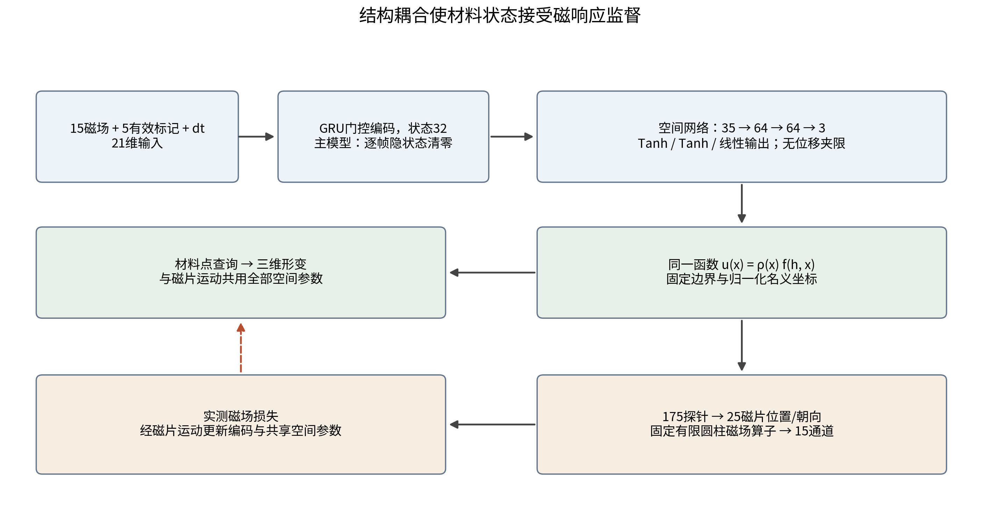
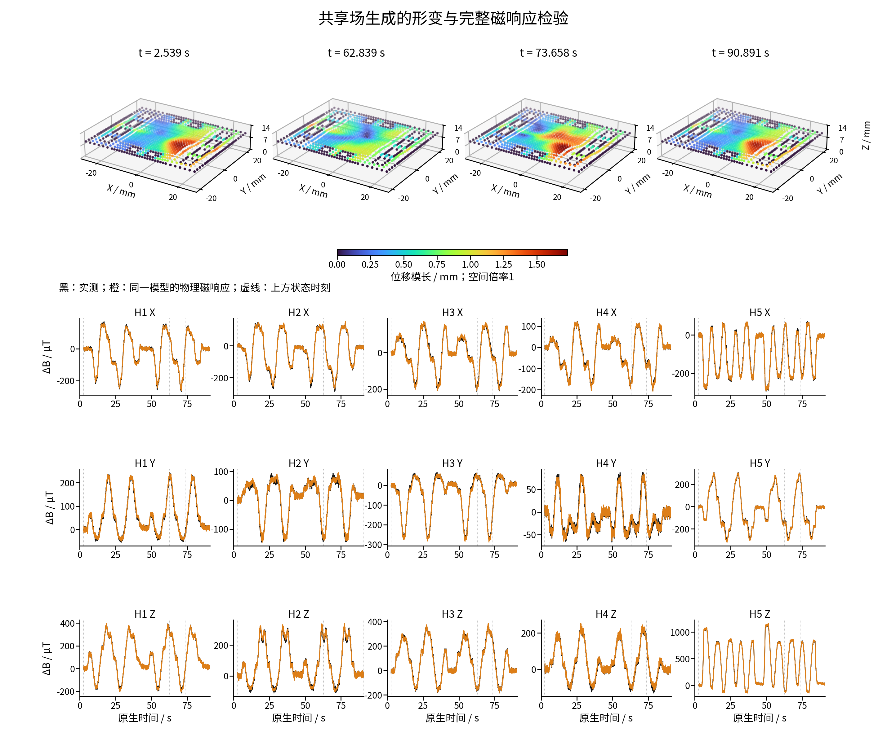
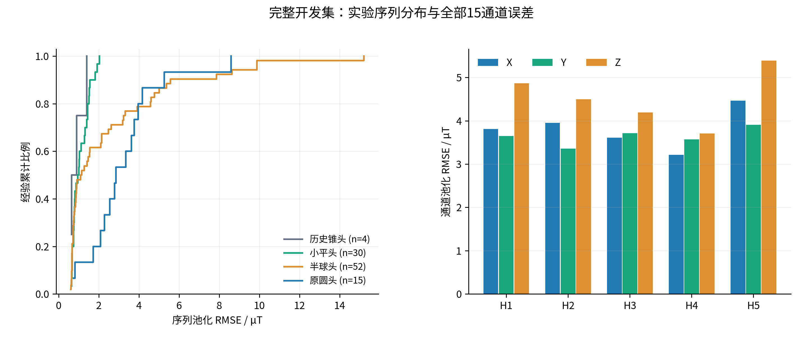
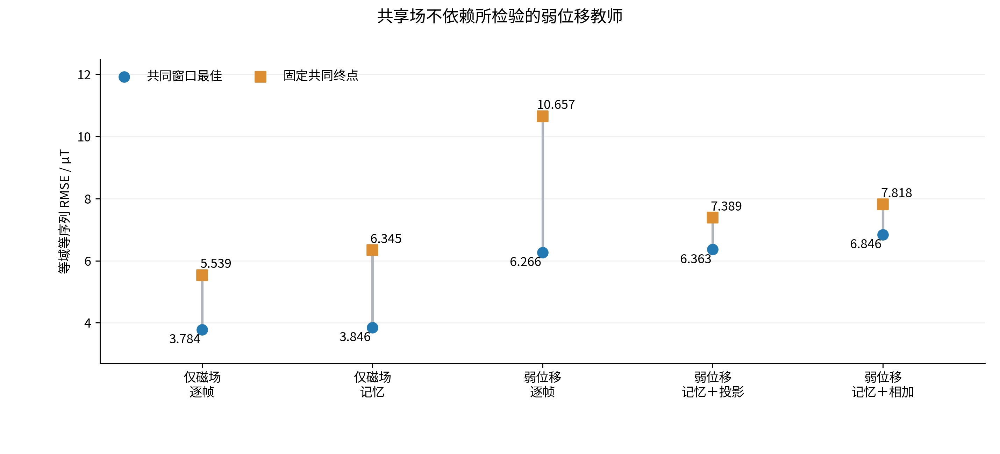

# 共享连续位移场中的磁场监督柔性形变学习

## 摘要

柔性磁触觉器件能够测量内部磁性单元运动产生的磁响应，但接触遮挡与内部材料运动使完整动态形变标签难以获取。本文研究能否利用可测磁响应，学习可查询的三维柔性状态。我们提出共享连续位移场的磁场监督方法：坐标条件化网络生成材料点位移，同一函数在磁片邻域的查询决定磁片位置与朝向，固定有限圆柱磁场算子将这些运动转换为观测；实测磁场通过这条状态依赖路径训练未知的状态关系。注册固定面由距离权重满足零位移，局部正交化产生合法磁片方向，网络不设独立磁片位姿或自由磁场输出头。基于381条训练与101条开发实验序列，最终纯磁场逐帧模型在不读取弱位移教师的条件下，达到2.822 µT等域等序列RMSE、4.034 µT池化RMSE及1.811 µT池化MAE。共同训练窗口内的五组对照表明，仅磁场监督能够优于所检验的弱位移监督配置；同一真实实验序列的三维形变与完整15通道磁响应展示了状态生成及其观测解释。本文的贡献是将材料表示与磁片运动耦合到共同参数路径，使难测状态通过可测物理后果接受监督。该证据支持当前结构下的学习可行性与效果，稠密位移精度仍需独立空间参考评价。

关键词：磁场监督；柔性磁触觉；连续位移场；表示耦合；物理读出；形变学习。

## 1 引言

软材料中嵌入磁性单元，可以将触碰引起的内部运动转化为可读磁场[1]。进一步的问题是从这些读数生成整个柔性体随触碰变化的状态，而不只输出触点或触头轨迹。一个触头中心坐标不能描述周围材料的局部起伏，单块磁片的运动也不足以描述阵列与硅胶的共同形变。三维状态表示能够连接材料运动、磁片响应和可视化，为柔性触觉的解释与后续交互提供空间基础。

这一任务的监督条件与常规形变重建不同。触头遮挡接触区域，Hall板与支撑限制背面观察，外表面图像也不自动给出内部材料点的对应运动。GelSight通过专用光学结构测量接触几何[2]；SuperMag利用配对光磁模块获得形状监督[3]。这些工作体现了空间参考的价值，但在原器件装配中直接获得完整逐节点动态标签仍然困难。我们关注另一种学习依据：形变会改变磁片运动，磁片运动产生可测磁响应，因此可以利用这种物理后果监督未知的状态映射。

物理模型在这里承担结构组织，而不是提前给出全部真实形变。磁触觉材料点仿真提供了机械与磁场表示的连接[4]，但生成几何与实际材料、装配及接触响应可能存在差异。本文保留器件几何、支撑和磁场读出，使网络学习尚未知的观测到状态关系。核心设计问题随之变为：磁场误差究竟约束了哪个状态？若材料位移与磁片位姿分别输出，磁场可能主要约束位姿分支；若两者来自同一位移函数，磁响应解释与材料状态便共享参数。

我们据此构造一个连续位移场，在任意名义材料坐标处输出位移，并用同一个函数导出全部磁片的局部运动。观测误差不能通过独立磁场输出绕过状态，而必须通过这条物理读出路径回传。坐标条件化表示本身已有研究基础[5]；本文的研究贡献在于共享场与磁片运动、注册边界和实测监督的具体耦合，以及这一耦合能否支持无需所用弱位移教师的学习。

本文检验三个相连的命题：共享参数是否建立了磁场到材料表示的监督路径；纯磁场监督是否足以学习解释实测响应的状态；这些状态及误差在完整实验序列和不同触头域中表现如何。我们给出实际结构与可证明的构造性质，使用五组共同训练窗口对照检验教师与时间配置，并将最终模型的三维状态和全部磁通道放在同一实验记录中展示。研究重心是通过可测响应学习难测状态的方法论，网络误差用于检验这一方法的效果。

## 2 方法与理论依据

### 2.1 从磁观测到状态，再从状态到磁响应

五个三轴Hall单元构成15维磁观测。输入包括归一化磁场变化、五个传感器有效标记及原生时间间隔，GRU编码器[6]形成32维条件表示h。网络只使用磁观测及其有效性和时钟，不读取触头身份、命令坐标、压深或CAD。名义材料坐标是预先固定的空间查询坐标，不是触头输入。

式1 输入与状态依赖磁响应的计算路径。a为21维输入，v为五个有效标记，sB为固定归一化尺度；Ψ将共享位移探针转换为磁片运动，H为固定物理读出。主模型的E每帧清零前隐藏态；记忆对照沿原生序列递推。

实测目标ΔB按各记录的未加载基线定义，预测则减去物理算子在名义零位移状态的响应。两者通过冻结的输入与基线合同对应，物理参考不等于新拟合的实测基线。器件坐标、磁化、传感器方向和机械到磁阵列的坐标关系沿注册定义保留。H不接受实测B作为自由输出参数；其参数固定，对状态的导数仍保留。

### 2.2 一个函数同时描述材料与磁片运动

空间网络将h与归一化名义坐标拼接，输出三维位移。距注册固定面集合Γ的距离d决定支撑权重：

式2 共享连续位移场及支撑权重。xmid与xhalf分别为固定名义网格包围盒的中心与半跨度，逐坐标归一化；支撑长度ℓs为1.25 mm。

只要x位于Γ，d=0，便有uθ(x)=0，对任意θ成立。因此固定边界由构造保证，不依赖将每个边界点重新作为位移标签训练。距离按注册轴对齐矩形固定面计算；网络结合Tanh隐层与连续距离权重形成连续位移函数，但最近固定面切换处不被宣称具有任意阶光滑性。这个结构不额外提供材料本构、体积守恒或完整接触平衡。

每片磁体的中心和六个轴向邻域点组成七个探针，25片共175个查询点。磁片平移使用中心位移，方向使用局部中心差分：

式3 由同一位移场构造磁片中心与局部变形轴。c0为名义磁片中心，ek为坐标轴单位向量，探针间距ℓp为1.25 mm。

F的前两列经正交化，第三方向由叉积产生：

式4 局部磁片方向构造。在detF>0且两条用于正交化的轴非退化时，方向矩阵满足RᵀR=I与detR=1。

单片以形状保持有限圆柱读出；阵列整体和硅胶可以发生不同的局部运动。detF≤0或轴退化被视为非法状态，不通过裁剪伪造合法方向。该方向构造保持原实现的轴序，不能等同为极分解所得到的最近旋转。稠密材料查询与磁片探针共用函数，但不将磁片内部所有材料查询点额外约束成严格刚体。形状保持性质属于局部磁片读出近似。

### 2.3 固定物理读出和实测监督

每片磁体在预测中心和朝向下产生有限圆柱磁响应，经坐标变换和传感器方向变换叠加到Hall位置[7]。实现保留厚度方向24点求积与椭圆积分计算，磁化极性及幅度来自注册参数。

式5 状态产生的物理磁响应。si为第i个Hall位置，Jj为注册有符号磁极化参数；Bnominal由同一算子的零位移参考计算。完整三轴读出沿传感器坐标定义。

对一条完整实验序列，原掩码内的有效磁场标量构成训练目标：

式6 归一化磁场损失。m为原生评分掩码，N为有效标量数，sB=99.09476558487553 µT，来源为既有训练集。无效观测不会被当作真实零场。

纯磁场路线只优化LB，不读取弱位移教师。物理算子和支撑几何仍然存在，因此“无需教师”特指所检验的弱位移标签，而不是没有先验。弱监督对照保留原0.5 mm位移尺度、参考采样与有效性规则，检验增加这类监督是否改善实际磁响应解释。

图1 实际网络与监督路径。32维条件表示与三维坐标连接到同一空间网络；材料点查询与175个磁片探针共用全部空间参数。磁场损失经固定读出和磁片运动更新共享函数。主模型逐帧清零前隐藏态，记忆对照沿序列递推；网络外的原生基线、重置与有效性处理沿同一输入合同执行。

表1 实际模型结构与可学习参数

| 部件 | 主逐帧配置 | 记忆对照配置 | 参数与作用 |
| --- | --- | --- | --- |
| 输入与编码 | 21→GRU32单步，前隐藏态为零 | 21→GRU32序列递推 | 主配置固定3072个隐藏到隐藏权重；两组保留偏置 |
| 空间网络 | 35→64→64→3 | 相同 | 两个Tanh隐层；末层线性，不设输出Tanh或位移夹限 |
| 支撑与运动 | 距离权重；175探针→25位姿 | 相同 | 注册固定面与局部方向构造；不新增学习参数 |
| 物理读出 | 固定有限圆柱磁场 | 相同 | 15通道；不设自由磁场头 |
| 总可学习参数 | 8867 | 11939 | 主配置与记忆配置容量不同 |

末层仅使用小幅初始化，并非硬位移范围。固定物理参数与几何缓冲不计入可学习参数。逐帧配置仍输入原生dt，表示当前磁响应及采样间隔；它不保留跨帧隐藏状态。记忆比较包含3072个参数差异，因此用于评价当前时间配置，不能解释为严格等容量的记忆因果实验。

### 2.4 共享参数带来的监督可达性

将175探针处位移堆叠为uP，磁场损失的链式导数为：

式7 磁观测经磁片运动构造回传到共享函数。J表示相应局部雅可比，P为磁片邻域探针集合。

材料显示也由同一fθ生成，所以式7所更新的空间参数同时决定这些材料点的位移。这是共享表示的关键：磁场不能只调整一个与显示无关的独立位姿头。该计算图建立了监督路径，但不同位置的灵敏度可以不同，个别参数或方向也可能局部梯度为零。共享函数把有限观测的影响传播到状态族中，并不把每个材料点变成独立的磁测量。

### 2.5 物理约束、可观测性与教师作用

在合法局部状态及可微邻域，探针位移变化与可评分磁场变化满足一阶关系：

式8 单时点观测的局部结构界限。mt为当时可评分通道数；该秩上界是维数结论，并非本实验测得的雅可比秩或条件数。

稀疏观测不足以唯一确定不受约束的525维探针位移。网络实际学习的是受共享32维条件表示、共同空间参数、固定支撑和局部磁片运动限制的状态族，而不是逐点自由求逆。历史信息与跨序列学习还可以提供约束。因而本方法的合理目标是学习能够生成状态并解释观测的受限关系；唯一稠密形变仍需要额外空间信息。

弱位移参考可缩小状态族，也可能引入与实测不相容的方向。令共同参数上的磁场和弱位移梯度为gB与gU，普通梯度步的一阶磁场损失变化为：

式9 普通梯度步的局部分析。λ为弱参考权重；负的梯度内积可能削弱磁场下降方向。该展开不是AdamW训练的单调下降保证，也不代表本实验已测量梯度夹角。

我们据此用组件对照检验教师作用，而不预设教师一定有益。两种记忆弱监督配置分别直接相加，或在原声明的共享编码参数上处理冲突梯度[9]；空间分支沿原梯度路由，不将投影扩大为全参数操作。实验结果检验这些具体配置的作用范围，不能推广为所有位移教师都无效。

## 3 实验装置、数据与评价协议

### 3.1 实验装置与采集来源

器件为硅胶中的5×5磁片阵列，磁片直径5 mm、厚1 mm、中心距5 mm，五个MLX90393三轴Hall单元读取响应。公开装置记录给出四角传感器约±7.594 mm及偏置中心约(0,+1.406) mm的布局，Cartesian运动平台为JGAURORA A5S，采集通过CH341进行分组触发与读取[10]。这些装置资料说明物理来源，实际模型使用本支线冻结的注册几何与坐标定义，不将早期装置尺寸视为重新测量的标定精度。

原生记录保留时间戳、磁基线、有效与重置标记及动作记录。触头包含原圆头、历史锥头、半球头和小平头，动作来自真实按压与移动实验。历史锥头包含磁层与批次差异，故按单独实验域统计，形状与器件差异不能完全分离。动作命令用于采集条件和来源追溯，推理输入只有磁观测合同。原装配没有完整动态节点位移或内部位姿真值。

装置仓库[10]与模型及回测材料仓库[11]承担不同来源说明：前者记录实验硬件与采集证据，后者组织磁监督方法、联合论文及两条独立实现。已有首页实测视频运行显式节点／磁片状态模型；它不是本文共享场模型的在线演示。

### 3.2 数据角色与训练协议

冻结集合包含482条完整实验序列和1343107个原生帧，按原角色保留381条训练与101条开发序列。开发序列未参与梯度更新，但参与逐轮选模，因此属于开发验证，不能称封存盲测。各序列在原时间、基线、掩码及重置规则下处理，不按预测误差删除帧，也不重新估计归一化尺度。

五组配置为仅磁场逐帧、仅磁场记忆、弱位移逐帧、弱位移记忆加梯度投影、弱位移记忆直接相加。对照复用共同初始化、训练与开发集合、原损失和梯度路由；学习率为0.0003，优化器为AdamW[8]，每条完整训练序列一次更新。共同274轮对应每组104394次更新，比较固定终点与1–274轮窗口最佳，两者分列。单种子实验未提供重复训练置信区间。

最终主模型为仅磁场逐帧路线在既定600轮窗口内按原等域等序列开发指标选择的第529轮权重。纯磁场记忆路线的窗口最佳另列，不将终态与窗口最佳混用，也不以训练上限作为充分收敛证明。该选模依据与组件对照的共同274轮窗口不同，分别回答最终实现效果与受控组件作用。

### 3.3 指标与完整分母

原选择指标先在每条序列计算归一化MSE，再在每个实验域内等权平均，最后对四个域等权平均；乘sB并开方得到等域等序列RMSE。域内指标保留等序列权重。池化指标则对全部有效标量合并：RMSEpool=√(ΣSSE/ΣN)，MAEpool=ΣSAE/ΣN；绝对残差P95来自合并的原评分集合。不同权重突出不同实验组成，不能互换。

最终101条开发序列共277348个原生帧，评分集合含3916620个有效磁场标量。完整序列分布与15通道误差采用该冻结结果；磁响应一致性评价单位为µT，不转换为未测得的毫米形变精度。展示样本沿既有规则选定，不能反向选择模型或替代完整集统计。

## 4 实验结果

### 4.1 同一状态的三维形变与完整磁响应

共享场能够从实测磁输入生成随触碰变化的空间状态，并由该状态产生可对照的磁响应。图2先把这两个结果放在同一真实半球触头实验序列中：上方为四个原生时刻的材料查询，下方为完整15通道实测与物理重建。材料与磁片运动的共享关系由图1及式3–5规定，波形不经过自由磁场头拟合。

图2 共享场形变与完整磁响应整体图。四个时刻为2.539、62.839、73.658及90.891 s；灰色为名义表面，彩色为估计状态，颜色表示位移模长，三维坐标统一毫米比例、视角和范围，空间倍率为1。下方黑色为实测ΔB，橙色为同一模型生成的物理响应，虚线对应上方时刻；原生全序列及评分缺口保留。该展示序列的15通道池化RMSE为5.567 µT，不是最低误差序列。

局部起伏与磁响应变化在原时间轴上呈现相应变化，展示了估计器实际生成的柔性状态及其可检验后果。完整序列含3092个原生帧，每通道有3049个评分时刻。四个稠密状态分别查询13010个名义节点；它们是模型状态展示，而不是四次独立的空间真值测量。补充图S3给出同一序列Hall3三轴及残差，补充图S4–S7保留每个域的最高误差序列。

### 4.2 完整开发集的磁响应解释

表2表明该方法在完整开发集合中达到2.822 µT等域等序列RMSE、4.034 µT池化RMSE、1.811 µT池化MAE和7.838 µT绝对残差P95。两种RMSE的差别来自序列长度、有效标量及域的权重，不是两个不同模型的结果。

表2 最终主模型的完整开发集结果

| 实验域 | 序列数 | 原生帧数 | 评分标量数 | 域内等序列RMSE / µT |
| --- | ---: | ---: | ---: | ---: |
| 历史锥头 | 4 | 43153 | 471195 | 0.949 |
| 小平头 | 30 | 49181 | 716250 | 1.167 |
| 半球头 | 52 | 126471 | 1860555 | 3.954 |
| 原圆头 | 15 | 58543 | 868620 | 3.735 |
| 全部 | 101 | 277348 | 3916620 | 等域等序列：2.822 |

半球和原圆域的误差高于小平头与历史锥头，且序列分布存在尾部。这说明整体低误差与特定动态条件的响应差距可以同时存在。全部通道统计约束了“只在某一传感器上拟合良好”的解释；域内最高误差波形保留较难信号的幅值、方向及残差，而不是从分母排除。历史锥头仅四条开发序列，不能据其较低指标推断锥头普遍更容易。

图3 完整101条开发序列的误差分布及全部Hall通道误差。左侧按域显示逐序列池化RMSE的经验累计分布；右侧按传感器和坐标轴合并有效标量。各域具有不同器件与动作组成，类别分布不被解释为连续形状趋势；柱和曲线不是重复实验置信区间。

### 4.3 所检验的弱位移教师并非必要条件

共同274轮窗口内，仅磁场逐帧和记忆路线的最佳等域等序列RMSE分别为3.784与3.846 µT，弱位移逐帧为6.266 µT，两种弱记忆路线分别为6.363与6.846 µT。固定共同终点的结果保持相同方向，因而这一发现并非只来自选择某个短暂最佳点。

表3 同一训练窗口下的组件结果，单位µT

| 配置 | 窗口最佳RMSE | 最佳轮数 | 固定274轮RMSE |
| --- | ---: | ---: | ---: |
| 仅磁场逐帧 | 3.784 | 263 | 5.539 |
| 仅磁场记忆 | 3.846 | 263 | 6.345 |
| 弱位移逐帧 | 6.266 | 263 | 10.657 |
| 弱位移记忆＋投影 | 6.363 | 250 | 7.389 |
| 弱位移记忆＋相加 | 6.846 | 250 | 7.818 |

相较弱位移逐帧，纯磁场逐帧的窗口最佳误差较低；两种记忆配置也表明增加所用弱参考并未改善磁响应解释。投影比直接相加更好，但仍未优于纯磁场记忆配置。这与式9中参考方向可能干扰观测适应的机制相容，尚不足以证明实际梯度冲突是唯一原因。

该实验支持明确而有限的科学结论：在当前支撑、磁片读出与共享表示下，不依赖所检验的弱位移教师也能学习解释真实响应的状态。它不声称所有物理参考有害，也未评价加入独立高质量空间真值的效果。固定结构和实测监督的分工由此得到组件层面的证据。

图4 共同训练窗口内的教师与时间配置对照。圆点为1–274轮开发窗口最佳，方点为固定274轮终点；竖线连接同一配置的两个统计量，不表示置信区间。全部配置保留相同训练与开发角色；其完整开发曲线见补充图S2。

### 4.4 时间配置和未见触头的证据范围

完整600轮纯磁场窗口中，逐帧配置最佳为2.822 µT，记忆配置最佳为2.917 µT，选中轮数分别为529和600。两者接近，说明当前任务不以保留跨帧隐藏态为必要条件；容量差异、数据动作和单种子限制使这一结果不能否定软材料的记忆性质。补充图S1保留训练与开发曲线及波动，不用少量末轮未改善替代收敛证据。

另一个冻结扩展只使用原圆与历史锥头的66条训练和19条已见域开发序列，评价82条半球与小平头序列。该扩展的参数训练未见两个触头，但使用既有全训练尺度及物理结构，研究者也曾接触相关域。其逐帧等域磁场RMSE为18.177 µT，明显高于主模型全触头训练后的2.822 µT；这些数值属于不同训练协议，不能直接作为同模型提升率。补充表S1完整区分该扩展的选模与评价。当前证据支持学习路径可执行，也揭示跨触头响应差距，未证明任意触头的普适可靠性。

## 5 讨论

### 5.1 共享场怎样改变磁监督的作用对象

本文的价值来自计算依赖的改变。磁片运动不是一个与材料形变平行的独立输出，而由同一位移函数导出。实测损失因此更新同时负责磁响应和材料查询的参数，构造出无需逐节点弱标签的训练路径。连续坐标函数、固定支撑和局部方向读出共同限制允许状态，磁响应则检验这个状态关系是否适应实际器件。物理模型提供结构，实测磁场辨识未知关系，预测状态产生的响应检验其解释，这三部分形成完整方法。

与显式节点／磁片路线相比，共享场提供的是互补证据。显式路线在固定表示与先验条件下检验实测适应；共享路线改变表示耦合并去掉所用弱位移教师，检验监督路径是否仍有效。两者可以在一个仓库中共享方法说明、分别保存模型与论文，不需要成为彼此对立的误差排行榜。本文独立论证共享场的结构与实验，联合论文组织两条路线共同支持的磁监督命题[11]。

### 5.2 成功的证据与仍待测量的空间量

三维状态实际输出、同状态产生的磁响应以及完整开发序列中的误差，分别证明状态表示可以运行、物理后果可以检验和观测解释具有量化效果。组件对照进一步表明这条学习路径不以所用弱位移教师为前提。这些结果构成方法可行性和有效性的实证依据。

空间精度属于另一项测量。有限磁片邻域的观测允许状态歧义，支撑与函数先验对未直接观测区域的延伸有影响；物理参数偏差也可能由状态吸收。当前没有独立稠密位移、全内部位姿或材料平衡真值，故不能将低磁场残差等同为完整柔性体的毫米准确度。后续独立空间参考、物理参数扰动和观测外验证，可以分别检验空间准确度、模型误差吸收与预测性。本文不把尚未完成的验证写成已有结果。

### 5.3 实验与复现边界

开发集参与选择、单种子、时间配置容量差异和历史锥头批次混杂限制了结论的统计与外推范围。局部合法方向不等于完整力学平衡，有限圆柱形状保持也不能替代全部材料本构。原生执行合同连接基线、时间、有效性与状态；相同输入和状态下可执行同一因果推理，但本文没有测得共享场模型的实时硬件吞吐或实机在线空间精度。

公开资料包包含独立中英文稿、图表、完整逐序列标量、指标复核工具、结构源码与来源映射[11]。科学权重、原始数组和注册几何保留在原计算环境；当前包不是含全部私有输入的一键复现实验。软件授权按各文件原许可说明，不将复用物理库的MIT许可扩大到全部项目。装置资料独立引用[10]，共享与显式实现分别标识，以便后续单独引用。

## 6 结论

本文建立了共享连续位移场的磁场监督方法，使材料查询、磁片运动与物理磁响应进入同一计算路径。注册支撑及合法局部朝向由构造满足，未知状态关系由实测磁场训练。完整101条开发序列中，纯磁场主模型达到2.822 µT等域等序列RMSE与4.034 µT池化RMSE，且在共同窗口内优于所检验的弱位移监督配置。三维状态及完整磁响应展示表明，该方法能够学习可查询、可解释观测的柔性状态。

共享场独立验证了磁监督不必依赖所用弱位移教师，与显式路线的实测适应证据共同支持通过可测物理后果学习难测状态这一方向。其研究贡献是监督与状态结构的耦合及相应实验依据；完整空间精度和更广泛工况仍需要独立测量检验。

## 参考文献

1. Bhirangi R, Hellebrekers T, Majidi C, Gupta A. ReSkin: versatile, replaceable, lasting tactile skins. PMLR 164:587-597, 2022. [原文](https://proceedings.mlr.press/v164/bhirangi22a.html).

2. Yuan W, Dong S, Adelson EH. GelSight: High-Resolution Robot Tactile Sensors for Estimating Geometry and Force. Sensors 17(12):2762, 2017. [原文](https://pmc.ncbi.nlm.nih.gov/articles/PMC5751610/).

3. Hou P, Sun D, Wang M, Huang Y, Zhang Z, Liu H, Li W, Jiao Z. SuperMag: Vision-based Tactile Data Guided High-resolution Tactile Shape Reconstruction for Magnetic Tactile Sensors. arXiv:2507.20002, 2025. [原文](https://arxiv.org/abs/2507.20002).

4. Lin X, Lin G, Liu R, Wang A, Lou Y. MPM-based simulation and bounded-error compression of material points for magnetic tactile sensors. Frontiers in Robotics and AI 13:1817251, 2026. [原文](https://www.frontiersin.org/journals/robotics-and-ai/articles/10.3389/frobt.2026.1817251/full).

5. Park JJ, Florence P, Straub J, Newcombe R, Lovegrove S. DeepSDF: Learning Continuous Signed Distance Functions for Shape Representation. CVPR:165-174, 2019. [原文](https://arxiv.org/abs/1901.05103).

6. Cho K, et al. Learning Phrase Representations using RNN Encoder-Decoder for Statistical Machine Translation. EMNLP:1724-1734, 2014. [原文](https://aclanthology.org/D14-1179/).

7. Derby N, Olbert S. Cylindrical Magnets and Ideal Solenoids. American Journal of Physics 78:229-235, 2010. [作者稿](https://arxiv.org/abs/0909.3880).

8. Loshchilov I, Hutter F. Decoupled Weight Decay Regularization. arXiv:1711.05101, revised 2019. [作者稿](https://arxiv.org/abs/1711.05101).

9. Yu T, Kumar S, Gupta A, Levine S, Hausman K, Finn C. Gradient Surgery for Multi-Task Learning. NeurIPS, 2020. [原文](https://arxiv.org/abs/2001.06782).

10. googo2025. MagTouch RA三维接触重建：实验装置与采集来源。GitHub，访问日期2026-10-14。[装置与采集记录](https://github.com/googo2025/MagTouch-RA-3d-trajectory-recon).

11. googo2025. 磁场监督柔性状态重建：联合方法与两条实现的论文及资料。GitHub，访问日期2026-10-14。[模型与论文资料仓库](https://github.com/googo2025/magtouch-temporal-state-reconstruction).
