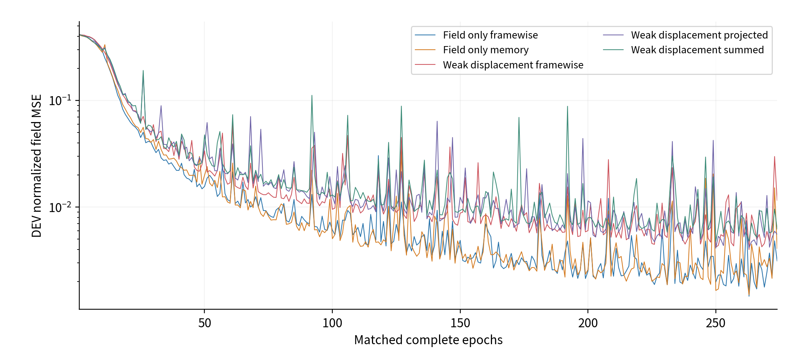
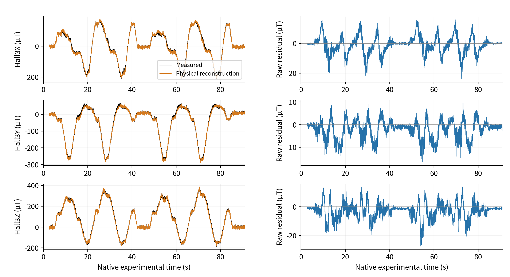
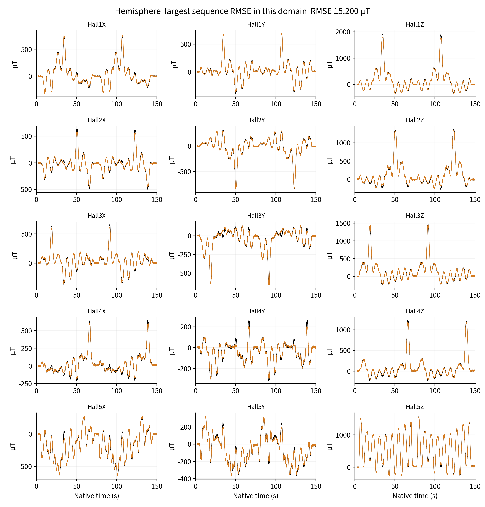

# Shared-Field Magnetic Supervision: Supplementary Experiments and Reproduction Protocols

## S1 Complete Learning Histories and the Common Window

Main Table 3 uses epochs 1–274 for all five configurations, with 381 training sequences and one update per sequence, totaling 104394 updates each. Window best is the minimum original development normalized field MSE; endpoint is epoch 274. Every curve point remains without smoothing, spike removal or interpolation. Weak auxiliary totals are not mixed into magnetic curves. The main 600-epoch window and epoch-529 selection are reported separately.

Training field scores summarize changing weights within an epoch; development scores use fixed end-of-epoch weights. Their separation is not a same-weight generalization gap. Magnetic-only memory has best equal-domain, equal-sequence RMSE 2.917413964 µT at epoch 600, and framewise has 2.821580798 µT at epoch 529. Closing a prescribed budget is not mathematical convergence proof.

Supplementary Figure S1. Every training/development normalized magnetic MSE point through epochs 1–600 for magnetic-only framewise and memory models. Spikes and fluctuations remain. Selection uses development rather than training scores.

Supplementary Figure S2. Complete development magnetic MSE over epochs 1–274 for five configurations. Legends describe supervision and temporal representation. Main Table 3 separates window bests and fixed endpoints.

## S2 Weak Supervision and Gradient Routing

The shared objective is LB+λU LU, with λU zero or one. Magnetic-only configurations do not read weak u. References retain the original 0.5 mm scale, valid states and material sampling. Physical mapping and reference generation remain fixed during inverse learning rather than freeing independent calibration and network parameters together.

Projection handles the weak gradient only on originally declared shared encoder parameters. When gB·gU<0 and ||gB||²>0, gU becomes gU−[(gB·gU)/||gB||²]gB; otherwise it is unchanged. Direct sum does not apply this operation, and spatial weak-reference feedback retains its original routing. Multi-objective projection does not guarantee magnetic-loss descent at every finite AdamW step.

Centers and orientations use 175 probes; nominal material queries call the same displacement function. Zero support, 1.25 mm probe spacing, nonfinite rejection and invalid-local-state rejection remain. Main supervision-reachability analysis follows the actual graph without assuming uniform spatial sensitivity.

## S3 Native Traces and Residuals

Figure S3 uses the same hemisphere display as the main integrated result. All 3092 native frames remain, with 3049 scored times per channel. Measured fields are observation references and deformation is a model state; juxtaposition does not interchange their ground-truth roles. Display fits no gain, rotation, spatial scale or time offset.

Supplementary Figure S3. Hall3 XYZ and scored residuals for the main integrated sequence. Native timing and scoring gaps remain; smoothing does not improve apparent agreement.

Each domain's maximum sequence RMSE is selected only after final weights and complete replay are frozen, as an error diagnostic rather than a tuning or selection input. Small flat, hemisphere, original round and historical cone maxima are approximately 2.032, 15.200, 8.590 and 1.399 µT; exact scalars and identities remain in the records and figures. Every sequence remains in main denominators.

Supplementary Figure S4. All 15 channels of the highest-error small-flat sequence. Black is measured and orange physical reconstruction, retaining amplitudes, native timing and gaps.

Supplementary Figure S5. Highest-error hemisphere sequence. Amplitude, direction and recovery discrepancies remain; traces alone do not uniquely identify material or magnetic-prior error.

Supplementary Figure S6. Complete highest-error original-round sequence. Its length and error do not remove it from original scalar or equal-sequence statistics.

Supplementary Figure S7. Highest-error historical-cone magnetic-layer sequence. Four development sequences have shape, layer and acquisition-batch confounds; their lower mean does not establish cross-material reliability.

## S4 Frozen Extension with Two Indenters Unseen in Parameter Fitting

This extension retains identities, roles, masks and scale for all 482 inputs. The 315 original hemisphere and small-flat training sequences are excluded from new fitting rather than relabeled as tests. The 66 original-round and historical-cone training sequences fit the networks; 19 seen-domain development sequences select weights; 82 original hemisphere/small-flat development sequences are evaluated only after freezing.

Both models start from a common untrained initialization and complete 200 epochs, totaling 13200 updates. Seen development selects memory epoch 198 and framewise epoch 192, with RMSE 11.007804 and 10.013960 µT. This is not extrapolation evaluation of the final all-indenter epoch-529 model. Evaluation has 175652 native frames and 2576805 scored scalars.

Table S1. Separate frozen-extension magnetic results in µT

| Scope | Sequences | Memory RMSE | Framewise RMSE |
| --- | ---: | ---: | ---: |
| Hemisphere | 52 | 26.671 | 24.135 |
| Small flat | 30 | 10.802 | 8.850 |
| Equal-domain aggregate | 82 | 20.347 | 18.177 |

Framewise has lower error on 77/82 sequences. Scale 99.09476558487553 µT comes from existing full-indenter training, while fixed physics, geometry and early development displays carry cross-domain information. New relation parameters are not fitted on the two indenters, but the complete research pipeline is not blind. Training quantity, development exposure and historical device domains vary together, preventing attribution solely to shape. The frozen results retain the extrapolation gap without establishing arbitrary-indenter reliability.

## S5 Inputs, Denominators and Metric Verification

Encoding uses 15 fields, five sensor-availability flags and dt; nominal coordinates support spatial queries. Commands, CAD, indenter identity, weak displacement labels and scoring masks do not enter the inverse encoder. Scoring eligibility retains its independent definition. Reset and baseline changes follow the input contract; missing observations are not physical zero fields. Hidden-state clearing and time-interval input are distinct designs.

Final replay covers 101 sequences, 277348 native frames and 3916620 scored scalars. Per-sequence SSE, SAE and channel counts support pooled RMSE/MAE recomputation; domain means support equal-domain, equal-sequence evaluation. P95 requires residual distributions and is retained as a frozen value rather than inferred from means. Complete scalar histories reproduce curves without reloading scientific weights.

Without measured u or complete pose truth, dense spatial accuracy is unmeasured rather than zero. Fields receive no constant XYZ translation removal, and commanded trajectories cannot replace all material-point displacement references. Identical observations, baselines, time, validity and state execute the same causal inference; offline execution is not automatically a different network output.

## S6 Public Materials, Model Identity and Citation

Companion materials organize the shared-field module within one repository: independent bilingual full texts and supplements, editable sources, vector and high-resolution figures, final per-sequence scalars, components and histories, architecture source, metric verification and provenance. Framework, explicit route and shared route have separate paper and citation descriptions. Researchers supply final authors and affiliations; names, correspondence and paper DOI are not invented.

The main shared model is magnetic-only framewise, with epoch-529 checkpoint SHA256 51c6b6580507d8bde16d35a55577d6a11aae5abb744c6845123b958723a6dbe8. Its complete 101-sequence replay is closed; this paper reuses saved output without additional optimization, physical inference or new 82-sequence evaluation. Scientific arrays, checkpoints, optimizer states and registered geometry are absent from the current public package, so architecture and scalar verification are not complete training reproduction.

Hardware provenance is documented in the [apparatus and acquisition repository](https://github.com/googo2025/MagTouch-RA-3d-trajectory-recon), and model/paper material in the [magnetic-supervision companion](https://github.com/googo2025/magtouch-temporal-state-reconstruction). Earlier hardware noise, sampling rates and trajectory errors are not reused as new deformation metrics. The homepage measured GIF explicitly corresponds to the explicit epoch-138 model, separately identified from shared-field results. New paper materials are prepared locally; remote availability depends on an actual publication commit.
