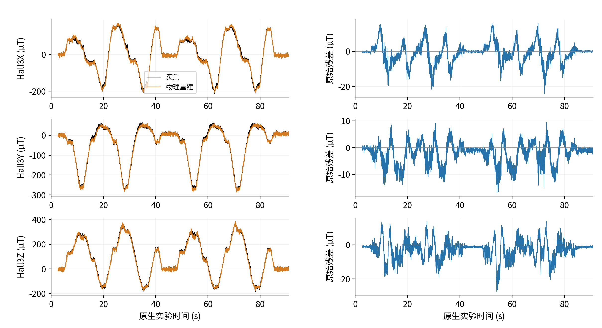
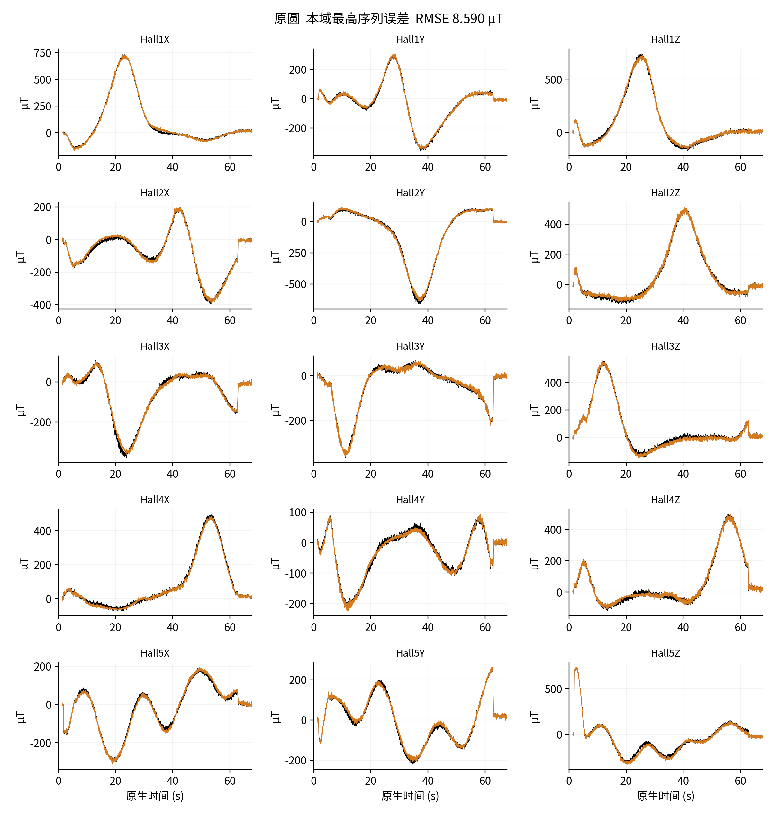
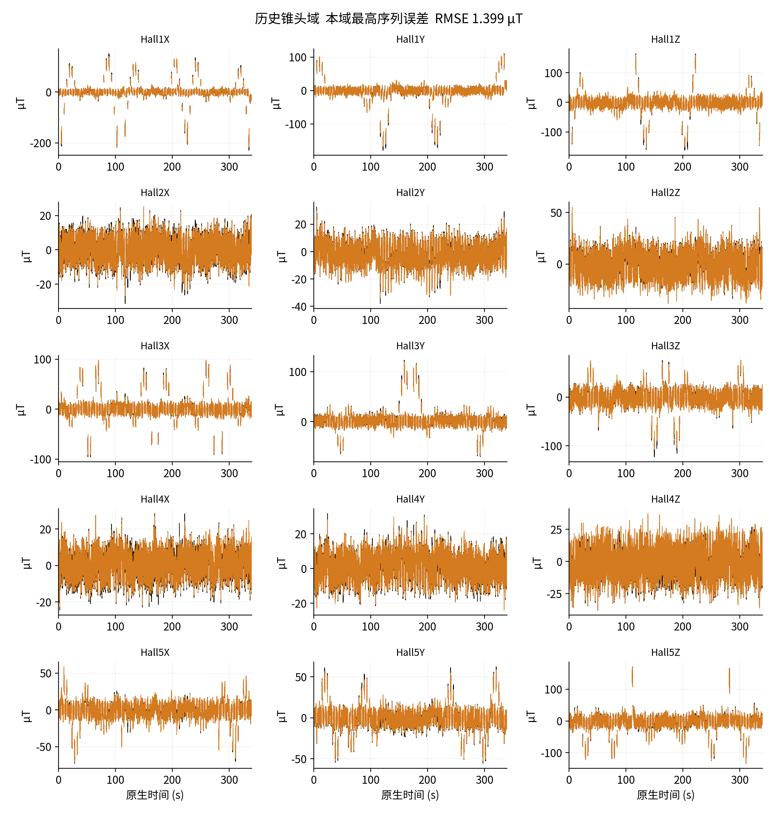

# 共享连续位移场磁监督学习：补充实验与复现协议

## S1 完整学习曲线与共同窗口

主文表3使用五组共同1–274轮窗口，每组381条训练序列、每序列一次更新，共104394次更新。窗口最佳为原开发归一化磁场MSE的最小值；固定终点为第274轮。所有原生曲线点保留，不平滑、删除尖峰或插值，弱监督总目标不混入磁场曲线。主模型的最终600轮窗口及第529轮选模另行报告。

训练磁场指标汇总一轮中不断变化的权重，开发指标在轮末固定权重上计算。因此两条曲线的差距不等同于同一权重下的泛化间隔。纯磁场记忆组在600轮的最佳等域等序列RMSE为2.917413964 µT，逐帧组第529轮为2.821580798 µT。达到共同上限只是当前剂量闭合，不构成数学收敛证明。

补充图S1 纯磁场逐帧与记忆的全部1–600轮训练／开发归一化磁场MSE。原始尖峰和波动保留，选择依据为开发指标；训练值不被当作独立选模指标。

补充图S2 五组共同1–274轮的全部开发磁场MSE。图例以监督与时间配置命名，窗口最佳与固定终点保留在主文表3。

## S2 弱监督与梯度路由

共享场弱监督目标为LB+λU LU，λU为零或一；纯磁场两组不读取弱u。弱参考采用原0.5 mm尺度、原有效状态与材料点采样。固定物理映射和弱参考来源不与逆向网络同时释放参数，避免把独立标定自由度混入当前实验。

投影配置仅在原声明的共享编码参数上处理弱梯度：当gB·gU<0且||gB||²>0时，将gU替换为gU−[(gB·gU)/||gB||²]gB，否则保留。直接相加配置不做该处理；空间弱参考反馈沿原实现路由。投影借用多目标梯度处理，不能在有限步长和AdamW下保证每步磁场损失下降。

中心与方向使用175个探针；名义材料点查询调用同一位移函数。零支撑、1.25 mm探针间距、非有限值拒绝及非法局部状态拒绝规则均保持。主文的监督可达性推导基于实际计算图，不假设所有空间位置具有相同灵敏度。

## S3 完整原生波形与残差

补充图S3与主文整体图来自同一半球展示序列。完整3092帧保留，每通道3049个评分时刻。图中磁场参考是实测信号，形变则是模型状态，二者不能因同页展示而互换真值含义。展示不拟合增益、旋转、空间尺度或时间偏移。

补充图S3 整体图对应的Hall3三轴实测与物理重建，以及原评分残差。完整原生时钟和评分缺口保留，不通过平滑改善波形一致性。

每个域的最高误差序列在最终权重与完整回测冻结后按逐序列RMSE选择，仅作误差诊断，不参与调参或选模。小平头、半球、原圆和历史锥头分别约为2.032、15.200、8.590、1.399 µT；精确值及UID保留在逐序列标量与图中。全部序列都保留在主文分母。

补充图S4 小平头域最高误差实验序列的全部15通道。黑为实测，橙为物理重建；保持真实幅值、原生时间及缺口。

补充图S5 半球域最高误差序列。幅值、方向及恢复段偏差保留；波形本身不能唯一定位材料模型或磁场先验误差。

补充图S6 原圆域最高误差完整序列。长序列仍按原标量和等序列定义进入统计，不因持续时间或误差剔除。

补充图S7 历史锥头磁层域最高误差序列。该域开发序列仅四条，形状、磁层和采集批次差异混杂，较低平均值不代表跨材料普适可靠。

## S4 两触头在参数训练中未见的冻结扩展

该扩展保留全部482输入的原身份、角色、掩码和尺度，315条原半球与小平头训练序列只是不参与新参数拟合，未重新标成测试集。原圆与历史锥头66条训练序列拟合网络，19条已见域开发序列选模，82条原半球／小平头开发序列仅在冻结后评价。

两组从共同未训初始化开始，各完成200轮、13200次更新。已见域开发选中记忆第198轮与逐帧第192轮，RMSE分别为11.007804与10.013960 µT；这不是最终全触头训练第529轮模型的外推测试。评价共175652原生帧、2576805评分标量。

表S1 独立冻结扩展的磁场结果，单位µT

| 范围 | 序列数 | 记忆RMSE | 逐帧RMSE |
| --- | ---: | ---: | ---: |
| 半球 | 52 | 26.671 | 24.135 |
| 小平头 | 30 | 10.802 | 8.850 |
| 等域合并 | 82 | 20.347 | 18.177 |

逐帧在77/82条序列的误差较低。尺度99.09476558487553 µT来自既有全触头训练集合，固定物理与几何先验、早期开发展示具有跨域信息。因此新关系参数未在两触头上训练，但整个研究流程不是盲测。训练量、开发暴露和历史器件域随协议一起变化，差距不能全部归因于触头形状。当前结果保留外推限制，不宣称任意触头均可靠。

## S5 输入、分母与指标复核

编码只使用15磁场、5传感器有效标记与dt，名义坐标用于空间查询。命令、CAD、触头身份、弱位移标签和评分掩码不进入逆向编码器；评分资格沿独立原定义保留。重置与基线切换按输入合同处理，缺失观测不是物理零场。逐帧隐状态清零与时间间隔输入是两个不同设计。

最终结果包括101条序列、277348原生帧、3916620评分标量。逐序列SSE、SAE及各通道有效数量支持重新合并池化RMSE与MAE；域内均值支持等域等序列指标。P95需要原残差分布，包内保留冻结值，不从均值臆算。训练与开发曲线使用完整标量记录，不重新加载科学权重。

没有实测u或完整位姿真值时，稠密空间精度属于未测量量，不能填零。磁场指标不做常量XYZ消偏；命令轨迹也不能代替全部材料点位移参考。相同输入、基线、时间、有效性与状态下执行同一因果推理，不将离线运行方式自动解释为另一个网络输出。

## S6 公开材料、模型身份与引用

公开材料按一个仓库中的共享场模块组织：独立中英全文与补充稿、可编辑源稿、矢量与高分辨率图、最终逐序列标量、组件和学习历史、结构源码、复核入口及来源索引。联合方法、显式路线和共享路线分别有论文与引用说明。作者及单位由研究者最终补填，不编造姓名、通讯信息或论文DOI。

共享主模型是纯磁场逐帧，第529轮权重的SHA256为51c6b6580507d8bde16d35a55577d6a11aae5abb744c6845123b958723a6dbe8。完整101序列回测已闭合；本论文仅复用封存输出，不增加优化、物理推理或新的82序列评价。科学数组、检查点、优化器状态与注册几何不在当前公开包中，因此结构与标量复核不被称为全训练复现。

实验装置来源见[装置与采集仓库](https://github.com/googo2025/MagTouch-RA-3d-trajectory-recon)，模型与论文归档见[磁监督资料仓库](https://github.com/googo2025/magtouch-temporal-state-reconstruction)。较早硬件论文的噪声、采样率和轨迹误差不被沿用为本形变实验的新指标。仓库首页实测GIF明确对应显式第138轮，与共享场论文的结果范围分别标识。新增论文资料处于本地上传准备状态，远端可用性以实际提交为准。
