# Physical Structure-Guided Magnetic Supervision for Soft Deformation Estimation

## Abstract

Soft magnetic tactile sensing requires recovery of a changing high-dimensional compliant state from sparse field observations, while contact occlusion and internal motion make complete dynamic deformation labels difficult to obtain. We propose physical structure-guided magnetic supervision: geometry and field models specify the state-to-observation structure, a neural network learns the unknown field-to-state relation, and measured fields supervise that relation through the response generated by the predicted state. The method does not require an exact inverse solution of a high-fidelity material and contact model, or tip commands, identity or CAD during inference. An explicit node and magnet state model retains weak geometry and identifies magnet motion through measured fields. A shared continuous displacement field additionally derives material displacement and magnet motion from one function, allowing observation feedback to update a common spatial representation. Real experimental sequences display three-dimensional compliant deformation, magnet motion and corresponding native field reconstruction. Across 97 complete development sequences, the final explicit model achieves pooled magnetic RMSE of 4.139 µT and MAE of 2.440 µT. Without a weak displacement teacher, the final shared field achieves equal-domain, equal-sequence RMSE of 2.822 µT and pooled RMSE of 4.034 µT across 101 complete development sequences. A fixed-start source comparison supports joint measured adaptation; shared-field component comparisons support learning without the weak displacement teacher examined. The two state structures and training routes jointly support learning difficult-to-measure deformation states through measurable magnetic responses. Actual three-dimensional outputs and magnetic observation consistency provide evidence of deformation generation and physical explanation, respectively.

Keywords: magnetic supervision; soft magnetic tactile sensing; temporal deformation estimation; physical structure; measured adaptation; continuous displacement field.

## 1 Introduction

Soft magnetic tactile sensors read the field induced by magnetic elements moving inside compliant material, enabling sensing through opaque encapsulation and occluded contact [1]. The central difficulty is recovering a changing high-dimensional compliant state from a few Hall channels. A tip-centre trajectory cannot describe local body deformation, and one magnet pose does not represent the motion of the entire array and silicone. We examine generation of three-dimensional body deformation and embedded-magnet states using deployable magnetic observations alone, while allowing those states to be checked against real measurements.

Making an exact inverse solution of high-fidelity simulation a deployment prerequisite places material parameters, contact conditions and simulation-to-device mismatch in the upfront modelling stage. We instead divide the work between physical structure and measured learning. Fixed models retain geometry, magnet motion and the field observation relation, while a network parameterizes the unknown field-to-state mapping. Model geometry can supply weak references; measured fields identify the relation and constrain its observable consequences. Magnetic-to-simulated-deformation mappings [2] and tactile simulation transfer [6] provide learning references, but proximity to a generated representation and explanation of a physical device are distinct requirements. We connect predicted states to a fixed physical readout and directly constrain their explanation through measured responses.

Complete deformation measurement requires clear spatial coverage. The tip occludes the contact region, the Hall board and supports restrict rear optical access, and surface measurements do not automatically establish internal material correspondence. Specialized optical structures [7] or paired optical-magnetic modules [8] establish relevant spatial references, but our original assembly has no complete dynamic per-node ground truth. Magnetic supervision learns unknown relations through the measurable consequences of deformation, without requiring complete deformation labels as the sole training basis. Temporal displays show states actually generated by the estimator, while magnetic replay tests whether they explain real signals.

State representation determines how magnetic constraints act on deformation. We test the method with two complementary implementations. Explicit node and magnet states retain weak geometry and use input and supervision source comparisons to test measured adaptation of generated relations. A shared continuous displacement field connects material displacement and magnet motion through one spatial function, using component comparisons to test learning without a weak displacement teacher. The common contribution is a deformation estimation method connecting physical structure, measured relation identification and testing through state-generated responses. The routes provide evidence for measured adaptation and representation coupling, respectively.

## 2 Magnetic Supervision for Deformation Estimation

### 2.1 Physical Structure and Unknown State Relations

Five three-axis Hall units provide 15 magnetic channels, whose readings change with motion of 25 embedded magnets. The nominal soft mesh contains 13010 nodes; magnets are 5 mm in diameter and 1 mm thick. Shape preservation is assumed for individual magnets, not for silicone or the complete array. A relation network Fθ estimates state z, a geometry mapping K converts it to magnet motion, and a fixed operator Hφ computes the corresponding observations.

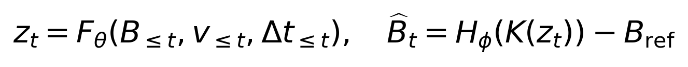

Equation 1. One path from magnetic inputs through soft states to physical responses. The validity v, native interval Δt and reference subtraction retain original baselines and registered definitions.

The physical readout computes finite-cylinder fields in each magnet frame, transforms them by predicted orientation and sums them at the five Hall positions. Original 24-point thickness quadrature and elliptic integrals are retained [4]. Coordinates, magnetization and reference subtraction are registered structure, while unknown mechanical response relations are identified by the network.

Fθ may use causal history or a current-frame representation, whereas Hφ reads only state-derived magnet motion. Geometry, Hall layout and magnetization specify known structure; unknown material and assembly responses are adapted through state-relation learning. Each implementation retains its original field mapping, fixing physical parameters while retaining state derivatives [4]. The implementations do not share weights or require online high-fidelity contact inversion. No free field-output head bypasses deformation, so reducing reconstruction error requires state changes to produce response changes.

### 2.2 Explicit Node and Magnet States

The explicit implementation retains a joint-state structure. Fifteen normalized fields, 15 validity flags and dt form a 31-dimensional input to a 64-dimensional GRU [3]. The readout generates 23352 components: 23202 ordinary-node displacement components and 150 translations and rotations for the 25 magnets. Nodes belonging to each magnet share a shape-preserving transformation. Displacements use mm, rotations use rad and the original fixed scaling. History resets at sequence onset, an explicit reset or a baseline-identity change.

Ordinary displacement and magnet motion receive weak model geometry, while fields directly depend on magnet pose p:

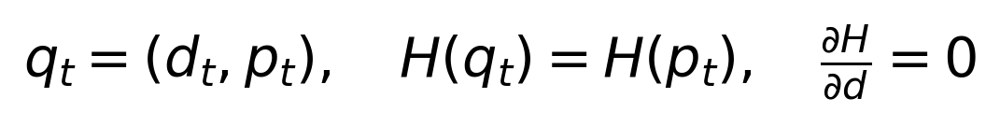

Equation 2. Explicit state q comprises ordinary displacement d and magnet pose p; ordinary displacement does not directly enter the field operator.

This dependency distinguishes the supervision roles. Magnetic feedback identifies magnet motion explaining actual responses, while ordinary geometry remains constrained by weak references and shared encoding. Both outputs belong to one joint state, but low field error does not mean that every ordinary node is directly magnetically supervised. The implementation therefore offers a testable route for adapting generated state relations to measurements with unchanged physical priors.

### 2.3 A Shared Continuous Displacement Field

The shared implementation generates three-dimensional displacement through a coordinate-conditioned function. Magnet centres and local orientations derive from that function, without a separate pose head. Fifteen fields, five sensor-validity flags and dt form a 21-dimensional input. A 32-dimensional representation joins nominal coordinates; the spatial network uses a 35→64→64→3 structure with tanh activations.

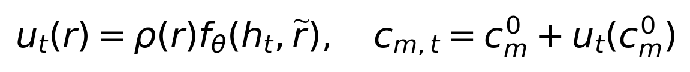

Equation 3. One displacement function generates material-point motion and magnet centres. The coordinate r is nominal material location; ρ supplies the registered fixed-surface support.

Each centre and six axial probes define a local query, giving 175 physical probes over 25 magnets. Central differences estimate displacement changes, and orthogonalized deformed axes define orientation:

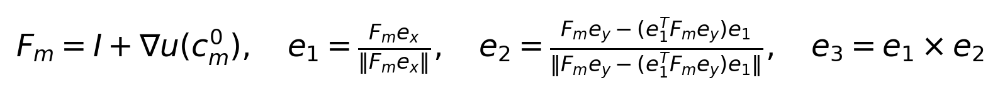

Equation 4. Local displacement changes generate magnet orientation, retaining original probe spacing, support and valid-state constraints.

Where ρ=0 on a registered fixed surface, uθ=0 for every parameter value. For nondegenerate local axes, orthogonalization and the cross product ensure RᵀR=I and detR=1. Fixed-surface constraints and valid individual-magnet orientations therefore follow directly from state construction rather than being learned from additional measured displacement labels. These properties concern registered boundaries and local magnet motion, not a complete constitutive or contact solution.

Spatial queries and magnet motion depend on one parameter set, so magnetic gradients update the same function used to display deformation. The memory version recurs over a sequence; the framewise version starts from zero hidden state for one encoding step at each frame. It still includes dt and has 8867 effective parameters, compared with 11939 for memory. The temporal comparison includes capacity differences and concerns the current configurations. The final shared implementation uses the pure magnetic framewise version.

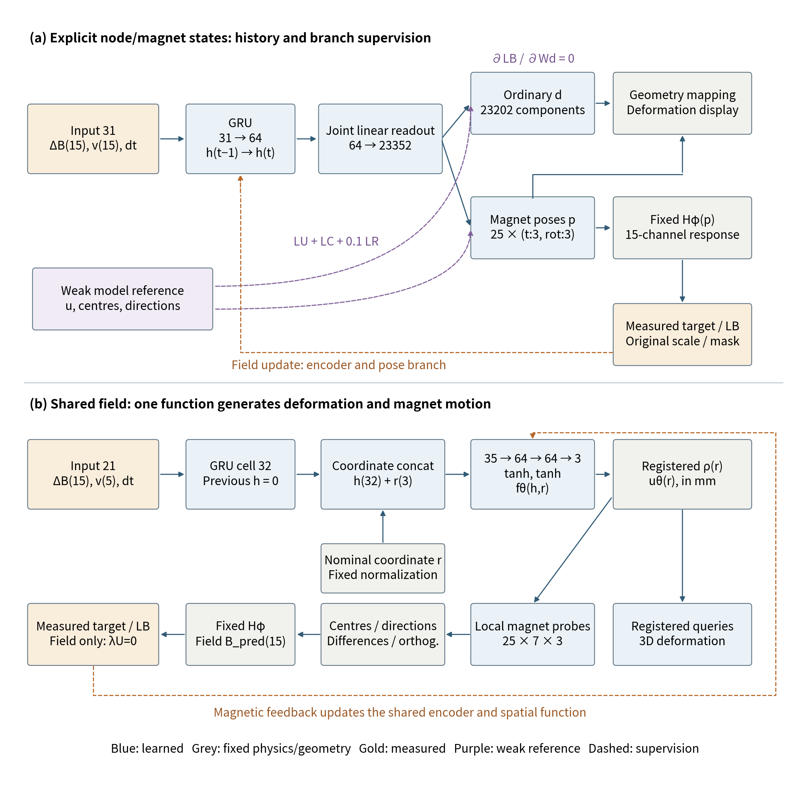

Figure 1. Implemented networks, state construction and supervision. (a) A history GRU and joint readout generate ordinary displacement and magnet poses; fields directly depend on the pose branch. (b) Final framewise encoding and a coordinate network generate one displacement function; probe motion constructs poses for the physical readout. Blue denotes learned modules, grey fixed physics/geometry, gold measurements and purple weak references. Dashed arrows indicate supervision dependencies. Native baselines, resets and validity follow external input contracts.

Table 1. Implemented network and state structures

| Implementation | Input and encoding | State construction | Learned parameters |
| --- | --- | --- | ---: |
| Explicit node/magnet states | Input 31; GRU64 | Joint 64→23352 head; ordinary displacement and 25 poses | 1536504 |
| Shared field, memory control | Input 21; GRU32 | Coordinate concat 35; 35→64→64→3 | 11939 |
| Shared field, final framewise | Input 21; zero-state GRU32 step | Same spatial network; 3072 history weights fixed | 8867 |

Counts follow the implemented layer dimensions; fixed field mappings and geometry buffers are excluded. Shared memory and framewise capacities differ, so comparisons are not an equal-capacity causal test of history.

### 2.4 Measured Supervision and Weak Geometric References

The original scoring set Mi contains Ni valid field scalars. The magnetic objective is:

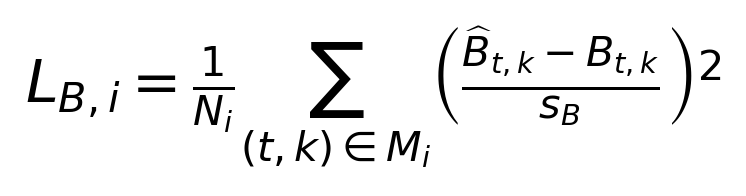

Equation 5. Normalized magnetic loss under original masks. Explicit and shared implementations retain their scales of approximately 104.114 and 99.095 µT; invalid readings are not measured zero fields.

The explicit model retains LB + LU + LC + 0.1 LR. Weak displacement and centre terms use a 0.5 mm scale; rotation compares direction matrices. The shared field uses LB + λU LU; the pure magnetic route sets λU=0 and reads no weak displacement labels. Measured fields are therefore not a renamed high-fidelity deformation label, but supervise unknown mappings through their physical state consequences.

The representations create different constraint structures: explicit magnetic loss directly constrains magnet states, while shared magnet motion and material queries use common parameters. This coupling supplies a computational basis for learning without a weak displacement teacher. Nevertheless, observations at finite magnet neighbourhoods are not independent measurements of every spatial point. The testable propositions are whether measured adaptation improves real-response explanation and whether the shared field can achieve such explanation without imitating the weak teacher examined.

### 2.5 Observation Space, State Priors and Supervision Reach

Let Gφ(z)=Hφ(K(z)) denote the composite state-to-response mapping. In a neighbourhood where the operator is differentiable and local states are valid, state and observation changes satisfy:

Equation 6. W selects eligible channels and mt is at most 15. This is a structural local-sensitivity bound, not an experimentally measured rank or condition number.

Finite observations permit a local null space in the ambient state domain. This bound concerns one time point and does not exclude additional constraints from history, shared parameters and priors. The method therefore learns an inverse relation constrained by representation and structure, rather than freely solving every node at each frame. With a fixed explicit readout, one linear head maps a 64-dimensional history representation into an affine state family of dimension at most 64. With fixed shared weights, one 32-dimensional condition generates every spatial query rather than independently fitting the points. Registered supports, individual-magnet shape preservation and common parameters further constrain admissible states. Measured learning identifies relations within these families that explain the device response, so complete deformation labels are not necessary to supply training signals.

Whether this constraint reaches displayed deformation depends on the actual graph. Absorbing the explicit fixed output scales into effective heads Wd and Wp gives:

Equation 7. Explicit magnetic loss has zero direct gradient on the ordinary displacement head, while updating common history through the pose head.

By the chain rule, LB reads only p, so ordinary displacement-head parameters receive no direct magnetic gradient. The common encoder receives gradients through Wp. The model jointly generates shape and pose, while ordinary displacement learning still requires weak geometry. This property explains the explicit source experiment: it tests measured adaptation of magnet-response relations, without extending the improvement into direct magnetic measurements of ordinary nodes.

For the shared field, let uP collect displacement at 175 probes and let Ψ construct centres and orientations:

Equation 8. Magnetic gradients update the shared displacement function and encoder through probe motion and pose construction.

Material display and physical probes call the same fθ, so the updated spatial parameters also determine deformation at positions not directly scored. Relative to an independent pose head, response explanation and spatial deformation occupy one parameter path, supplying supervision for pure magnetic training. This neither increases the number of sensors nor makes every point independently identifiable. Extension to unobserved regions remains determined by the learned function and structural prior. Complementarity follows from this supervision coverage, rather than direct ranking of error numbers.

### 2.6 Why Weak Geometry Requires Empirical Assessment

Generated geometry can organize a state while differing from actual device response. For common parameters, denote magnetic and weak-reference gradients by gB and gU. A first-order expansion of an ordinary gradient step yields:

Equation 9. The auxiliary-to-magnetic gradient inner product determines its first-order contribution to this step's observation objective.

Aligned gradients can assist observation learning, while a negative inner product weakens the corresponding descent direction. Proximity to a weak teacher therefore cannot be assumed to improve real-field explanation. The projected control follows multi-objective gradient treatment [11] on the originally specified shared parameters. AdamW momentum, preconditioning and finite steps mean the expansion is not a monotonic-descent guarantee for actual training. Pure magnetic, weak-reference and gradient-routing comparisons assess the design empirically; the symbolic expansion alone does not establish teacher performance.

## 3 Apparatus, Data Sources and Evaluation Protocol

### 3.1 Apparatus and Native Records

The platform combines a 5×5 cylindrical-magnet array embedded in silicone with five MLX90393 three-axis magnetic sensors. Nominal magnets are 5 mm in diameter and 1 mm thick, with 5 mm centre spacing. The board uses four outer sensing nodes and an offset centre node. The apparatus and earlier acquisition evidence are documented in the project repository [9], including 15.188 mm outer-node spacing and a 1.406 mm centre-node offset. The inverse models retain their registered, frozen layouts, magnetization and geometry mappings; nominal fabrication settings are not treated as independently measured constitutive constants.

A JGAURORA A5S Cartesian stage applies contact, while a CH341 I²C interface acquires the five magnetic units. Software retains fields, native timestamps, validity, unloaded baselines, actions and reset records, including original grouped trigger/read timing. Tip commands and geometry organize experiments and generate weak model references; they are not inverse-encoder inputs. Acquisition batches and historical magnetic layers retain their identities, since a common platform does not imply identical layers and assemblies.

The original shared-field collection contains 482 complete experimental sequences and 1343107 native frames, partitioned into 381 fitting and 101 development sequences across original round, hemisphere, small flat and a separate historical cone domain. The explicit route retains 459 records in three seen-shape domains, with 346 fitting, 16 internal monitoring and 97 development roles. Indentation, lateral motion and compound contacts produce response sequences without independent dense displacement labels. Repository [10] is the archival entry for explicit states, native replay and physical demonstration. Original roles and the reproduction scope of the joint-paper additions are mapped in supplementary material and the prepared archive.

Time increments retain native records rather than being reconstructed from video encoding rates. The main hemisphere sequence contains 3092 native points over 90.891 s, averaging approximately 34.0 groups/s. This example does not establish a fixed rate for all acquisition, and earlier repository noise/rate values are not imported as measurements of the present dataset.

### 3.2 Data Roles and Frozen Models

Complete sequences retain their original sources, roles, scales, baselines and validity. The explicit protocol includes 346 fitting sequences and 16 internal TRAIN weak-reference monitoring sequences; the shared field has 381 fitting sequences. Development and scoring scopes are given in Table 2. Both participate in original selection and are not sealed blind tests.

Table 2. Complete-sequence evaluation scopes

| Implementation | Fitting sequences | DEV sequences | Scored field scalars | Principal aggregation |
| --- | ---: | ---: | ---: | --- |
| Explicit node and magnet states | 346 | 97 | 3506865 | Pooled scalar RMSE |
| Shared continuous field | 381 | 101 | 3916620 | Equal-domain, equal-sequence RMSE; pooled metrics also reported |

Explicit development covers the seen small-flat, hemisphere and original-round domains, with 234195 native and 233791 jointly valid time points. The shared field also retains a historical cone domain, with 277348 native points. Masks and aggregation weights differ; joint reporting does not reconstruct an identical-denominator structural comparison.

Training uses original objectives and AdamW [5]. The explicit model follows model-reference pretraining with measured adaptation, selecting epoch 138 by complete development field metrics through epoch 160. Pure magnetic framewise shared learning selects epoch 529 by its original criterion through epoch 600. Four explicit source combinations adapt for five epochs from a common start; five shared arms use a common 274-epoch budget to test weak displacement references and temporal representation. Window bests and fixed ages are retained separately. Full curves, optimization settings and gradient routing are in the supplement; decreasing TRAIN loss or reaching an integer budget does not establish convergence.

Main deformation and replay use the same established hemisphere sequence and saved outputs. Spatial views retain four native times, physical XYZ proportions in mm and displacement magnification 1. Field figures retain complete native clocks and scoring gaps. The overview displays all 15 channels; residual detail uses the fixed Hall3 XYZ subset, and all channels enter aggregate evaluation. Replay fixes final weights and compares measurements directly with physical reconstruction, without gain, baseline or time-shift fitting. Identical native inputs and states execute the same causal inference in replay and online use.

## 4 Results

### 4.1 Compliant Deformation and Magnet Motion Driven by Observations

Figure 2 presents the complete state explanation chain: estimated body deformation and embedded magnets at upper left, the 25 magnet poses separately at upper right, and measurements with physical reconstruction for all 15 channels below. The cursor connects the three-dimensional state at 62.839 s to native responses, showing the deformation actually generated and the observations the state must explain.

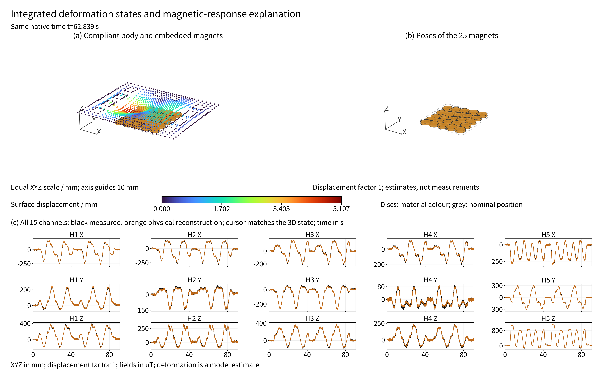

Figure 2. Integrated output of the explicit state model during hemisphere contact at native time 62.839 s. Surface colour denotes displacement magnitude in mm, magnet colour denotes material and grey outlines nominal locations. Black measurements and orange reconstruction retain all 15 complete native traces. XYZ proportions and displacement magnification 1 are retained without interpolation; the static state and trace cursor are synchronized.

Figure 3 presents the explicit implementation's principal output: magnetic history from real touching generates soft-surface displacement and 25 magnet states. Four times retain spatial proportions, view and magnification 1. Local deformation and internal array motion arise from one joint state, without commanded positions or tip geometry driving inverse inference.

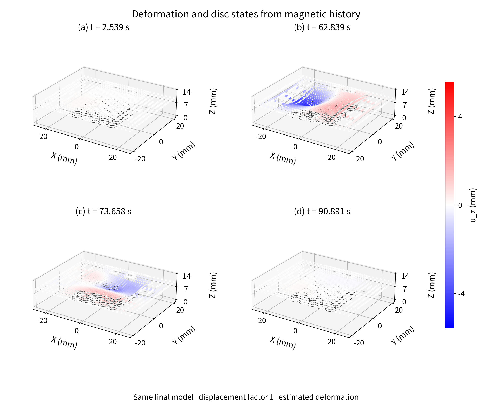

Figure 3. Explicit epoch-138 states of the established hemisphere sequence at 2.539, 62.839, 73.658 and 90.891 s. Grey denotes nominal geometry, colour estimated vertical displacement and outlines magnets from the same state. Existing saved-time selection, XYZ proportions, view, colour scale and magnification 1 are fixed. Estimated deformation is not calibrated displacement ground truth.

Figure 4 shows shared-field queries at the same sequence and times. Unlike separate readouts for ordinary displacement and pose, material and magnet motion belong to one function, so displayed deformation and local motion used for field calculation have common parameter origins. Without reading a weak displacement teacher, pure magnetic learning generates spatial states that can be checked through their response.

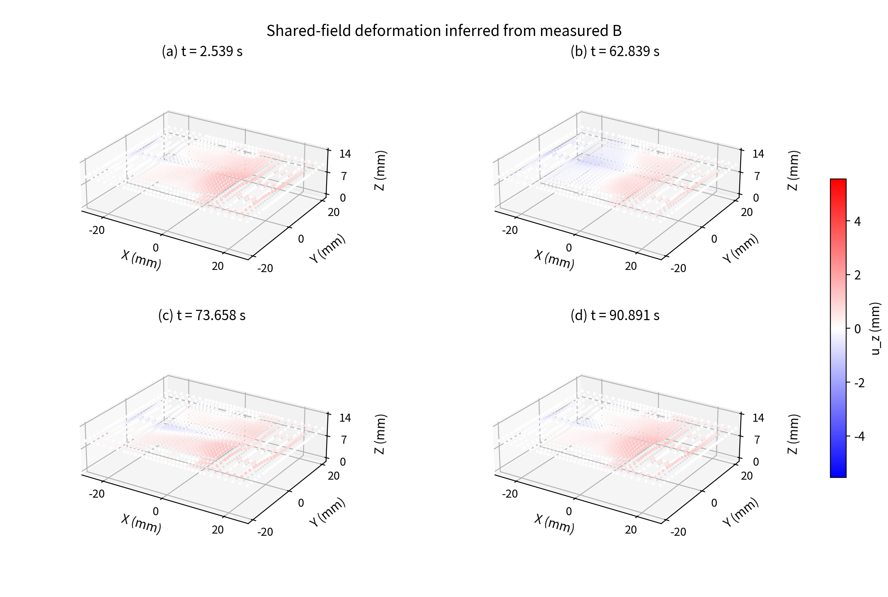

Figure 4. Estimated motion from the epoch-529 shared field at the sequence and times in Figure 3. Spatial queries and magnet motion derive from one field. Physical mm proportions and the displayed colour scale apply; queries are not fabricated by interpolation.

These results make compliant deformation and internal motion inspectable state outputs. The final explicit model is also used for physical pressing with online display, where actual interaction accompanies local deformation changes. This operation evidence appears in Supplementary Video V1 and the public demonstration, separately from the saved hemisphere sequence and aggregate replay denominator.

### 4.2 Real Magnetic Responses of the Same States and Aggregate Performance

Figure 5 connects both state outputs with measured fields, physical reconstruction and raw residuals from the same real record. Complete native traces check amplitude, sign and dynamic change; residuals retain unexplained response. Reconstruction derives from magnet motion through fixed physics, creating a prescribed dependency on the three-dimensional state rather than an independent free-field fit.

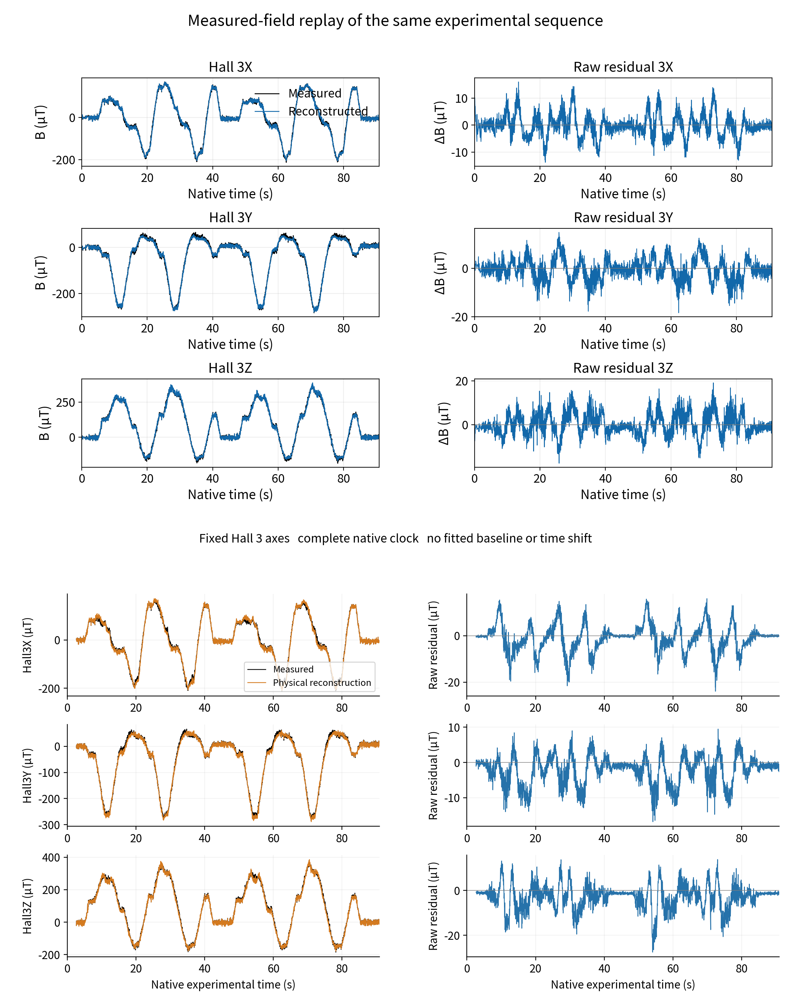

Figure 5. Hall3 XYZ replay of the sequence in Figures 3 and 4. Top: explicit states, with black measurements and blue reconstruction. Bottom: shared field, with black measurements and orange reconstruction. Native clocks and scoring gaps remain. Explicit has 3091 jointly valid times; shared has 3049 scored times per channel, so this is not an identical-denominator structural control. All 15 channels contribute to aggregate evaluation.

Table 3. Final-model field replay across each complete development set

| Implementation | Selected epoch | Sequences | Pooled RMSE µT | MAE µT | Absolute residual P95 µT |
| --- | ---: | ---: | ---: | ---: | ---: |
| Explicit node and magnet states | 138 | 97 | 4.139 | 2.440 | 8.577 |
| Shared continuous field | 529 | 101 | 4.034 | 1.811 | 7.838 |

The original shared equal-domain, equal-sequence metric is 2.822 µT; explicit macro-average sequence RMSE is 2.803 µT. These weights differ from pooling. Explicit pooled domain RMSE is 1.984 µT for small flat, 4.749 for hemisphere and 4.062 for original round. Shared within-domain equal-sequence metrics, full channel summaries and distributions are in the supplement, retaining aggregate tails. The shared display sequence has 15-channel pooled RMSE 5.567 µT, so the established display connects states and observations rather than substituting a lowest-error record for overall performance.

### 4.3 Measured Adaptation with Fixed Physical Structure

The explicit source experiment tests whether magnetic supervision adapts generated relations to a physical device. Four combinations retain the pretrained start, physical mapping, network and weak geometry, changing only input and reconstruction-target sources for five epochs, then evaluating the same 97 measured development sequences. Generated-input/generated-target RMSE is 13.636 µT. Replacing only the target or only the input yields 19.090 and 22.833 µT, respectively. Joint measured inputs and targets reach 9.144 µT, reducing error by 32.94% relative to all-generated continuation, with improvement in 87/97 sequences.

One-sided replacement does not achieve the same benefit, indicating that fixed structure requires joint adaptation of actual input and target relations. The comparison distinguishes physical structure from simply imitating generated references: model geometry organizes a state prior, whereas measured fields determine whether the learned relation fits the actual device.

### 4.4 Testing Weak Displacement Teacher Dependence in the Shared Field

The shared representation changes state-observation coupling and permits a further test of learning without weak displacement labels. Within a common 274-epoch budget, pure magnetic framewise and memory development bests are 3.784 and 3.846 µT. Weak framewise yields 6.266 µT, while two weak-memory variants yield 6.363 and 6.846 µT. Fixed common endpoints have the same direction; full matched-age values appear in Supplementary Table S1.

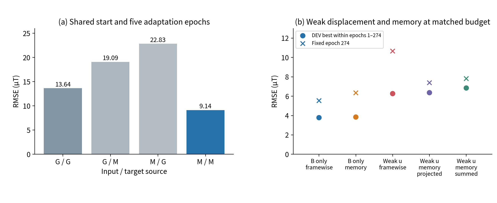

Figure 6. Explicit source comparisons (left) and shared-field weak-reference and temporal comparisons (right). Each panel retains its original start, data and common budget, testing measured adaptation and the teacher examined rather than ranking structures. Fixed endpoints and window bests are separate; category markers are not confidence intervals.

The result supports learning a state representation that explains actual magnetic responses without the weak displacement teacher examined. It complements explicit measured adaptation: the shared route changes representation coupling and removes the teacher; the explicit route fixes representation and priors while changing observation sources. Both point to one methodological interpretation: physics organizes interpretable structure, measured fields identify unknown relations, and state-generated responses test the learned result.

## 5 Discussion

The method does not make an exact inverse solution of high-fidelity material and contact mechanics a deployment prerequisite. Geometry, magnet motion and field mapping supply structure, while a network learns state relations from measured fields. Explicit source comparisons support measured adaptation beyond continuing to follow generated relations; shared learning additionally supports that the weak displacement teacher is not necessary for response explanation in the present configuration. Physical priors organize states and observations rather than pre-specifying every actual material-point motion.

The implementations differ in supervision coverage. Explicit ordinary displacement and magnet pose are separate outputs, and ordinary displacement retains weak geometry dependence. Shared motion and material queries use one function, so magnetic updates act on common spatial parameters. This improves representation coupling but does not establish high-dimensional uniqueness from finite magnetic observations alone. Deformation display, weak-reference proximity and field error address output form, prior consistency and physical observation explanation, respectively.

Conclusions retain their evidence scope. The main evaluations use exposed development sets; one seed does not establish statistical robustness, and frozen tip-holdout extensions retain response gaps detailed in the supplement. Without independent dense displacement ground truth or physical-parameter perturbation experiments, low magnetic residuals are not converted into volumetric millimetre accuracy or generalized to arbitrary coarse models and tips. Physical demonstration supports actual deformation display by the final explicit model; independent spatial references can further quantify accuracy.

## 6 Conclusion

We establish physical structure-guided magnetic supervision for deformation estimation, connecting real observations, unknown state relations and the physical response generated by a state. The method generates three-dimensional compliant states and internal magnet motion that can be checked against observations. Explicit node/magnet states and a shared continuous field provide complementary evidence through different structures and training routes: measured adaptation improves generated relations, and shared learning does not require a weak displacement teacher.

The final explicit model reaches pooled magnetic RMSE 4.139 µT across 97 complete sequences. The final shared field reaches equal-domain, equal-sequence RMSE 2.822 µT and pooled RMSE 4.034 µT across 101. Real deformation sequences, native replay of the same states and physical operation establish an executable state-learning route for soft magnetic bodies whose complete deformation is difficult to measure. Its scientific value lies in supervising and testing difficult-to-measure state relations through measurable physical responses.

## References

1. Bhirangi R, Hellebrekers T, Majidi C, Gupta A. ReSkin: versatile, replaceable, lasting tactile skins. PMLR 164:587–597, 2022. [Original paper](https://proceedings.mlr.press/v164/bhirangi22a.html).
2. Lin X, Lin G, Liu R, Wang A, Lou Y. MPM-based simulation and bounded-error compression of material points for magnetic tactile sensors. Frontiers in Robotics and AI 13:1817251, 2026. [Original paper](https://www.frontiersin.org/journals/robotics-and-ai/articles/10.3389/frobt.2026.1817251/full).
3. Cho K, et al. Learning Phrase Representations using RNN Encoder–Decoder for Statistical Machine Translation. EMNLP:1724–1734, 2014. [Original paper](https://aclanthology.org/D14-1179/).
4. Derby N, Olbert S. Cylindrical Magnets and Ideal Solenoids. American Journal of Physics 78:229–235, 2010. [Author manuscript and publication identifiers](https://arxiv.org/abs/0909.3880).
5. Loshchilov I, Hutter F. Decoupled Weight Decay Regularization. arXiv:1711.05101, revised 2019. [Author manuscript](https://arxiv.org/abs/1711.05101).
6. Church A, Lloyd J, Hadsell R, Lepora NF. Tactile Sim-to-Real Policy Transfer via Real-to-Sim Image Translation. PMLR 164:1645–1654, 2022. [Original paper](https://proceedings.mlr.press/v164/church22a.html).
7. Yuan W, Dong S, Adelson EH. GelSight: High-Resolution Robot Tactile Sensors for Estimating Geometry and Force. Sensors 17(12):2762, 2017. [Original paper](https://pmc.ncbi.nlm.nih.gov/articles/PMC5751610/).

8. Hou P, et al. SuperMag: Vision-based Tactile Data Guided High-resolution Tactile Shape Reconstruction for Magnetic Tactile Sensors. arXiv:2507.20002, 2025. [Original paper](https://arxiv.org/abs/2507.20002).

9. googo2025. MagTouch RA three-dimensional contact reconstruction: experimental apparatus and acquisition evidence. GitHub, accessed 2026-10-14. [Apparatus and source records](https://github.com/googo2025/MagTouch-RA-3d-trajectory-recon).

10. googo2025. Magnetic-history-driven deformation estimates, native replay and implementation companion. GitHub, accessed 2026-10-14. [Companion archive](https://github.com/googo2025/magtouch-temporal-state-reconstruction).

11. Yu T, Kumar S, Gupta A, Levine S, Hausman K, Finn C. Gradient Surgery for Multi-Task Learning. NeurIPS, 2020. [Original paper](https://arxiv.org/abs/2001.06782).
