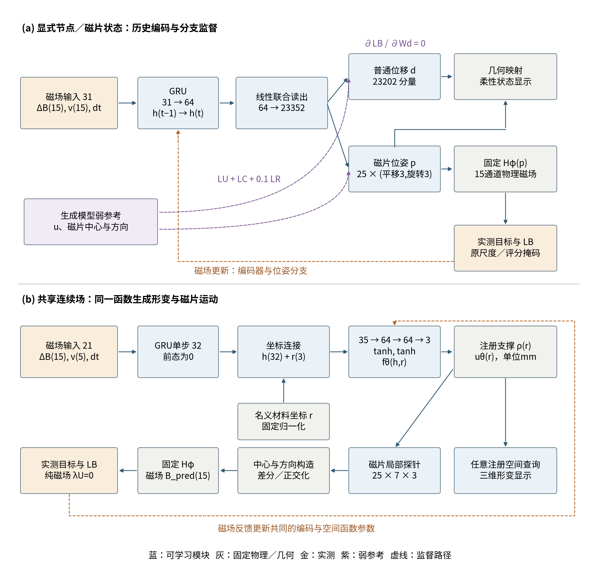
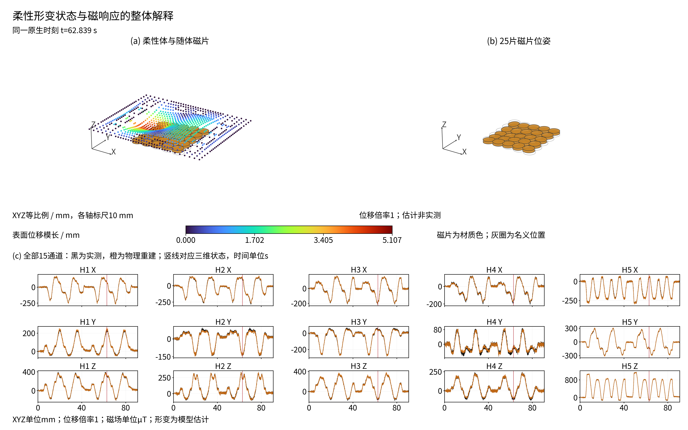
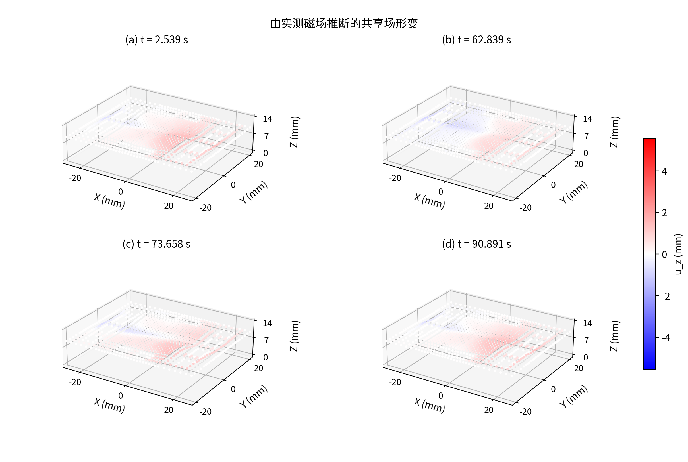
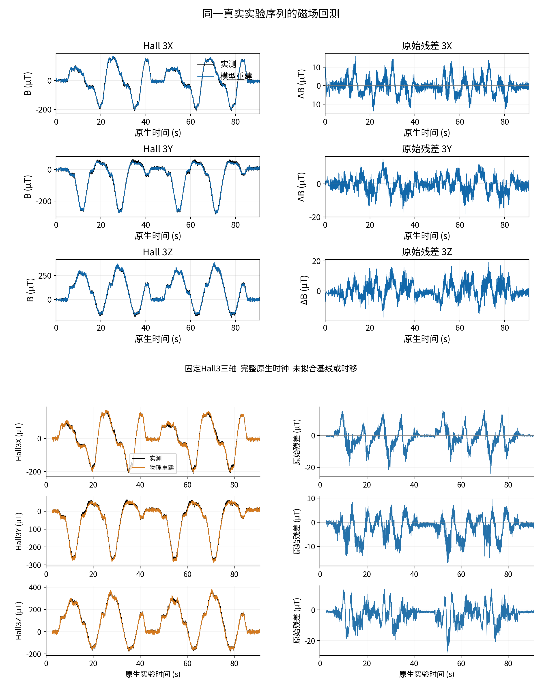
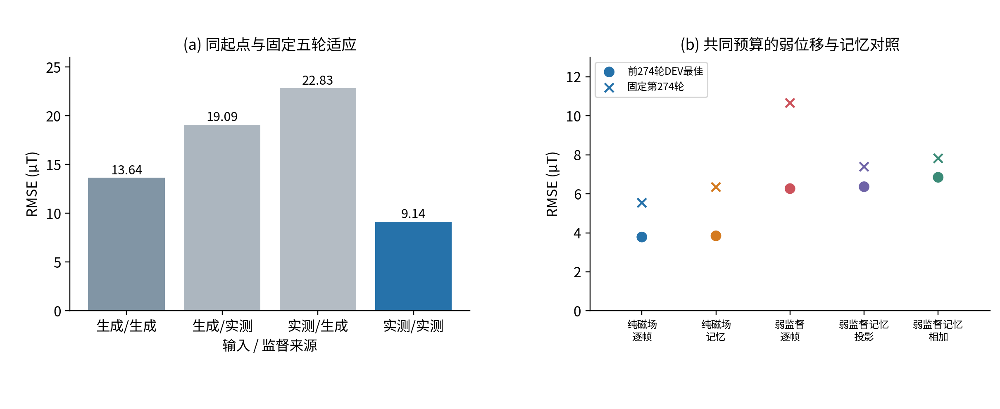

# 物理结构引导的磁场监督柔性形变估计

## 摘要

柔性磁触觉需要从稀疏磁场观测中恢复随触碰变化的高维柔性状态，而接触遮挡和内部运动使完整动态形变标签难以获得。本文提出物理结构引导的磁场监督方法：几何与磁场模型规定状态到观测的结构，神经网络学习未知的磁场到状态关系，实测磁场通过预测状态产生的磁响应监督这一关系。方法不以高保真材料与接触模型的精确逆解为前提，推理不需要触头命令、身份或CAD。显式节点与磁片状态模型保留弱几何参考，由实测磁场辨识磁片运动；共享连续位移场进一步由同一函数导出材料位移与磁片运动，使观测反馈更新共同的空间表示。真实实验序列展示了三维柔性形变、磁片运动及对应的原生磁场重建。最终显式模型在97条完整开发序列上的池化磁场RMSE为4.139 µT、MAE为2.440 µT；最终共享场无需弱位移教师，在101条完整开发序列上的等域等序列RMSE为2.822 µT、池化RMSE为4.034 µT。固定起点的来源对照支持联合实测适应，共享场组件对照支持不依赖所用弱位移教师的学习。两种状态结构与训练路径共同支持以可测磁响应学习难测形变状态的方法，三维状态的实际输出与磁场观测一致性分别构成形变效果和物理解释证据。

关键词：磁场监督；柔性磁触觉；时序形变估计；物理结构；实测适应；连续位移场。

## 1 引言

柔性磁触觉通过软材料内磁性单元的运动产生可读磁场，因此能够在不透明封装和受遮挡接触中感知触碰[1]。其核心困难是从少量Hall通道恢复随时间变化的高维柔性状态：触头中心轨迹不能描述柔性体的局部形变，单块磁片位姿也不能代表整个磁片阵列与硅胶的运动。本文关注仅使用可部署磁观测，生成三维柔性形变和随体磁片状态，并使这些状态接受真实观测检验的问题。

将高保真物理仿真的精确逆解作为部署前提，会将材料参数、接触条件及模型与实物之间的差异都推到前期建模阶段。本文采用物理结构与实测学习的分工：固定模型保留器件几何、磁片运动及磁场观测关系，网络参数化尚未知的磁场到状态映射；模型几何可以作为弱参考，实测磁场则承担关系辨识与观测约束。已有磁场到模拟形变表示的映射[2]和触觉仿真迁移[6]为学习提供参考，但接近生成表示与解释真实器件是不同要求。本文将预测状态接入固定物理磁场读出，直接以实测响应约束其解释。

完整真实形变的测量需要明确空间覆盖。触头遮挡接触区，Hall板和支撑限制背面观测，外表面测量也不自动给出内部材料点对应。专用光学结构[7]或配对光磁模块[8]能够建立相应空间参考，但本器件原装配没有完整逐节点动态真值。磁场监督利用形变产生的可测后果学习未知关系，而不把完整形变标签作为唯一训练前提。形变时序展示体现估计器实际生成的状态，磁场回测检验状态是否解释真实信号，二者具有明确的分工。

状态表示决定磁场约束怎样作用于形变。为检验这一方法，本文采用两条互补实现：显式节点与磁片状态保留几何弱参考，通过输入和监督来源对照检验生成关系的实测适应；共享连续位移场把材料位移与磁片运动连接到同一空间函数，通过组件对照检验无需弱位移教师的学习。研究的共同贡献是建立物理结构、实测关系辨识与状态磁响应检验相衔接的形变估计方法，两条路线分别为实测适应和表示耦合提供证据。

## 2 磁场监督的形变估计方法

### 2.1 物理结构与未知状态关系

五个三轴Hall单元提供15通道磁场，25块嵌入磁片的运动改变这些读数。名义柔性网格包含13010个节点，磁片直径5 mm、厚度1 mm。单片采用形状保持近似，不将硅胶或整个阵列视为刚体。关系网络Fθ估计状态z，几何映射K将其转换为磁片运动，固定磁场算子Hφ计算相应观测。

式1 磁场输入、柔性状态与物理磁响应的共同路径。v为有效标记，Δt为原生间隔，参考相减沿原基线与注册定义。

物理读出在每片局部坐标系中计算有限圆柱磁场，按预测姿态变换后叠加到五个Hall位置；厚度方向24点求积与椭圆积分沿原实现保留[4]。器件坐标、磁化和参考相减是已注册结构，机械响应的未知关系则由网络辨识。

Fθ可以使用因果磁场历史或当前帧表示，Hφ只能读取状态导出的磁片运动。器件几何、Hall布局和磁化定义提供已知结构，未知材料与装配响应通过状态关系学习适应实物。各实现保持其原磁场映射，冻结物理参数而保留对状态的导数[4]；它们不共享权重，也不要求在线求解高保真接触逆问题。没有绕开形变状态的自由磁场输出头，因此减小重建误差必须通过状态改变产生磁响应变化。

### 2.2 显式节点与磁片状态

显式实现沿用联合状态结构。15个归一化磁场、15个有效标记及dt构成31维输入，64维GRU[3]编码历史。读出23352维状态，其中23202维为普通节点自由位移，150维为25片各自的平移和旋转；每片所属节点共享形状保持变换。位移使用mm，旋转使用rad与原固定缩放。序列开始、重置或基线身份改变时清除历史状态。

普通位移与磁片运动接受模型弱几何参考，磁场直接依赖磁片位姿p：

式2 显式状态q包含普通位移d和磁片位姿p；普通位移不直接进入磁场算子。

该依赖区分了两类监督的作用。磁场反馈辨识能够解释实际响应的磁片运动，普通节点几何则仍受弱参考与共享编码约束。普通位移与磁片位姿来自同一联合状态，但低磁场误差不等于全部普通节点受到直接磁场监督。显式实现由此提供物理先验不变时，生成状态关系能否通过实测适应改进的可检验路径。

### 2.3 共享连续位移场

共享实现用一个坐标条件化函数生成三维位移，磁片中心和局部方向均由这个函数导出，不设置独立磁片位姿头。15个磁场、5个传感器有效标记和dt形成21维输入；32维表示与名义坐标连接，空间网络采用35→64→64→3结构及tanh激活。

式3 同一位移函数生成材料点运动及磁片中心。r为名义材料坐标，ρ提供注册固定面的支撑约束。

每片中心及六个轴向探针形成局部查询，25片共175个物理探针；中心差分得到位移变化，变形轴经正交化构成磁片方向：

式4 由局部位移变化计算磁片方向，保持原探针间距、支撑与合法状态约束。

当注册固定面上ρ=0时，uθ=0对任意网络参数成立；当两条局部变形轴非退化时，正交化与叉积保证RᵀR=I、detR=1。因此，固定面约束和单片合法方向由状态构造直接满足，无需以额外实测位移标签学习。该性质针对注册边界与局部磁片运动，不将空间网络等同于完整材料本构或接触求解器。

空间查询与磁片运动依赖同一组参数，磁场梯度因而更新同时用于形变显示的函数。记忆版本沿序列递推，逐帧版本每帧从零隐藏态执行一步编码；后者仍输入dt，有效参数8867个，记忆版本11939个。时间对照包含容量差异，检验的是当前时间表示配置。最终共享实现采用纯磁场逐帧版本。

图1 两种真实实现的网络、状态构造与监督路径。(a) 历史GRU和联合读出生成普通位移与磁片位姿，磁场只直接依赖位姿分支；(b) 最终共享场逐帧编码与坐标网络生成同一位移函数，探针运动构造磁片位姿后读出磁场。蓝色可学习，灰色固定物理与几何，金色实测，紫色弱参考；虚线示意监督依赖。原生基线、重置和有效性处理在网络外沿合同执行。

表1 两种实现的网络与状态结构

| 实现 | 输入与编码 | 状态构造 | 可学习参数 |
| --- | --- | --- | ---: |
| 显式节点／磁片状态 | 31维输入；GRU64 | 64→23352联合头；普通位移＋25片位姿 | 1536504 |
| 共享场 记忆对照 | 21维输入；GRU32 | 坐标连接35维；35→64→64→3 | 11939 |
| 共享场 最终逐帧 | 21维输入；零前态GRU32单步 | 同一空间网络；固定3072个历史权重 | 8867 |

参数数由真实层维度确定；固定场映射和几何缓冲不计入可学习网络参数。共享场记忆与逐帧的容量不同，比较结果不被当作纯粹等容量的时间因果实验。

### 2.4 实测监督与弱几何参考的分工

原评分集合Mi含Ni个有效磁场标量，磁场目标为：

式5 原掩码内的归一化磁场损失。显式与共享实现分别保留其原尺度，约104.114与99.095 µT；无效读数不视为实测零场。

显式模型保留LB + LU + LC + 0.1 LR，其中普通位移与中心弱参考使用0.5 mm尺度，旋转项比较方向矩阵。共享场使用LB + λU LU，纯磁场路线取λU=0且不读取弱位移标签。实测场因此不是对高保真形变标签的替代命名，而是通过状态的物理后果训练未知映射。

两种表示形成不同的约束结构：显式磁场项直接约束磁片状态，共享场的磁片运动与材料查询共用参数。后一耦合为无需弱位移教师的形变表示提供计算基础，但有限磁片邻域的观测仍不是每个空间点的独立测量。方法的可检验命题分别是实测适应是否改善真实磁响应解释，以及共享场是否能在不模仿所用弱教师时完成这种解释。

### 2.5 观测空间、状态先验与监督可达性

令Gφ(z)=Hφ(K(z))为状态到磁响应的复合映射。在物理映射可微且局部状态合法的邻域，状态变化与观测变化满足一阶关系：

式6 W表示当时可评分通道，mt不超过15。此为局部灵敏度的结构界限，不是本实验测得的秩或条件数。

有限磁观测在未限制的状态空间中允许局部零空间。该界限针对单一时点，不排除历史信息、共享参数及先验提供更多约束。因此，本方法不是逐帧自由求解全部节点，而是学习受表示与结构约束的逆向关系。固定显式读出时，状态由64维历史表示通过同一个线性头生成，位于至多64维的仿射族；固定共享网络时，各空间点由同一32维条件表示生成，而非各自独立拟合。注册支撑、单片形状保持及共同参数进一步限制允许状态。实测学习在这些状态族内寻找能够解释器件响应的关系，完整形变标签因而不是提供训练信号的必要条件。

这种约束能否作用于显示的形变，取决于实际计算图。将显式固定输出缩放吸收入有效头Wd与Wp，可写为：

式7 显式磁场损失对普通位移头的直接梯度为零，但会通过位姿头更新共同历史表示。

由链式法则，LB只读取p，所以普通位移头的参数不接受直接磁场梯度；共同编码则接收经Wp传递的梯度。模型可以联合输出形变与位姿，但普通位移学习仍需几何弱参考。这一结构性质解释了显式来源实验的作用：它检验实测适应如何改进磁片响应关系，不把改进扩大为普通节点的直接磁测量。

共享场将175个探针处的位移记为uP，中心和方向构造记为Ψ，则：

式8 磁场梯度经探针运动与位姿构造更新共享位移函数及编码器。

材料显示与物理探针调用同一fθ，因此式8更新的空间参数也决定未直接评分位置的形变。相比独立位姿头，这个设计将磁响应解释和空间形变放在共同参数路径上，为纯磁场训练提供监督通道。它并不增加传感器数量，也不使所有空间点独立可辨识；连续场在未直接观测区域的延伸仍由所学函数和结构先验决定。两条路线的互补性来自监督覆盖的这一差别，而不是误差数字的直接排名。

### 2.6 弱几何参考为何需要实验检验

物理生成的弱几何参考可以组织状态，却可能与真实器件响应存在偏差。对共同参数记磁场梯度gB、弱参考梯度gU，普通梯度步的一阶展开为：

式9 辅助梯度与磁场梯度的内积决定其对该步观测目标的一阶作用。

当gB与gU同向时，弱参考可以辅助观测目标；当内积为负时，辅助项会削弱相应下降方向，因此不能预设接近弱教师必然改善真实磁场解释。投影对照参考多目标梯度处理[11]，在原指定共享参数上处理冲突分量；AdamW的动量、预条件和有限步长使上述分析不构成实际训练单调下降保证。本文通过纯磁场、弱参考及梯度路由对照检验这一设计选择，而不由理论展开单独判定所用教师的效果。

## 3 实验装置、数据来源与评价协议

### 3.1 实验装置与原生数据

实验平台采用硅胶基体中的5×5圆柱磁片阵列和五颗MLX90393三轴磁传感器。磁片名义直径5 mm、厚度1 mm、中心间距5 mm；读出板为四角与偏置中心的五点布局。装置和早期采集证据由项目仓库[9]提供，其中记录四角间距15.188 mm及中心节点1.406 mm偏置。本文逆向模型沿各分支已注册并冻结的布局、磁化与几何映射，不把名义制造参数当成独立测得的材料本构常数。

JGAURORA A5S笛卡尔运动平台施加触碰，CH341 I²C接口采集五路磁场。采集软件保存磁场、原生时间戳、有效性、无载基线、动作与重置记录；磁场组触发和读取的时序沿原日志保留。触头命令和几何用于组织实验及生成模型弱参考，不进入逆向编码器。不同采集批次及历史磁层保持各自身份，使用同一平台不意味着所有磁层和装配完全相同。

共享场原集合包含482条完整实验序列、1343107个原生帧，分为381条拟合与101条开发，覆盖原圆、半球、小平头及独立历史锥头域。显式路线使用其中三个已见形状域的既定459条记录，另按346拟合、16内部监测和97开发保持角色。定点压入、横向运动及复合触碰形成磁响应序列；没有独立稠密位移标签。本文的显式状态、原生回测及实物运行伴随资料存档入口为[10]；原始数据角色和本论文新增结果的复现范围在补充材料与上传包中对应说明。

时间间隔使用原生记录，不按视频编码帧率重构磁场时钟。主文半球序列为3092原生时点、90.891 s，平均约34.0组/s；这一示例不被当作全部采集的固定频率，也不借用早期仓库的噪声或速率数值作为本数据的新测量。

### 3.2 数据角色与模型冻结

划分以完整实验序列为单位，保持各自来源、角色、尺度、基线和有效标记。显式协议包含346条拟合及16条TRAIN内部弱参考监测；共享场包含381条拟合。开发序列与评分范围见表2，均已参与原选模，不称封存盲测。

表2 两条实现的完整序列评价范围

| 实现 | 拟合序列 | 开发序列 | 评分磁场标量 | 主要汇总 |
| --- | ---: | ---: | ---: | --- |
| 显式节点与磁片状态 | 346 | 97 | 3506865 | 全标量池化RMSE |
| 共享连续位移场 | 381 | 101 | 3916620 | 等域等序列RMSE，并列池化指标 |

显式开发范围覆盖小平头、半球和原圆三个已见域，共234195原生时点、233791共同有效时点。共享场另保留历史锥头域，共277348原生时点。两协议的掩码和聚合权重不同，联合报告不将其重新构造成同分母结构比较。

训练采用原目标与AdamW[5]。显式模型参考预训练后进行实测适应，最终按截至160轮的完整开发磁场指标选定第138轮；共享纯磁场逐帧按截至600轮的原开发指标选定第529轮。显式四个来源组合从共同起点各适应五轮，共享五臂以共同274轮预算检验弱位移参考与时间表示，最佳窗口与固定年龄结果分别保留。完整曲线、优化设置和梯度路由在补充材料中给出，不由训练损失下降或整数预算宣称充分收敛。

主文形变与回测沿同一既定半球序列和保存输出。空间图使用四个原生时刻、统一XYZ毫米比例及位移倍率1；磁场图保留完整原生时钟与评分断线，总览显示全部15通道，残差细节固定显示Hall3三轴；全部通道参与总体评价。回测固定最终权重，直接比较实测与物理重建，不拟合增益、基线或时移。原生输入和状态相同时，回测执行与在线是同一因果推理。

## 4 结果

### 4.1 磁观测驱动的柔性形变与磁片运动

图2首先给出整个状态解释链条：左上是估计柔性体及随体磁片，右上单独显示25片磁片位姿，下方为同一完整序列的全部15通道实测与物理重建。竖线把62.839 s的三维状态连接到原生磁响应，直观呈现本方法实际生成的形变以及该状态必须解释的观测。

图2 显式状态模型在半球触碰序列62.839 s的整体输出。表面颜色为位移模长mm，磁片颜色为材质，灰色轮廓为名义位置；黑色实测、橙色重建，15通道原生波形完整保留。XYZ等比例，位移倍率1，不插值；静态图的时刻与场曲线游标同步。

图3呈现显式实现的主要输出：真实触碰序列的磁场历史被转换为柔性表面位移和25块磁片状态。四个时刻保持空间比例、视角及倍率1，局部形变和内部阵列运动均由同一联合状态产生，不使用触头命令或触头几何驱动逆向推理。

图3 显式第138轮在既定半球序列2.539、62.839、73.658和90.891 s的三维状态。灰色为名义几何，颜色为估计垂直位移，轮廓为同一状态的磁片。四时刻沿原保存选择，XYZ比例、视角、色标及倍率1固定；估计形变不等同于已标定的位移真值。

共享场在相同序列和时刻给出图4的空间查询。与分别读出普通位移和位姿的显式结构相比，材料位移和磁片运动在这里属于同一个函数：用于显示的形变与用于磁场计算的局部运动具有共同参数来源。纯磁场训练不读取弱位移教师，仍能产生空间状态并接受磁响应核对。

图4 第529轮共享场在图3同一序列和时刻的估计运动。空间查询与磁片运动来自同一场，按真实mm比例及图中色标读取，不插值补造查询。

这些结果使柔性形变及内部运动成为可检查的状态输出。最终显式模型进一步用于实物按压和在线显示，视频中实际触碰伴随局部形变变化；该运行证据见补充视频V1及公开演示，不混入保存半球序列或总体回测分母。

### 4.2 同一状态的真实磁响应与总体效果

图5将两种状态输出与同一真实记录的实测磁场、物理重建及原始残差联系起来。完整原生波形核对幅值、符号和动态变化，残差体现未解释部分。重建由磁片运动经固定场模型产生，因此与三维状态存在规定的物理依赖，而不是另一个自由磁场拟合结果。

图5 与图3、4相同序列的Hall3三轴回测。上为显式状态：黑色实测、蓝色重建；下为共享场：黑色实测、橙色重建。原生时钟和评分断线保留，显式共同有效3091时点，共享每通道评分3049时点，故不视为同分母结构对照。全部15通道进入总体评价。

表3 最终模型在各自全部开发序列上的磁场回测

| 实现 | 选定轮次 | 序列数 | 池化RMSE µT | MAE µT | 绝对残差P95 µT |
| --- | ---: | ---: | ---: | ---: | ---: |
| 显式节点与磁片状态 | 138 | 97 | 4.139 | 2.440 | 8.577 |
| 共享连续位移场 | 529 | 101 | 4.034 | 1.811 | 7.838 |

共享场原等域等序列指标为2.822 µT；显式等权序列RMSE宏平均为2.803 µT，权重与上述池化不同。显式三个域的池化RMSE分别为小平头1.984、半球4.749、原圆4.062 µT。共享域内等序列指标以及全部通道、序列分布见补充材料，保留总体尾部。共享场展示序列的15通道池化RMSE为5.567 µT，主图据既定序列连接状态与观测，而非以最低误差替代总体效果。

### 4.3 固定物理结构下的实测适应

显式来源实验检验磁场监督能否使生成关系适应实物。四组合保持同一预训练起点、物理映射、网络和几何弱参考，五轮预算内仅改变输入与重建目标来源，并在相同97条实测开发序列评价。全生成组合RMSE为13.636 µT；仅替换目标和仅替换输入分别为19.090和22.833 µT；联合实测输入与实测目标降为9.144 µT，相对全生成降低32.94%，87/97条序列改善。

单侧替换没有取得相同收益，说明固定物理结构需要与实际输入和目标关系共同适应。这个对照把物理结构的作用与仅模仿生成参考区分开来：模型几何提供组织状态的先验，真实磁场则判断所学关系是否适合实际器件。

### 4.4 共享场对弱位移教师依赖的检验

共享场改变了状态与观测的耦合，因而可以进一步检验没有弱位移标签的学习。共同274轮预算内，纯磁场逐帧和记忆的开发最佳RMSE分别为3.784与3.846 µT，弱位移逐帧为6.266 µT，两种弱监督记忆为6.363和6.846 µT。固定共同终态具有相同方向，完整同龄数值见补充表S1。

图6 显式来源对照（左）与共享场的弱参考、时间表示对照（右）。两个面板各保留原起点、数据和共同预算，分别检验实测适应与所用教师依赖，不构成跨结构排行榜；固定终态与窗口最佳分列，类别点不是置信区间。

该结果支持共享场无需所用弱位移教师，也能学习解释真实磁响应的状态表示。它与显式实测适应实验相互补充：前者改变表示耦合并去掉弱教师，后者固定表示与先验、改变观测来源。两条路径指向同一方法判断——物理模型组织可解释结构，实测磁场辨识未知关系，状态产生的磁响应检验学习结果。

## 5 讨论

本方法不以高保真材料与接触模型的精确逆解为部署前提。器件几何、磁片运动和场映射提供结构，网络从真实磁场学习状态关系。显式来源对照支持实测适应可以修正继续遵循生成关系的不足；共享场进一步支持弱位移教师不是当前磁响应解释的必要条件。物理先验在这里承担的是组织状态与观测的作用，而非预先给出所有真实材料点运动。

两条实现的意义在于不同的监督覆盖。显式普通位移与磁片位姿分别输出，普通位移仍依赖弱几何参考；共享场让磁片运动和材料位移使用同一函数，磁场更新作用于共同空间参数。该联系增强表示的一致性，但不能由有限磁观测单独推出高维状态唯一。形变显示、弱参考接近度和磁场误差分别对应输出形态、先验一致性和实物观测解释，不互相替代。

结果保持在实际证据范围内：两主评价为已暴露开发集，单种子不构成统计稳健性；冻结触头留出扩展仍存在磁场解释差距，详见补充材料。没有独立稠密位移真值或物理参数扰动实验，不将低磁场残差换算为全体积毫米精度，也不推广任意粗模型或任意触头的可靠性。实物演示支持最终显式模型的实际形变显示，独立空间参考可进一步量化其准确性。

## 6 结论

本文建立了物理结构引导的磁场监督形变估计方法，将真实磁观测、未知状态关系和状态的物理磁响应连接起来，实现三维柔性状态及内部磁片运动的生成与观测核对。显式节点／磁片状态和共享连续位移场通过不同结构与训练路径提供互补证据：实测适应改进生成关系，共享场支持无需弱位移教师的学习。

最终显式模型在97条完整序列上取得4.139 µT池化磁场RMSE；最终共享场在101条上取得2.822 µT等域等序列RMSE和4.034 µT池化RMSE。真实形变时序输出、同一状态的原生磁场回测及实物运行表明，这一方法为难以直接测量完整形变的柔性磁体提供了可执行的状态学习路径，其科研价值在于用可测物理响应监督并检验难测状态关系。

## 参考文献

1. Bhirangi R, Hellebrekers T, Majidi C, Gupta A. ReSkin: versatile, replaceable, lasting tactile skins. PMLR 164:587–597, 2022. [论文原始来源](https://proceedings.mlr.press/v164/bhirangi22a.html)。
2. Lin X, Lin G, Liu R, Wang A, Lou Y. MPM-based simulation and bounded-error compression of material points for magnetic tactile sensors. Frontiers in Robotics and AI 13:1817251, 2026. [论文原始来源](https://www.frontiersin.org/journals/robotics-and-ai/articles/10.3389/frobt.2026.1817251/full)。
3. Cho K, et al. Learning Phrase Representations using RNN Encoder–Decoder for Statistical Machine Translation. EMNLP:1724–1734, 2014. [论文原始来源](https://aclanthology.org/D14-1179/)。
4. Derby N, Olbert S. Cylindrical Magnets and Ideal Solenoids. American Journal of Physics 78:229–235, 2010. [作者稿与出版标识](https://arxiv.org/abs/0909.3880)。
5. Loshchilov I, Hutter F. Decoupled Weight Decay Regularization. arXiv:1711.05101, revised 2019. [作者稿](https://arxiv.org/abs/1711.05101)。
6. Church A, Lloyd J, Hadsell R, Lepora NF. Tactile Sim-to-Real Policy Transfer via Real-to-Sim Image Translation. PMLR 164:1645–1654, 2022. [论文原始来源](https://proceedings.mlr.press/v164/church22a.html)。
7. Yuan W, Dong S, Adelson EH. GelSight: High-Resolution Robot Tactile Sensors for Estimating Geometry and Force. Sensors 17(12):2762, 2017. [论文原始来源](https://pmc.ncbi.nlm.nih.gov/articles/PMC5751610/)。

8. Hou P, et al. SuperMag: Vision-based Tactile Data Guided High-resolution Tactile Shape Reconstruction for Magnetic Tactile Sensors. arXiv:2507.20002, 2025. [原始论文](https://arxiv.org/abs/2507.20002).

9. googo2025. MagTouch RA three-dimensional contact reconstruction: experimental apparatus and acquisition evidence. GitHub, accessed 2026-10-14. [装置与源记录](https://github.com/googo2025/MagTouch-RA-3d-trajectory-recon).

10. googo2025. Magnetic-history-driven deformation estimates, native replay and implementation companion. GitHub, accessed 2026-10-14. [本文伴随资料入口](https://github.com/googo2025/magtouch-temporal-state-reconstruction).

11. Yu T, Kumar S, Gupta A, Levine S, Hausman K, Finn C. Gradient Surgery for Multi-Task Learning. NeurIPS, 2020. [原始论文](https://arxiv.org/abs/2001.06782).
