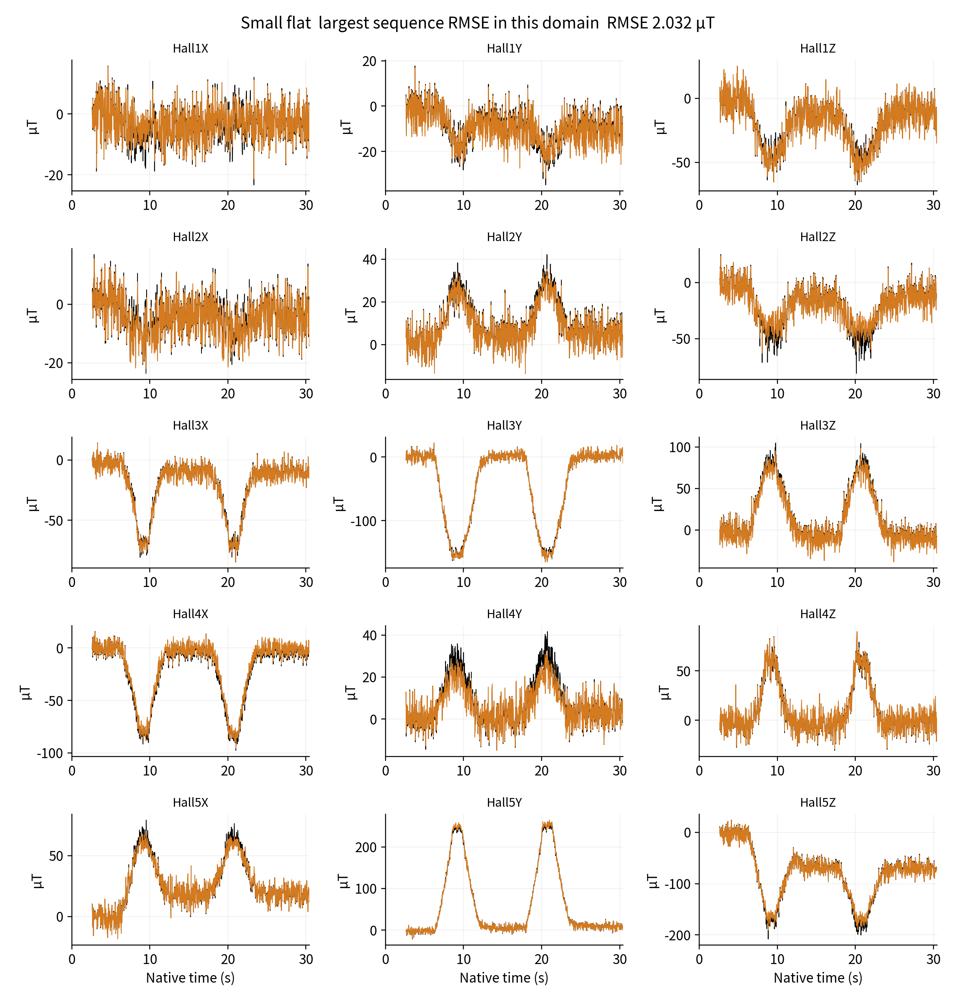
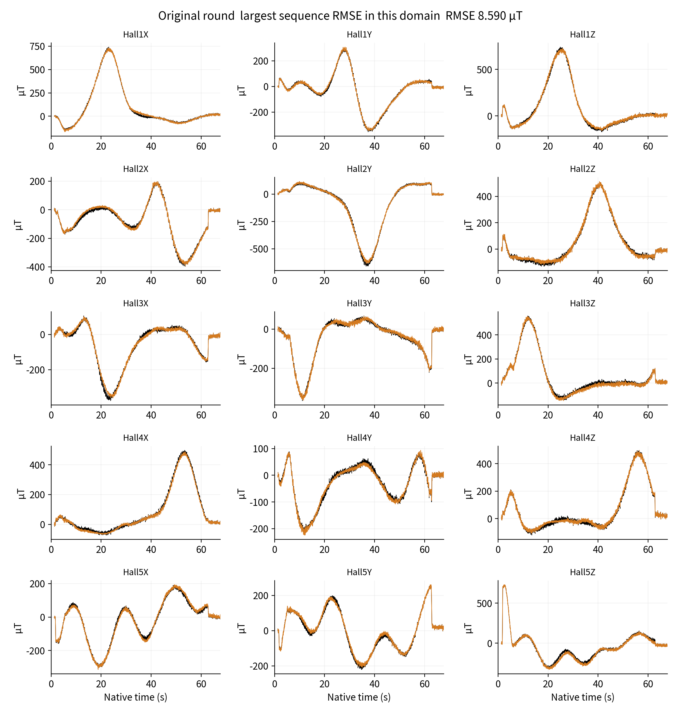
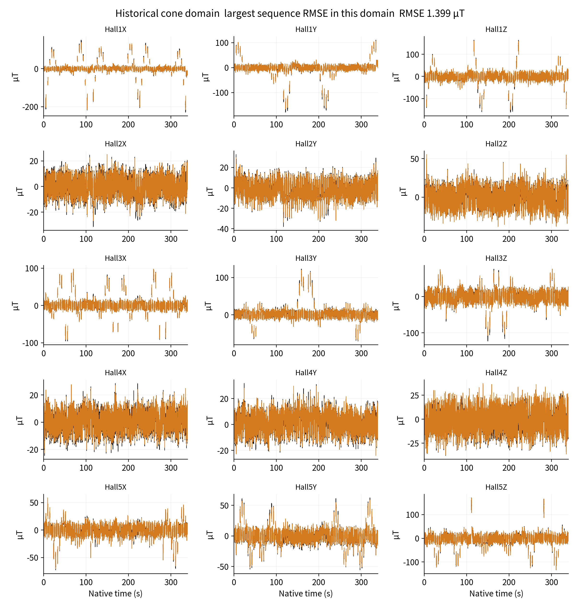
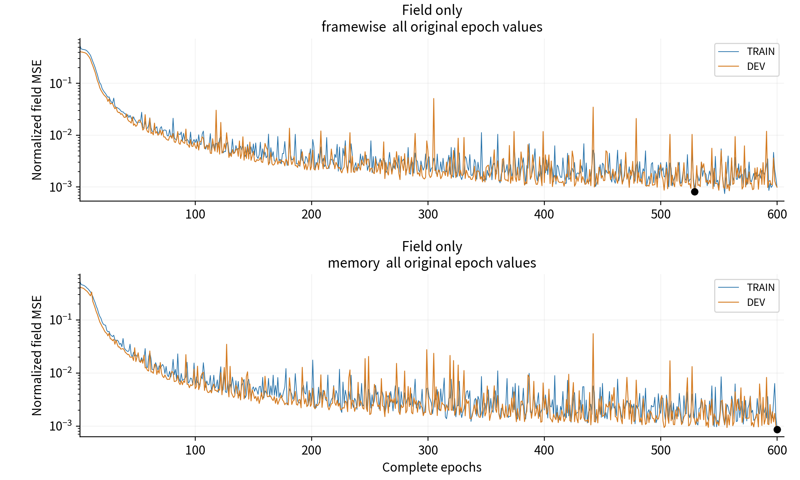
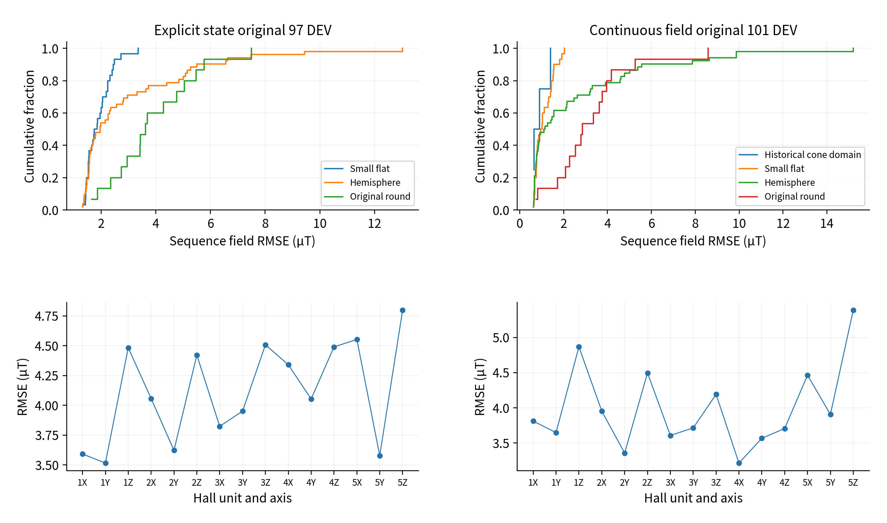

# Supplementary experiments and reproducibility protocols for magnetic supervision

## S1 Matched training budgets and learning histories

The main component comparison uses 274 complete epochs for all five arms, or 104394 sequence updates per arm. A window best is the smallest original DEV field MSE within epochs 1–274, while the fixed state is epoch 274. Both are retained rather than conflated. Sequence ordering, scales and one update per complete sequence remain unchanged. Component comparisons retain the common budget; the final model weights selected from extended learning are reported separately.

Supplementary Figure S1. Every DEV normalized field-MSE point within the common 1–274 epoch window. Spikes are retained without smoothing, removal or interpolation. Legend names describe supervision and temporal representation rather than internal run identifiers.

Complete field-only TRAIN and DEV histories through epoch 600 appear in Supplementary Figure S6. The selected minima are framewise epoch 529 and memory epoch 600. Reaching 600 closes the current budget and is not a mathematical convergence proof. TRAIN summarizes the changing weights within an epoch; DEV evaluates fixed weights at its end. Weak auxiliary totals are not mixed into field curves, and line separation is not a same-weight generalization gap.

## S2 Supervision and gradient paths

The explicit objective is LB + LU + LC + 0.1 LR. LU and LC compare ordinary displacement and magnet centers against model-generated weak references with a 0.5 mm scale; LR compares rotation matrices. The shared-field objective is LB + λU LU, with λU zero or one; field-only arms do not read weak u. Current inverse stages freeze H and reference source G and update only declared relation-network parameters, without simultaneously freeing independent calibration and inverse-network parameters.

For recurrent shared parameters, projected weak feedback is gU − [(gB·gU)/||gB||²]gB when gB·gU<0 and ||gB||²>0; otherwise it retains gU. The addition control retains the original gradient components, and spatial weak-reference feedback follows the implementation. This borrows multi-objective gradient handling without guaranteeing monotonic field loss under finite steps and AdamW preconditioning.

Explicit-state source adaptation starts from a common model-reference pretrained state. The source network can use commands and geometry to generate weak references, but these do not enter inverse deployment inputs. The 23202 ordinary displacement dimensions are not all directly supplied to H; the magnetic operator directly uses the 150 pose components of 25 magnets.

The shared representation queries one function at 175 physical probes and valid nominal material points. Distance support, central differences and orthogonal-axis construction retain their registered definitions, with nonfinite and invalid local states rejected. Dense queries share this function, but finite observations do not provide independent truth for every queried point.

## S3 Largest-error sequences retained in each domain

The following displays are selected by maximum sequence RMSE within each domain of the final epoch-529 development replay. They are post-freeze error diagnostics, not model selection or tuning. All 15 channels retain native clocks and scoring gaps; black denotes measurements and orange physical reconstruction. They supplement complete distributions so a low aggregate cannot conceal local failure or tails.

Supplementary Figure S2. Complete 15-channel record with largest small-flat sequence RMSE. Display selection removes no records from aggregate denominators and uses no gain or temporal fitting.

Supplementary Figure S3. Largest-error hemisphere record. Signs, amplitudes, movement and recovery residuals remain visible; waveform symptoms cannot uniquely identify material or field-prior mismatch.

Supplementary Figure S4. Largest-error original-round record. The long complete sequence contributes to overall scores under unchanged sequence and scalar definitions, without exclusion for its duration or error.

Supplementary Figure S5. Largest-error record in the historical cone magnetic-layer domain. It contains only four development sequences, with layer, shape and acquisition-batch confounds; its low mean does not establish cross-material reliability.

## S4 Shape-holdout extension and prior exposure

The two-tip extension retains the original identities, masks and normalization of all 482 inputs. The 315 original hemisphere and small-flat TRAIN sequences are excluded from new parameter fitting rather than relabeled as tests. The 66 original-round and historical-cone TRAIN sequences fit the models; 19 seen DEV sequences select weights; 82 original hemisphere and small-flat VAL sequences receive one frozen evaluation.

Memory and framewise models start from a common untrained initialization and complete 200 epochs of 66 sequences, or 13200 updates. Seen DEV selects epochs 198 and 192, with equal-domain equal-sequence RMSE of 11.007804 and 10.013960 µT. Held-out evaluation includes 52 hemisphere and 30 small-flat sequences, 175652 native frames and 2576805 scoring scalars. Supplementary Table S2 retains the frozen results without reselection from the 82-sequence evaluation or animations.

The scale 99.09476558487553 µT derives from existing full-tip TRAIN, and H, geometry and early development displays contain cross-domain information. New relation parameters are therefore not trained on the two tips, while the pipeline as a whole is not blind. Training quantity, development exposure, budget and historical acquisition domains vary together; the observed protocol gap is not attributed solely to shape.

## S5 Native inputs and evaluation contracts

Explicit encoding uses 31 inputs and a 64-dimensional GRU. The shared field uses 21 inputs, a 32-dimensional latent representation and nominal spatial queries. Sensor unavailability is represented by original validity rather than physical-zero readings. Native dt retains actual gaps; reset and baseline identities follow the contract. Commands, tip CAD, weak labels and scoring masks do not enter the inverse encoder. Scoring eligibility retains its independent original definition.

Epoch-138 explicit evaluation covers 97 sequences, 233791 jointly valid times and 3506865 scalars. Epoch-529 shared-field evaluation covers 101 sequences, 277348 native times and 3916620 original scoring scalars, evaluated with fixed weights under original inputs, masks and states.

Pooled metrics, equal-domain equal-sequence metrics, macro-mean sequence RMSE and P95 use different aggregations, recorded with their denominators and weights. Spatial-translation removal does not apply to magnetic fields. Any positional model-reference diagnostic must preserve raw results and paired results after one constant XYZ translation fitted over the same complete sequence, including its fit vector. With no measured node or pose truth, measured u/pose accuracy remains uncomputable rather than zero.

## S6 Reproducibility material and publication scope

Companion material includes manuscript sources, equivalent bilingual figures, complete scalar histories, sequence and channel summaries, metric definitions and necessary recomputation scripts. The verified explicit-state public companion is reused directly, with the continuous-field and joint-paper additions separately attributed. Rights and dependencies are specified by file; MIT permission for two physical-library files does not become blanket permission for all data, CAD, models and manuscripts.

Public scalars and summaries reproduce paper tables, matched-budget comparisons and curves, but do not constitute full training reproduction when raw data or weights are not public. Original scientific inputs, optimizer state and private paths are excluded. Publishable files are verified through manifests and hashes. The joint-paper archive is prepared for upload; physical demonstration media are separately authorized for the existing repository, with publication status established by commit and readback receipts.

## S7 Complete Scalar Evidence Supporting the Main Conclusions

Table S1. Shared-field components within a common 274-epoch budget

| Supervision and temporal representation | DEV-best RMSE µT | Best epoch | Fixed epoch-274 RMSE µT |
| --- | ---: | ---: | ---: |
| Magnetic only, framewise | 3.784 | 263 | 5.539 |
| Magnetic only, memory | 3.846 | 263 | 6.345 |
| Weak displacement, framewise | 6.266 | 263 | 10.657 |
| Weak memory, projected | 6.363 | 250 | 7.389 |
| Weak memory, summed | 6.846 | 250 | 7.818 |

The weak framewise window best is 65.6% above pure magnetic framewise; projected and summed weak memory are 65.5% and 78.0% above pure magnetic memory. Fixed endpoints have the same direction. Over the final 600-epoch window, pure framewise and memory bests are 2.822 and 2.917 µT. Their 3.28% difference includes capacity effects and is neither the main method contribution nor evidence of absent material history.

Supplementary Figure S6. Complete epoch-1-to-600 TRAIN and DEV normalized magnetic MSE, retaining raw spikes. TRAIN summarizes changing weights within an epoch; DEV uses fixed end-of-epoch weights. No smoothing or point deletion is applied.

Supplementary Figure S7. Sequence RMSE distributions and pooled errors for all 15 channels within each original protocol. The 97- and 101-sequence scopes are separate. Distribution tails are retained; connections across channels are reading guides only.

Table S2. Frozen extension with two tips unseen during parameter fitting

| Evaluation scope | Sequences | Memory RMSE µT | Framewise RMSE µT |
| --- | ---: | ---: | ---: |
| Hemisphere | 52 | 26.671 | 24.135 |
| Small flat | 30 | 10.802 | 8.850 |
| Equal-domain aggregate | 82 | 20.347 | 18.177 |

These values retain the original frozen extension and are not replaced by the final all-tip models. Framewise has lower error on 77/82 records. Different fitting quantities, development exposure and historical domain confounding remain; two held-out tips do not establish arbitrary-tip reliability.

## S8 Objective, Structure and Evaluation Definitions

Supplementary Equation S1. Distance support in the shared field imposes zero displacement at the fixed surface, retaining the original 1.25 mm scale.

Supplementary Equation S2. Distinct pooled and equal-domain, equal-sequence RMSE weights; common units do not imply common denominators.

## S9 Supplementary Video V1: Physical Demonstration of the Final Model

The experimenter directly confirms that the video runs the explicit node and magnet state model at epoch 138. The original is 1280×720 at 30 fps and 25.787333 s. The GIF retains the complete segment at 800×450, sampled to 6 fps for a 3x preview, with 52 frames and duration 8.670 s. Centisecond quantization and sampling mean the GIF is not strict native-clock media; the original is retained for detail. No frame interpolation, fitted time shift or deformation amplification is applied, and the finger, device and screen remain in one camera view.

This demonstration is outside the replay denominators and is distinct from the saved hemisphere display sequence. It supports qualitative physical operation and online deformation display, without calculating millimetre error or latency, or selecting final weights from visual appearance.

## S10 Source and interpretation of the apparatus

The cited hardware repository documents the five-node readout and motion/acquisition platform. Its earlier static/dynamic trajectory metrics, noise windows and sampling rates are not reused as current deformation results. Nominal silicone and magnet supplier specifications are not independently measured constitutive properties. Historical layers and assemblies remain separate domains.

Supplementary Equation S3. The general chain-rule expression for magnetic supervision; the main text expands its actual explicit and shared parameter dependencies.
