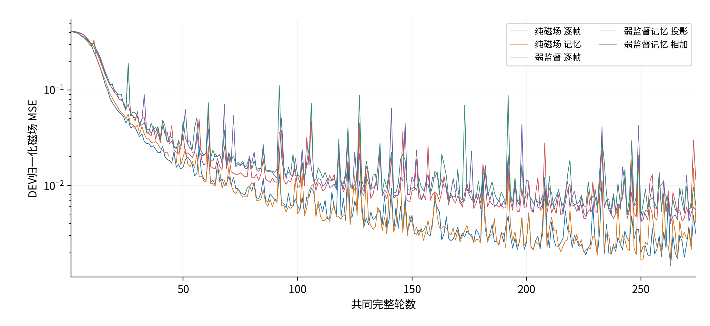
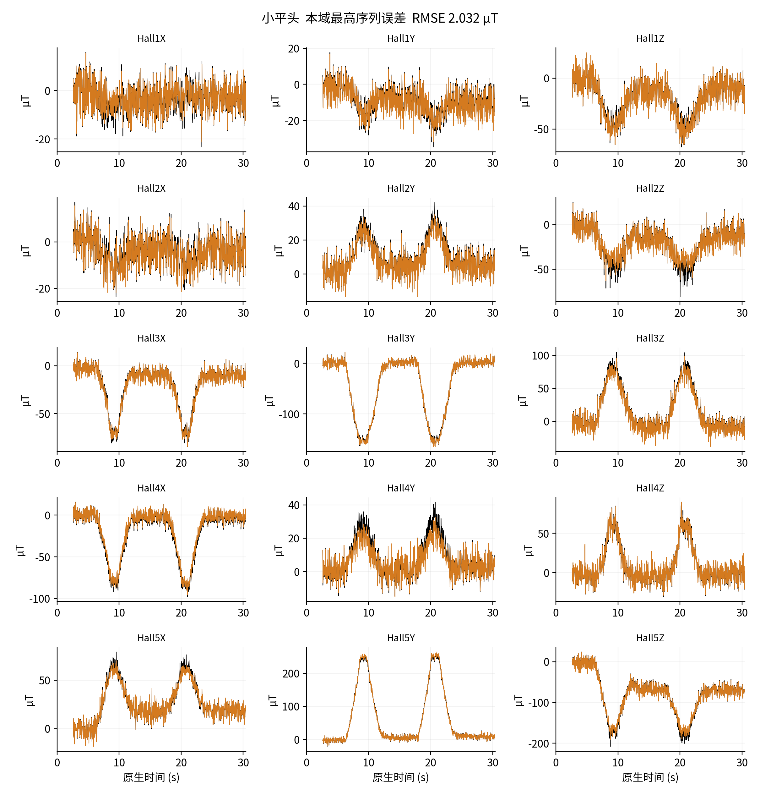
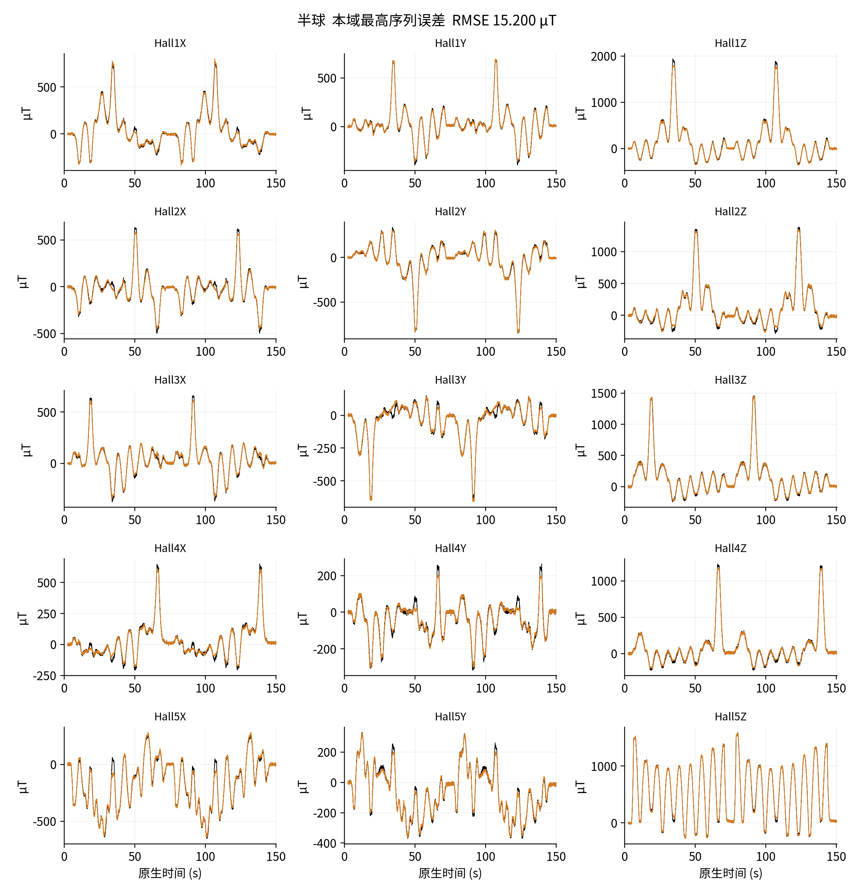
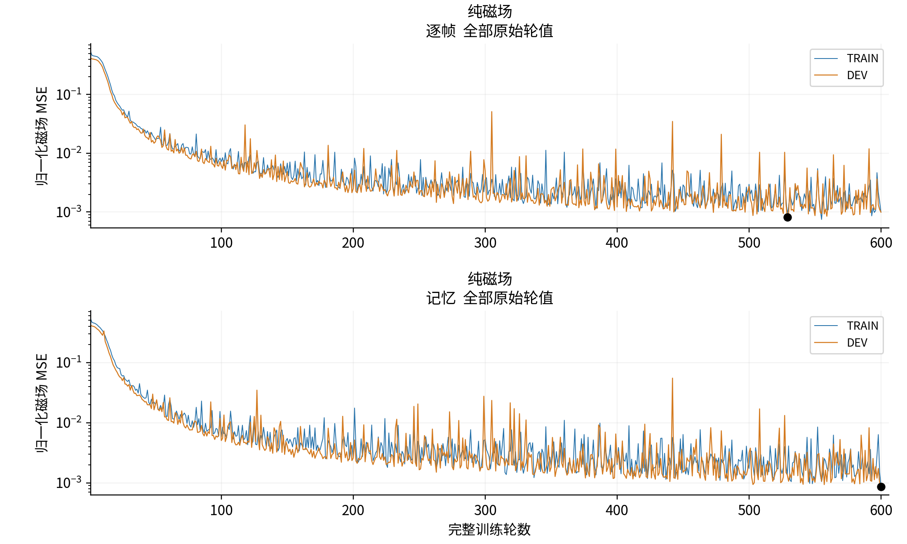
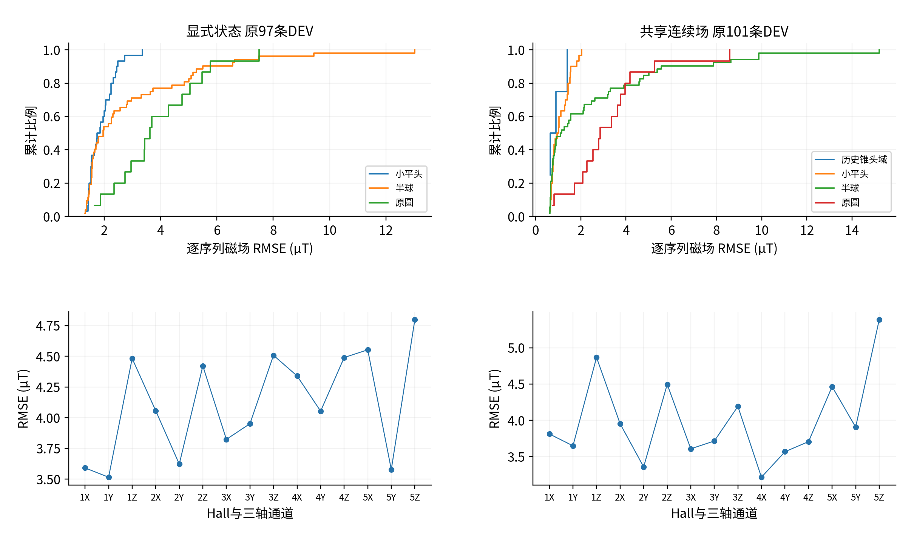
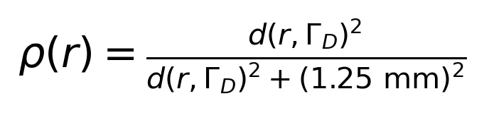
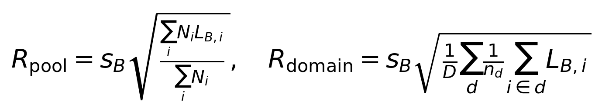
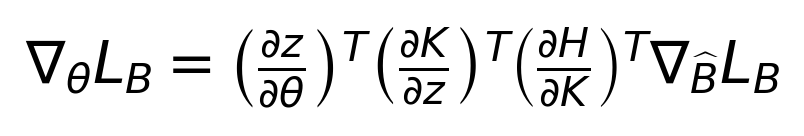

# 磁场监督形变推断的补充实验与复现协议

## S1 共同训练预算与学习过程

主文共同274轮比较使用五臂相同完整训练年龄，各104394次序列更新。窗口最佳是每臂1至274轮原DEV磁场MSE最小值，固定终态是第274轮；两者并列而不混称。同一数据顺序、原始尺度和每完整序列一次更新保持不变。本次组件比较固定在共同预算，最终模型的后续选定权重另列。

补充图S1 全部共同1至274轮DEV归一化磁场MSE。保留全部原始尖峰，不平滑、不删点、不插值。图例中的监督和时间表示是语义名称，不以内部训练编号代替实验设计。

两纯磁场臂的完整1至600轮TRAIN与DEV见补充图S6。两臂最佳分别为逐帧第529轮与记忆第600轮；达到600是本次预算关闭，不是充分收敛的数学证明。TRAIN为轮内随权重更新的磁场分量汇总，DEV为轮末固定权重评价，不能把弱辅助总损失混入磁场曲线或把两线直接当作同权重下的泛化差距。

## S2 监督和梯度路径

显式状态的原目标为 LB + LU + LC + 0.1 LR。LU与LC分别检查模型弱参考的普通位移与磁片中心，尺度0.5 mm；LR检查旋转矩阵，参考均来自生成模型。共享场目标为 LB + λU LU，λU为0或1，纯磁场臂不读取弱u。当前训练阶段冻结H及参考来源G，只更新声明的关系网络参数，不把独立物理校准与逆向网络同时自由训练。

循环共享参数的投影控制在gB·gU<0且||gB||²>0时，使用 gU − [(gB·gU)/||gB||²]gB；否则保留gU。直接相加组保留原梯度分量。空间弱参考梯度沿原实现保持。该控制借鉴多目标梯度处理，有限步长和AdamW预条件下不提供磁场损失单调下降保证。

显式状态从共同模型参考预训练起点作输入与目标来源适应。源网络能够使用命令和几何生成弱参考，但这些量不进入逆向模型部署输入。完整普通位移维数23202并不意味着全部这些分量直接进入H，磁场算子直接依赖的是25块磁片的150个位姿分量。

共享场在磁片175探针与合法名义材料点上查询同一函数。距离支撑、中心差分与正交方向构造沿原注册定义执行，非有限值和非法局部状态拒绝。稠密形变来自同一共享函数，但有限观测尚不足以为每个查询点建立独立真值。

## S3 保留各域的高误差序列

以下展示按第529轮全部101条开发记录的各域最大逐序列RMSE确定，属于冻结结果后的误差诊断，不用于模型选择或调参。全部15通道保留原生时钟和评分断线，黑线实测、橙线物理重建。它们补充主文完整分布，确保低总体误差不掩盖局部失败和尾部。

补充图S2 小平头域最大误差序列的完整15通道。展示选择不从总体分母移除其他序列，不拟合幅值或时间偏移。

补充图S3 半球域最大误差序列。符号、幅度、运动段与恢复段的残差均保留，波形症状不能唯一确定材料或场先验失配的来源。

补充图S4 原圆域最大误差序列。完整长序列仍按相同逐序列和磁场标量定义参与总体评价，未因展示时长或误差大而删减。

补充图S5 历史锥头磁层域最大误差序列。该域仅4条开发序列，磁层、形状及采集批次混杂，不从低域均值推广跨材料可靠性。

## S4 触头留出扩展与研究者暴露

两触头拟合扩展保持原482条输入的身份、掩码和归一化尺度。原半球和小平头315条TRAIN只是不参与新模型参数更新，未重新标为测试。66条原圆和历史锥头TRAIN用于拟合，19条已见DEV用于选模，82条原半球与小平头VAL在冻结后一次评价。

记忆与逐帧分别从共同未训初始化完成200轮66序列训练、13200次更新，在19条已见DEV选择第198轮和第192轮。已见DEV等域等序列RMSE分别11.007804与10.013960 µT。半球52条和小平头30条评价，共175652原生帧及2576805评分标量；补充表S2保留原冻结评价，不据82或动画反选权重。

训练尺度99.09476558487553 µT来自既有全触头TRAIN，H、几何先验及早期开发与展示也有跨域信息。因此可以声明新关系参数训练未见这两种触头，不能声明全管线完全盲测。不同训练量、开发暴露、预算和历史采集域同时变化，不将实际协议差距全部归于形状本身。

## S5 原生输入与评价合同

显式编码使用31维输入和64维GRU，共享场使用21维输入、32维潜在表示及名义坐标查询。无效传感器通过原有效标记表达，不能补零后称实测零场；dt保持真实时间间隙，重置与基线身份沿原合同。命令XYZ、触头CAD、模型弱标签和评分掩码不进入逆向编码器。评分仍按其原有合同独立形成。

第138轮显式模型评价97条序列、233791共同有效时点及3506865标量。第529轮共享场评价101条序列、277348原生时点及3916620原评分标量，固定权重后沿原输入、掩码和状态计算。

标量池化、等域等序列、宏平均序列RMSE以及P95是不同汇总，全部在结果数据中注明分母与权重。磁场不适用空间平移消偏；若报告带位置参考的模型差异，须保留原始与同完整序列唯一常量XYZ消偏的成对结果和拟合向量。当前没有实测节点或位姿真值，实测u/pose精度保持不可计算，不填写零误差。

## S6 可复现资料与公开范围

论文源稿、等价中英文图、完整标量曲线、逐序列与逐通道汇总、结果定义和必要复算脚本组成论文伴随资料。显式状态已验收公开资料直接复用，并与本次共享场和联合稿增量分别标明来源。相关权利及依赖按文件范围说明，不把两份物理库的MIT授权扩展为所有数据、CAD、模型和稿件的许可。

公开的标量和汇总能够复算论文表格、共同预算比较及曲线，但不能因而声称在未公开原始数据或权重时已经提供完整从头训练复现。原科学输入、优化器状态和私人路径不进入公开包。全部可公开文件通过清单与哈希核验；联合论文压缩包用于上传准备；实物演示媒体另按直接授权发布至已有仓库，实际状态以提交和读回回执为准。

## S7 支持主结论的完整标量证据

表S1 共同274轮预算下的共享场组件比较

| 监督和时间表示 | DEV最佳RMSE µT | 最佳轮次 | 固定274轮RMSE µT |
| --- | ---: | ---: | ---: |
| 纯磁场逐帧 | 3.784 | 263 | 5.539 |
| 纯磁场记忆 | 3.846 | 263 | 6.345 |
| 弱位移逐帧 | 6.266 | 263 | 10.657 |
| 弱监督记忆 梯度投影 | 6.363 | 250 | 7.389 |
| 弱监督记忆 直接相加 | 6.846 | 250 | 7.818 |

弱逐帧窗口最佳比纯磁场逐帧高65.6%；投影与直接相加弱记忆分别比纯磁场记忆高65.5%和78.0%。固定终态具有相同方向。最终600轮窗口内两纯磁场臂最佳分别为逐帧2.822 µT和记忆2.917 µT；3.28%的差距含容量因素，不构成本文主要方法贡献或材料无历史效应的证据。

补充图S6 完整1至600轮TRAIN与DEV归一化磁场MSE，原始尖峰保留。TRAIN是变化权重的轮内汇总，DEV是轮末固定权重评价，不平滑、不删点。

补充图S7 各自原协议的逐序列RMSE分布与全部15通道池化RMSE。97与101条范围不同，分列呈现；分布尾部保留，通道间连线仅作读图导向。

表S2 参数训练未见两触头的冻结扩展

| 评价范围 | 序列数 | 记忆RMSE µT | 逐帧RMSE µT |
| --- | ---: | ---: | ---: |
| 半球 | 52 | 26.671 | 24.135 |
| 小平头 | 30 | 10.802 | 8.850 |
| 两域等权总体 | 82 | 20.347 | 18.177 |

这些数值来自原冻结扩展，不由全触头最终模型替换。逐帧在77/82条记录上较低。不同训练量、开发暴露和历史域混杂仍保留，不能从两种留出触头推广为任意触头可靠。

## S8 目标、结构与评价定义

补充式S1 共享场的距离支撑，固定面位移为零；原尺度1.25 mm保持。

补充式S2 池化与等域等序列RMSE的不同加权定义，不用相同单位掩盖不同分母。

## S9 补充视频V1：最终模型的实物演示

实验者直接确认视频运行显式节点与磁片状态第138轮。原视频1280×720、30 fps、25.787333 s；GIF保留完整过程，降为800×450，以6 fps和3倍速预览，共52帧、8.670 s。GIF的百分之一秒时间量化及抽帧使它不是严格原生时钟媒体；原片段另保留以便查看细节。没有帧插值、拟时移或形变幅度改动，原片的手指、器件与屏幕始终保留在同一画面。

该演示不计入回测分母，不与保存半球序列误认为同一次实验。它支持实物运行和在线形变显示的定性结论，没有用于毫米误差或延迟计算，也不从视觉表现反选最终权重。

## S10 装置来源及解释范围

引用硬件仓库用于五点读出和运动／采集平台的来源追溯，不把其早期定位误差、噪声窗口或采样频率作为当前形变数据的新结果。硅胶与磁片供应商名义规格不被当作独立实测本构参数，历史磁层与装配仍分域保存。

补充式S3 磁场监督的一般链式梯度，主文进一步展开两种实现中的实际参数依赖。
